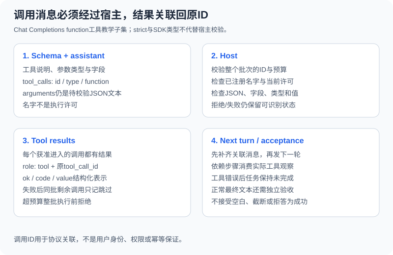
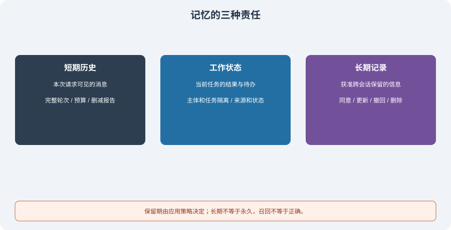

<div align="center">


# 从零开始学 AI Agent

**一本图解驱动、中英双语、面向真实工程的 AI Agent 开源书。**

从 Function Calling、记忆、规划、RAG、上下文工程，先完成评估、安全、部署与领域交付，再按需进入强化学习和自我改进研究。

<p>
<a href="https://Haozhe-Xing.github.io/agent_learning/zh/"></a>
<a href="https://Haozhe-Xing.github.io/agent_learning/en/"></a>
</p>

<p>
<a href="https://github.com/Haozhe-Xing/agent_learning/stargazers"></a>
<a href="LICENSE"></a>
<a href="https://github.com/Haozhe-Xing/agent_learning/pulls"></a>


</p>

[English README](README.md) · [完整目录](#完整目录) · [可运行参考实现](#可运行参考实现) · [参与贡献](#参与贡献)

</div>

---

## 这个仓库是什么？

`agent_learning` 是一本开源 AI Agent 教科书，也是一个结构化学习仓库。它填补的是 **「我会调用 LLM API」到「我能构建、评估、保护并部署 Agent 系统」**之间的空白。

全书不是按框架 API 堆知识点，而是沿着一条统一主线展开：

> **任务契约 → 模型基线 → 工具 → 记忆 → 规划 → 证据 → 上下文 → 宿主控制 → 评估 → 安全 → 部署 → 一个领域项目**

仓库包含：

- **25 章、7 个部分**，先构建和交付应用，再按需研究训练与自我进化。
- **中英文对齐的目录与学习交接**，每章从失败问题进入，留下可检查的学习产物。
- **330+ 张原创 SVG 图解**和 **5 个交互动画**，解释架构、状态、时序和训练流程。
- **从论文到工程的解读**，覆盖 ReAct、Reflexion、MemGPT/Letta、GraphRAG、GRPO、MCP、A2A 等主题。
- **`reference-agent/` 可运行教学底座**，包含工具、记忆、安全闸门、评估、MCP Server、FastAPI 服务和离线回归测试。

> 它不是 Awesome List，也不是某个框架的使用手册，而是一条从原理到生产工程的完整学习路径。

---

## 为什么值得看

| 你的需求 | 本项目提供什么 |
| --- | --- |
| 建立正确直觉 | 每项技术都先解释「什么工程问题逼出了它」，再讲机制和代码。 |
| 看懂复杂系统 | 原创图解覆盖 Agent Loop、消息流、记忆分层、协议边界和强化学习流程。 |
| 把论文用于工程 | 论文按工程问题组织，明确方法、贡献、落地启示和局限。 |
| 从 Demo 走向生产 | 单独讲评估、可观测性、提示注入、权限控制、部署和成本。 |
| 避免框架绑定 | 先讲机制，再把 LangChain、LangGraph、CrewAI、AutoGen 等作为具体实现。 |
| 中英双语学习 | `src/zh/` 与 `src/en/` 的正文、图解和交互内容保持对齐。 |

---

## 按你的目标开始

| 当前目标 | 推荐路线 |
| --- | --- |
| **第一次构建 Agent** | [Agent 基础](https://Haozhe-Xing.github.io/agent_learning/zh/chapter_intro/) → [大模型基础](https://Haozhe-Xing.github.io/agent_learning/zh/chapter_llm/) → [Hello Agent](https://Haozhe-Xing.github.io/agent_learning/zh/chapter_setup/04_hello_agent.html) |
| **构建 Agent 应用** | [工具](https://Haozhe-Xing.github.io/agent_learning/zh/chapter_tools/) → [记忆](https://Haozhe-Xing.github.io/agent_learning/zh/chapter_memory/) → [规划](https://Haozhe-Xing.github.io/agent_learning/zh/chapter_planning/) → [RAG](https://Haozhe-Xing.github.io/agent_learning/zh/chapter_rag/) |
| **让脆弱 Demo 变可靠** | [上下文工程](https://Haozhe-Xing.github.io/agent_learning/zh/chapter_context_engineering/) → [Harness 工程](https://Haozhe-Xing.github.io/agent_learning/zh/chapter_harness/) → [评估](https://Haozhe-Xing.github.io/agent_learning/zh/chapter_20_evaluation/) → [安全](https://Haozhe-Xing.github.io/agent_learning/zh/chapter_21_security/) |
| **训练和改进 Agent** | [评估](src/zh/chapter_20_evaluation/README.md)与[安全](src/zh/chapter_21_security/README.md)之后，再按瓶颈选择 [Agentic RL](https://Haozhe-Xing.github.io/agent_learning/zh/chapter_agentic_rl/) 或 [自我进化 Agent](https://Haozhe-Xing.github.io/agent_learning/zh/chapter_self_evolving/) |
| **选择 Agent 框架** | [LangChain](https://Haozhe-Xing.github.io/agent_learning/zh/chapter_langchain/) → [LangGraph](https://Haozhe-Xing.github.io/agent_learning/zh/chapter_langgraph/) ；按问题选择[实现方式](src/zh/part3.md) |
| **设计多 Agent 系统** | [多 Agent 协作](https://Haozhe-Xing.github.io/agent_learning/zh/chapter_18_multi_agent/) → [MCP / A2A / ANP](https://Haozhe-Xing.github.io/agent_learning/zh/chapter_19_protocol/) |

---

## 完整目录

先看[贯穿项目与实战验收](src/zh/learning_project.md)。每章交代上一版失败、本章增量、验收产物和下一步选择；框架与协作按需选，训练放在末尾研究进阶篇。章节URL与示例目录保留稳定名称，阅读章号以目录为准。

- **[第一部分：入门篇](src/zh/part1.md)**
  - [第1章 什么是 Agent？](src/zh/chapter_intro/README.md)
  - [第2章 大语言模型基础](src/zh/chapter_llm/README.md)
- **[第二部分：核心能力篇](src/zh/part2.md)**
  - [第3章 工具调用（Tool Use / Function Calling）](src/zh/chapter_tools/README.md)
  - [第4章 记忆系统（Memory）](src/zh/chapter_memory/README.md)
  - [第5章 规划与推理（Planning & Reasoning）](src/zh/chapter_planning/README.md)
  - [第6章 检索增强生成（RAG）](src/zh/chapter_rag/README.md)
  - [第7章 上下文工程](src/zh/chapter_context_engineering/README.md)
  - [第8章 Harness Engineering：驾驭 Agent 的系统工程](src/zh/chapter_harness/README.md)
  - [第9章 Skill System](src/zh/chapter_skill/README.md)
- **[第三部分：框架与实现选择篇](src/zh/part3.md)**
  - [第10章 LangChain 深入实战](src/zh/chapter_langchain/README.md)
  - [第11章 LangGraph：构建有状态的 Agent](src/zh/chapter_langgraph/README.md)
  - [第12章 OpenClaw：跨平台个人 AI 助理](src/zh/chapter_openclaw/README.md)
  - [第13章 Hermes Agent：自我进化的 Agent](src/zh/chapter_hermes/README.md)
  - [第14章 Claude Code 深度解析](src/zh/chapter_claude_code/README.md)
  - [第15章 DeepSeek Harness：一切皆插件的开源底座](src/zh/chapter_deepseek_harness/README.md)
- **[第四部分：协作与集成篇](src/zh/part4.md)**
  - [第16章 多 Agent 协作](src/zh/chapter_18_multi_agent/README.md)
  - [第17章 Agent 通信协议](src/zh/chapter_19_protocol/README.md)
- **[第五部分：验证与部署篇](src/zh/part5.md)**
  - [第18章 Agent 的评估与优化](src/zh/chapter_20_evaluation/README.md)
  - [第19章 安全与可靠性](src/zh/chapter_21_security/README.md)
  - [第20章 部署与生产化](src/zh/chapter_22_deployment/README.md)
- **[第六部分：综合项目篇](src/zh/part6.md)**
  - [第21章 项目实战：AI 编程助手](src/zh/chapter_23_coding_agent/README.md)
  - [第22章 项目实战：智能数据分析 Agent](src/zh/chapter_24_data_agent/README.md)
  - [第23章 项目实战：多模态 Agent](src/zh/chapter_25_multimodal/README.md)
- **[第七部分：研究进阶篇](src/zh/part7.md)**
  - [第24章 Agentic-RL：智能体强化学习训练](src/zh/chapter_agentic_rl/README.md)
  - [第25章 自我进化与持续学习](src/zh/chapter_self_evolving/README.md)
  - [附录 F：开发环境搭建](src/zh/chapter_setup/README.md)

[中文完整目录](src/zh/SUMMARY.md) · [英文完整目录](src/en/SUMMARY.md) · [独立参考项目](reference_code/evidence_assistant/README.md) · [章节示例](examples/README.md)

---

## 独立参考项目

[本地资料调研助手](reference_code/evidence_assistant/README.md) 将实现、样例资料、测试和契约集中放在一个目录。主任务是读取多份本地资料，按多个问题检索证据，在执行与上下文预算内生成带来源的报告。默认使用 Python 标准库和离线资料，先学单 Agent 的完整流程，再按需接入模型或框架。

```bash
python -m reference_code.evidence_assistant
```

距离计算的六阶段案例保留为基础练习：`python -m reference_code.evidence_assistant.demo --all`。阅读顺序和练习难度见项目 README。

## 图解驱动的讲解

<table>
<tr>
<td width="50%" align="center">
<b>感知 → 思考 → 行动</b><br>

</td>
<td width="50%" align="center">
<b>Function Calling 完整链路</b><br>

</td>
</tr>
<tr>
<td width="50%" align="center">
<b>三层记忆架构</b><br>

</td>
<td width="50%" align="center">
<b>GRPO 训练架构</b><br>

</td>
</tr>
</table>

在线书还提供 Agent Loop、ReAct、Function Calling、RAG、GRPO 采样五个交互动画。

---

## 快速开始

### 在线阅读

- [中文在线书](https://Haozhe-Xing.github.io/agent_learning/zh/)
- [English Book](https://Haozhe-Xing.github.io/agent_learning/en/)

### 本地构建中英双语版本

依赖：`mdbook`、可选的 `mdbook-katex`、Python 3。

```bash
git clone https://github.com/Haozhe-Xing/agent_learning.git
cd agent_learning
./serve.sh
```

打开：

- `http://localhost:3000/` — 语言选择页
- `http://localhost:3000/zh/` — 中文版
- `http://localhost:3000/en/` — 英文版

需要监听源码变化时使用 `./serve.sh --watch`。

---

## 可运行参考实现

[`reference-agent/`](reference-agent/) 是实战章节共用的轻量教学实现，包含：

- 最小 ReAct 循环与工具注册表；
- 离线 `FakeProvider` 与可选的 OpenAI Provider；
- 记忆、提示注入防护和 fail-closed 权限检查；
- MCP Server、FastAPI 接口、流式输出、评估 Harness 和 Dockerfile；
- **16 个无需 API Key 即可运行的测试**。

```bash
cd reference-agent
python -m venv .venv
source .venv/bin/activate
pip install -e ".[dev]"
pytest -q
```

这套实现刻意保持足够小，方便读者读完源码。它是教学底座，不夸大为完整生产方案。

---

## 微信

<div align="center">

欢迎联系作者


</div>

---

## 快速定位内容

下面的索引同时服务于读者、IDE 搜索和大模型代码检索，尽量让主题、关键词与目录直接对应。

| 想找什么 | 路径 / 关键词 |
| --- | --- |
| 中文正文 | `src/zh/` · `src/zh/SUMMARY.md` |
| 英文正文 | `src/en/` · `src/en/SUMMARY.md` |
| Function Calling 与工具 | `src/*/chapter_tools/` · 工具描述 · Tool Schema |
| Agent 记忆 | `src/*/chapter_memory/` · 短期记忆 · 长期记忆 · MemGPT · Letta |
| 规划与推理 | `src/*/chapter_planning/` · ReAct · Reflection · Plan-and-Execute |
| RAG 与检索 | `src/*/chapter_rag/` · Embedding · Rerank · GraphRAG · Agentic RAG |
| 上下文与 Harness 工程 | `src/*/chapter_context_engineering/` · `src/*/chapter_harness/` |
| Agentic RL 与自我进化 | `src/*/chapter_agentic_rl/` · `src/*/chapter_self_evolving/` · PPO · DPO · GRPO |
| 多 Agent 与协议 | `src/*/chapter_18_multi_agent/` · `src/*/chapter_19_protocol/` · MCP · A2A · ANP |
| 评估、安全、部署 | `src/*/chapter_20_evaluation/` · `src/*/chapter_21_security/` · `src/*/chapter_22_deployment/` |
| 可运行 Python 底座 | `reference-agent/src/reference_agent/` |
| SVG 图解与交互动画 | `src/*/svg/` · `src/*/animations/` |

仓库结构：

```text
agent_learning/
├── src/zh/                 # 中文 mdBook 源文件
├── src/en/                 # 英文 mdBook 源文件
├── reference-agent/        # 可运行教学底座与测试
├── theme/                  # 中英共用主题
├── book.toml               # 中文构建配置
├── book-en.toml            # 英文构建配置
└── serve.sh                # 构建双语版本并启动本地服务
```

---

## 项目原则

1. **先讲机制，再讲框架。** 先解释抽象为什么存在，再介绍具体 API。
2. **图必须承担信息。** 图解用于表达架构和流程，不做无意义装饰。
3. **论文必须落到工程。** 论文解读要包含贡献、机制、用途和局限。
4. **生产化表述必须诚实。** 明确可运行代码、测试、安全边界和已知限制。
5. **双语内容保持对齐。** 正文、图解、导航和交互动画同步维护。

---

## 参与贡献

欢迎纠错、优化讲解、补充可运行示例、修订翻译或新增论文解读。

- 发现错误：直接[提交 Issue](https://github.com/Haozhe-Xing/agent_learning/issues/new)。
- 修改章节：尽量同步修改 `src/zh/` 与 `src/en/` 中的对应文件。
- 新增页面：同时更新两份 `SUMMARY.md`。
- 新增图解：分别放入 `src/zh/svg/` 与 `src/en/svg/`。
- 提交 PR 前：运行 `./serve.sh`，确认中英文都能构建。

论文、协议、版本和外部项目相关事实，请优先引用一手来源，并保持可核验。

---

## 路线图

- [x] 25 章中英双语 mdBook
- [x] 本地化图解与交互动画
- [x] Agentic RL、上下文工程、Harness 工程、自我进化 Agent
- [x] 带离线测试的 `reference-agent` 可运行底座
- [ ] 更完整的端到端综合项目
- [ ] 可搜索的图解画廊与概念索引
- [ ] 评估与可观测性项目模板
- [ ] 更多练习题、面试题和回归用例

建议可以直接发到 [Issues](https://github.com/Haozhe-Xing/agent_learning/issues)。

---

## 开源协议

项目采用 [MIT License](LICENSE)。

<div align="center">

### 如果这个项目帮你节省了时间，欢迎点一个 Star。

Star 会让更多正在学习 AI Agent 的工程师找到一条结构化路线，而不是再掉进互不相连的链接清单里。

[阅读中文版](https://Haozhe-Xing.github.io/agent_learning/zh/) · [Read in English](https://Haozhe-Xing.github.io/agent_learning/en/) · [提交 Issue](https://github.com/Haozhe-Xing/agent_learning/issues)

</div>
