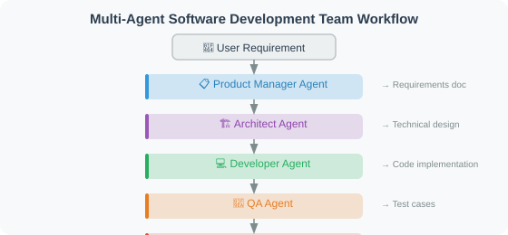

# 16.5 Practice: Multi-Agent Software Development Team

## Iteration and Acceptance

Build an executable workflow and record execution completion separately from acceptance.

- **Success criteria**: Report `delivered` only after pytest exits with code `0` and deployment configuration and documentation have been written. Compare single-Agent and team approaches using identical requirements and independent acceptance tests, recording calls, duration, and repair attempts.
- **Failure cases**: Cover persistent assertion failures, generation exceptions, collection errors, infinite loops, and background processes left by generated tests. Exhausting the budget or timing out must never enter successful delivery nodes.
- **Execution boundary**: Each test run defaults to 30 seconds, with at most 3 generated versions. On macOS/Linux, cleanup covers the test process group. Temporary directories and process groups do not provide a security sandbox; untrusted generated code requires an external isolated executor.

See [Chapter 18](../chapter_20_evaluation/README.md) for evaluation and [Chapter 19](../chapter_21_security/README.md) for trust and permissions.

## System Design

The Product Manager, Architect, Developer, Tester, DevOps Engineer, and Documentation Engineer are six LangGraph nodes sharing `DevState`. The developer writes implementation and tests to disk. The tester executes pytest. Only a passing result allows the deployment and documentation nodes to create delivery artifacts.

The runnable implementation is `examples/dev_team/dev_team.py`, with regression tests in `examples/dev_team/tests/test_dev_team.py`. This section shows the key contracts; the source file contains the complete implementation.

The offline `DeterministicDeveloper` produces only addition and multiplication functions. It demonstrates orchestration, artifacts, and failure handling; asking it for a user management system does not implement registration or login. Replace `Developer` for actual requirements. In this example, the developer generates both code and tests while the tester executes them, so passing these tests still requires independent acceptance coverage.



> The image illustrates the roles. Actual routing is Product → Architecture → Development → Testing →, after a pass, DevOps → Documentation. Assertion failures can return to Development; exceptions, timeouts, and budget exhaustion terminate through the failure node.

## Completion Criteria and State Contract

`status` describes the whole task; `test_status` describes its latest test run. Passing tests does not yet mean deployment artifacts and documentation have been written.

| Final `status` | Trigger | Delivery behavior |
|---|---|---|
| `delivered` | Tests pass and both delivery nodes complete | Writes `Dockerfile` and `README.md` |
| `failed` | Generation or delivery artifact writing raises, or pytest has an execution, collection, or configuration error | Stops through the failure node and saves a report |
| `timed_out` | One test run exceeds `test_timeout_seconds` | Cleans up the process group, stops immediately, and saves a report |
| `budget_exhausted` | Assertions still fail after `max_iterations` versions | Preserves every attempt and stops |

During execution, `status` is `running`. The latest `test_status` is `pending`, `passed`, `failed`, `timed_out`, or `error`; `test_passed` retains the Boolean result. Each entry in `attempts` records its iteration, test status, real return code, time limit, diagnostic message, and output. A timeout has no normal exit code, so its recorded `returncode` is `None`.

The failure node returns `failure_report` and saves the same structured object as `failure_report.json` in the workspace. For example:

```json
{
  "reason": "max_iterations",
  "message": "Tests did not pass within the iteration budget",
  "status": "budget_exhausted",
  "delivered": false,
  "iteration": 3,
  "max_iterations": 3,
  "attempts": []
}
```

The attempt contents are omitted here; an actual exhausted-budget report contains all test runs. An empty list is appropriate when generation fails before testing starts. Failure preserves implementation, tests, and diagnostics and skips DevOps and documentation. `workspace_dir` must not exist yet or must be an empty directory. Previous successful runs, failed runs, and unrelated nonempty directories are rejected with `ValueError` before any files are written. Existing artifacts, failure reports, and user files are preserved. Choose a new directory for each run so historical artifacts cannot be mixed with the current delivery.

## Retry and Stop Rules

The routing function separates a pass, a repairable failure, and a terminal failure:

```python
def route_after_test(state):
    if state.get("status") in {"failed", "timed_out"}:
        return "fail"
    if state.get("test_passed"):
        return "deliver"
    if state["iteration"] >= state["max_iterations"]:
        return "fail"
    return "fix"
```

`deliver` enters DevOps, `fix` returns to Development, and `fail` enters the failure node before ending. A pytest exit code of `1` permits a repair attempt; execution errors such as codes `2`–`5` stop immediately. Before a retry, the developer receives the previous real test output appended to the design through `Developer.develop(design, requirement)`. Reaching the iteration limit is a stop condition, never a reason to declare success.

`max_iterations` counts generated versions, including the first, and must be a positive integer. `test_timeout_seconds` must be finite and positive. Both values and the workspace condition are validated before writing files or starting the graph.

## Test Process Lifecycle

On macOS/Linux, the tester uses `Popen(..., start_new_session=True)` to create an independent session and applies a timeout to `wait()`. After every pass, failure, or timeout, it sends `SIGTERM` to that process group, then `SIGKILL` to terminate remaining processes, and calls `wait()` to reap the direct pytest process. Cleanup also runs after pytest exits normally because generated tests can leave background children behind.

Output goes to a temporary file and is read after cleanup. With inherited stdout pipes, a background child can keep the pipe open after its parent exits, leaving code waiting for EOF indefinitely. Bounding only the parent process does not solve this case.

These measures manage ordinary test processes. Malicious code can create a new session and escape its original group. Non-POSIX platforms only terminate the direct child. The example does not restrict filesystem, network, memory, or credential access. The per-test timeout also does not bound `Developer.develop`; a model integration needs separate request timeouts and call budgets.

## Running the Example

```bash
cd examples/dev_team
pip install -e .
pytest -v
python dev_team.py --max-iterations 3 --test-timeout-seconds 30
```

No API key is required for the offline demo. The CLI prints final status, test result, and workspace path. An unsuccessful run explicitly reports that delivery did not occur, prints the structured report, and exits with code `1`; success exits with code `0`. The same configuration is available through the API:

```python
from dev_team import develop

result = develop(
    "Arithmetic module: addition and multiplication",
    max_iterations=3,
    test_timeout_seconds=30,
)
if result["status"] == "delivered":
    print("Delivered:", result["workspace_dir"])
else:
    print("Not delivered:", result["failure_report"])
```

The regression suite covers artifact creation, repair after failure, persistent failure exhausting the budget, generation and delivery exceptions, collection errors, configuration validation, nonempty workspace rejection with contents preserved, infinite-loop timeouts, and process-group cleanup after both normal parent exit and timeout on macOS/Linux. The child-process cases also ignore `SIGTERM` to exercise forced termination.

## Model Integration and Independent Acceptance

Implement `Developer.develop` to obtain implementation and test source from structured model output. `LLMDeveloper` remains an extension interface and does not yet call a model. Real development needs a fixed independent acceptance suite so a developer cannot conceal defects by rewriting its own acceptance criteria. Establish an isolated executor with credential, network, and filesystem restrictions before running untrusted generated programs.

Preparation tasks can run in parallel when they do not depend on acceptance. Final deployment and delivery must wait for acceptance; files already produced by parallel nodes do not establish success.

---

*Next chapter: [Chapter 17: Agent Communication Protocols](../chapter_19_protocol/README.md)*
