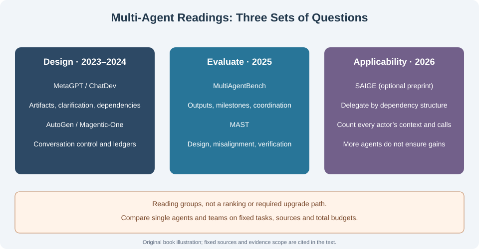
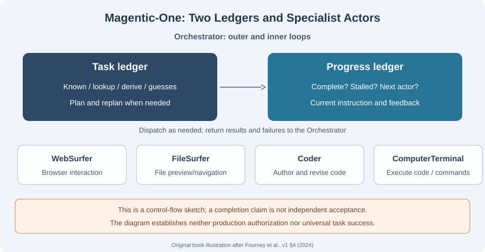

# 16.6 Paper Readings: Multi-Agent Systems Research

This section is optional. Complete the [development-team exercise in 16.5](05_practice_dev_team.md), then ask a concrete question: does delegation simplify the task, or merely add handoffs, context and verification costs? Single agents, fixed pipelines and teams need the same task acceptance criteria.

Selection and source checks are dated 2026-10-22. Both languages use the same seven papers and fixed versions. Methods and experimental conditions were checked; the studies were not reproduced, and historical framework names do not document current SDKs. Read one collaboration design and one evaluation approach closely, then complete the exercise.

## Reading Route: Separate Design from Evidence

| Question | Read | Engineering check |
|---|---|---|
| What crosses a handoff? | MetaGPT, ChatDev | Artifact fields, dependencies, clarification and independent acceptance |
| Who acts next, stops or handles failure? | AutoGen, Magentic-One | Control flow, progress records and stopping budgets |
| Is the team collaborating or just exchanging text? | MultiAgentBench, MAST | Report final outputs, coordination and failure labels separately |
| When should decomposition stop? | SAIGE | Dependency density, handoff loss and total team cost |

These are reading groups, not a replacement ladder. No agent count is universally optimal.

## MetaGPT: Make Artifacts and Dependencies Explicit

Sirui Hong et al., *MetaGPT: Meta Programming for A Multi-Agent Collaborative Framework*; first submitted in 2023; this section uses [v7, 2024-11-01, §§3–4](https://arxiv.org/html/2308.00352v7).

Software-development SOPs organize product, architecture, management, engineering and QA roles. Documents, designs and code pass through a shared message pool with subscriptions; execution feedback supports revisions. Structured output makes interfaces inspectable, but valid fields do not establish correct content or grant permissions.

Experiments use HumanEval, MBPP and SoftwareDev. SoftwareDev contains 70 tasks; the paper's comparison samples seven and includes human executability ratings. Different tasks, metrics and model settings cannot become one universal success ranking or isolate communication format as the cause of gains.

**Apply it here**: Version requirements, code artifacts and test reports in 16.5. Submit a complete-looking artifact with failing tests and confirm it cannot be delivered. Producer-written tests still need independently frozen task expectations.

## ChatDev: Clarify Within Staged Conversations

Chen Qian et al., *ChatDev: Communicative Agents for Software Development*; first submitted in 2023; use [v5, 2024-06-05, §§3–4 and §6](https://arxiv.org/html/2307.07924v5).

This version structures design, coding and testing into a chat chain of subtasks. An instructor and assistant converse within each subtask; extracted results feed later stages. Communicative dehallucination asks for missing details before a final response.

The authors use 1,200 SRDD requirements to study completeness, executability, requirement consistency and pairwise quality. Running code, absence of placeholders or reviewer preference does not establish all business requirements. Pairwise subtasks simplify local communication, but do not alone reduce total complexity from quadratic to linear; rounds, edges and message lengths still matter.

**Apply it here**: Give a requirement with no unit or input range an explicit clarification outcome. Agreement between two roles cannot supply missing facts, and more dialogue cannot replace tests.

## AutoGen: Conversations Need Programmable Control Flow

Qingyun Wu et al., *AutoGen: Enabling Next-Gen LLM Applications via Multi-Agent Conversation*; use [v2, 2023-10-03, §§2–4 and relevant Appendix D settings](https://arxiv.org/html/2308.08155v2).

The paper separates conversable agents from conversation programming. Agents combine model, human and tool capabilities; applications define recipients, reply behavior and continuation. Six applications cover mathematics, QA and interactive environments with different models, tasks and comparisons. They are not one controlled comparison of every collaboration design.

**Apply it here**: Treat delegation as a call with inputs, outputs, failures and a budget. A human proxy does not authenticate a person, and code execution does not establish isolation. Read the 2023 abstraction without presenting historical classes as current package interfaces.

## Magentic-One: Separate Task and Progress Ledgers

Adam Fourney et al., *Magentic-One: A Generalist Multi-Agent System for Solving Complex Tasks*; use [v1, 2024-11-07, §§4–6](https://arxiv.org/html/2411.04468v1).

The Orchestrator's outer loop maintains a task ledger of known information, lookup/derivation needs, guesses and plans. Its inner progress ledger tracks completion, stalls and the next actor. Specialists are WebSurfer, FileSurfer, Coder and ComputerTerminal. A ledger guides control; the coordinator's completion claim still needs independent acceptance.

AutoGenBench resets containers and records repeated runs for GAIA, AssistantBench and WebArena, alongside ablations and error analysis. Competitive results in those settings do not establish human-level ability, a current ranking or a fixed contribution from replanning. Resetting containers improves experimental isolation without independently proving production authorization safety.

**Apply it here**: Keep guesses separate from verified observations. Repeated stalls should retain their reasons and exhaust a budget; creating another plan is not task success.

## MultiAgentBench: Coordination Scores Are Not Delivery

Kunlun Zhu et al., *MultiAgentBench: Evaluating the Collaboration and Competition of LLM agents*; use [v1, 2025-03-03, §§3–5](https://arxiv.org/html/2503.01935v1).

MARBLE organizes research, Minecraft, database, coding, bargaining and Werewolf scenarios, comparing star, tree, chain and mesh communication. Final task scores, milestone contributions and communication/planning judgments are separate. Some depend on LLM detection or grading; other tasks use rules.

Topology and model results vary by scenario. A graph result in research cannot recommend graphs everywhere. Judge agreement is not objective truth; rounds, roles, tools and grading prompts remain experimental conditions.

**Apply it here**: Report final acceptance, handoff errors, total calls and time. Retain cases with extensive communication but failed delivery, and manually inspect judge labels. Message count is not coordination quality.

## MAST: Locate Failure Before Adding Roles

Mert Cemri et al., *Why Do Multi-Agent LLM Systems Fail?*; use [v3, 2025-10-26, §§3–5](https://arxiv.org/html/2503.13657v3).

MAST groups 14 observed failure modes into system design, inter-agent misalignment and task verification. An initial 150-trace human study informs an LLM annotation pipeline; this version contains 1,642 traces from seven systems across coding, mathematics and general tasks.

These labels characterize sampled systems and tasks, not ecosystem prevalence or an exhaustive taxonomy. Several modes can occur in one trace. Inspect annotation evidence rather than treating a role label as proven causal responsibility.

**Apply it here**: Take a failed-test or exhausted-budget record from 16.5. Mark the first contract violation, its propagation and the acceptance gap. Change one boundary and rerun before adding another supervisor.

## SAIGE: Delegate According to Dependencies

Yishuo Yuan et al., *Rethinking Multi-Agent Collaboration: When More Is Less*; optional preprint [v2, 2026-09-18, §§3–5](https://arxiv.org/html/2609.19759v2).

The authors model trajectories as dependency graphs and examine boundaries suitable for relatively independent subtasks. SAIGE creates agents incrementally and fetches other subtask results when needed. Incorrect boundaries can still cause waiting, omissions and communication overhead.

Main experiments compare four long-horizon benchmarks using the same harness and foundation model, at most four agents and one level of child delegation; separate ablations vary scale. Outcomes depend on task coupling rather than supporting universal benefits from more agents. Those limits are experimental settings, not optimal team sizes for every project.

**Apply it here**: Draw dependencies before delegating. Independent document reads may run in parallel; successive edits to one artifact may suit a single writer or sequential pipeline. Count every subtask's calls and input, not only the coordinator's.

## Exercise: Six Controls for One Deliverable

Use this book's small fixture: delivery must cite the two specified source versions, name the unit and correctly sum their same-currency values. Baseline A-v1 states “40 CNY” and B-v1 states “60 CNY”, with an independent expectation of 100 CNY. Freeze each control's input snapshot and expectation before inspecting traces or implementing a small flow; none of the research frameworks needs installation.

| Controlled input | Independent expectation | Boundary to record |
|---|---|---|
| Both correct sources | Sources, unit and 100 CNY all present | Baseline acceptance |
| B missing, a role still claims completion | Remain incomplete; name the missing source | Consensus cannot fill unknowns |
| B changes to 60 USD | Do not sum directly; require a conversion basis | Valid fields, failed semantic contract |
| Create a separate A-v1/B-v2 snapshot, with B-v2 stating 80 CNY | Independently freeze 120 CNY before invocation; do not reuse the old 100 report | Version/cache propagation |
| The same B-v1 is forwarded twice | Count it once | Source identity and duplicate handoffs |
| A subtask fails, times out or exhausts the total budget | Retain failure and partial output; no complete delivery | Stopping and failure propagation |

Compare the last row with 16.5's existing `delivered/budget_exhausted/timed_out/failed` states. Those concern its code-test contract and do not implement this document task automatically. In the configured 16.5 environment, run `python -m pytest examples/dev_team/tests/test_dev_team.py -q` to inspect its lifecycle counterexamples.

For a single-agent/team comparison, freeze source versions, questions, tools and the **total budget across all actors**. Preserve repeated runs and failures rather than selecting successful traces. A handoff manifest should identify task, source versions, artifact, validation status and remaining budget. A producer's “passed” label cannot replace the consumer's checks.

These are book exercises, not reproductions or benchmark scores. Return to [16.2 communication contracts](02_communication_patterns.md) or [16.5](05_practice_dev_team.md) to repair an observed failure, then use [Chapter 18](../chapter_20_evaluation/README.md) to design a comparison. Keep the simpler design when delegation has no measured benefit.
