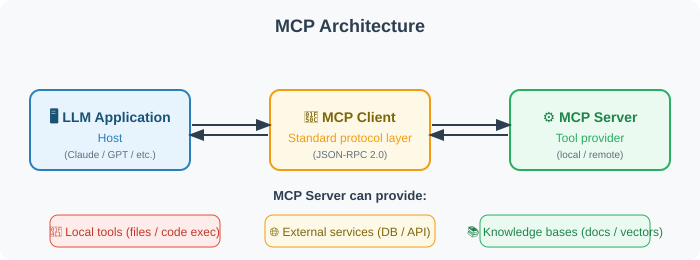

# 19.1 MCP (Model Context Protocol)

MCP decouples an agent host from the implementation of its tools and data sources. The host selects servers, manages permissions, and passes results to the model. Each MCP client communicates with a server that advertises capabilities, executes requests, and returns results.

| Capability | Client operations | Example |
|---|---|---|
| Tools | `tools/list`, `tools/call` | Calculate a result or look up an authorized order |
| Resources | `resources/list`, `resources/read` | Read a help document by URI |
| Prompts | `prompts/list`, `prompts/get` | Retrieve a parameterized support-ticket summary template |

The host can pass tool descriptions and input schemas to the model. The model proposes a call, and the host checks its scope and arguments before execution and then returns the result as a tool message. Applications should handle the returned content types explicitly and check whether the tool reported an error.

## Protocol versions and transports

| | Handshake revisions through `2025-11-25` | `2026-07-28` |
|---|---|---|
| Discovery and version | `initialize` and `notifications/initialized` | A client can use `server/discover` to learn versions and capabilities |
| Request context | Negotiated at initialization | Every request carries version and client capabilities in `_meta` |
| Streamable HTTP | The server can assign `Mcp-Session-Id` | The protocol has no session. Applications can use explicit handles for cross-request state |
| Long-running work | Experimental Tasks in `2025-11-25` | Optional Tasks extension with `tasks/get` for polling and `tasks/update` for further input |

Local tools often use **stdio**, and remote servers use **Streamable HTTP**. In the modern revision, clients can opt into change notifications through `subscriptions/listen`. Request-scoped progress can still travel on the response stream. The old HTTP+SSE transport and Roots, Sampling, and Logging are deprecated. Apply the remote authorization requirements and least privilege for the deployment, and check resource access in each tool.

If a modern tool needs more information, it can return an input request so the client can collect answers and continue the call. Use the Tasks extension for background work that needs polling or follow-up across requests. Check version and extension support across your SDK, host, and server. See the [MCP 2026-07-28 changelog](https://modelcontextprotocol.io/specification/2026-07-28/changelog) and [Python SDK migration guide](https://py.sdk.modelcontextprotocol.io/migration/).

Next, run the [tool discovery and invocation example in 19.5](./05_practice_mcp_integration.md).
