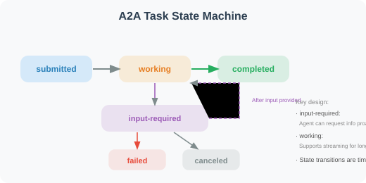

# 19.2 A2A (Agent-to-Agent) Protocol

A2A lets independent agents discover each other's capabilities, send messages, track delegated work, and receive artifacts. A2A connects remote agents. MCP connects a host to tools, data sources, and prompts. A system can use A2A to delegate work and MCP to call tools.

## Discover the interface

A2A v1.0 defines `/.well-known/agent-card.json` for discovery. Clients can also use a registry or direct configuration. An Agent Card describes skills, capabilities, security schemes, and `supportedInterfaces`. The client selects a URL, `protocolBinding`, and `protocolVersion` from those interfaces. The standard bindings are JSON-RPC, gRPC, and HTTP+JSON.

The top-level `version` identifies the agent service. The interface’s `protocolVersion` identifies A2A.

```json
{
  "name": "Release Notes Assistant",
  "description": "Summarizes release notes.",
  "version": "1.2.0",
  "supportedInterfaces": [
    {
      "url": "https://research.example.com/a2a",
      "protocolBinding": "HTTP+JSON",
      "protocolVersion": "1.0"
    }
  ],
  "capabilities": {
    "streaming": true
  },
  "defaultInputModes": [
    "text/plain"
  ],
  "defaultOutputModes": [
    "text/plain"
  ],
  "skills": [
    {
      "id": "summarize",
      "name": "Summarize",
      "description": "Summarizes the supplied notes.",
      "tags": [
        "release-notes"
      ]
    }
  ]
}
```

## HTTP+JSON example

Suppose the Agent Card advertises `https://research.example.com/a2a`, `HTTP+JSON`, and `1.0`. The requests below show discovery, sending a message, and polling after receiving a `task.id`. The hostname and IDs are illustrative. Supply credentials according to the Agent Card's security scheme on a real connection.

```http
GET /.well-known/agent-card.json HTTP/1.1
Host: research.example.com
```

```http
POST /a2a/message:send HTTP/1.1
Host: research.example.com
Content-Type: application/json
A2A-Version: 1.0

{
  "message": {
    "messageId": "note-001",
    "role": "ROLE_USER",
    "parts": [{"text": "Summarize the provided release notes."}]
  },
  "configuration": {"returnImmediately": true}
}
```

```http
GET /a2a/tasks/task-001 HTTP/1.1
Host: research.example.com
A2A-Version: 1.0
```

## Messages, tasks, and artifacts

A send operation can return a direct `Message` or a `Task` with an `id`, `contextId`, and status. Poll only when a task is returned. If the state is `TASK_STATE_INPUT_REQUIRED`, send the follow-up with the existing `taskId` and retain the `contextId` where needed. Use the task's `Artifact` objects for deliverables.



Use `POST /message:stream` to send a message and receive task, status, or artifact updates over SSE. To follow an existing non-terminal task, use `POST /tasks/{id}:subscribe`. To request cancellation, use `POST /tasks/{id}:cancel`. Check the Agent Card for push-notification support before configuring it.

When delegating across systems, validate the interface and authorization scope, persist task IDs and terminal states, and follow the server's idempotency rules when retrying. See the [A2A v1.0 specification](https://a2a-protocol.org/v1.0.0/specification/) for field definitions, task states, and binding mappings.
