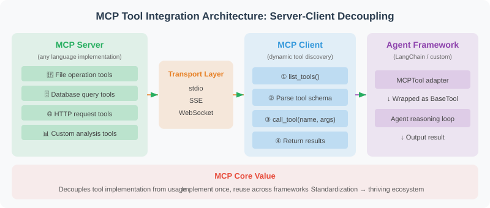

# 19.5 Practice: Discover and Call an MCP Tool



Use the official Python SDK v2 to connect to an in-process server. The example probes the protocol version with `server/discover`, lists the tools, and calls `add`. The in-process transport lets CI exercise the full call without a network listener or model credentials.

```bash
python -m pip install "mcp>=2,<3"
python examples/chapter19/mcp_demo.py
```

```python
{{#include ../../../examples/chapter19/mcp_demo.py}}
```

Expected output is `2026-07-28: add` followed by `20`. The SDK handles discovery and request metadata. To connect to a separate tool process or a remote service, use the corresponding [client transport settings](https://py.sdk.modelcontextprotocol.io/client/transports/). Load and invoke tools inside the client context. A tool wrapper that captures a client can only be used while that context is open.

When wiring tools into an agent, the host decides which tools the model can see. Tool code validates arguments and access rights. Tools that write state should enforce server-side permissions, any required approval, and idempotency. Treat third-party content in tool results as data when passing it to the model.

The repository command `python -m reference_agent.mcp_server` is a **minimal MCP 2024-11-05 example** for inspecting raw stdio messages. See the SDK's [protocol versions guide](https://py.sdk.modelcontextprotocol.io/protocol-versions/) for modern and handshake-era clients.
