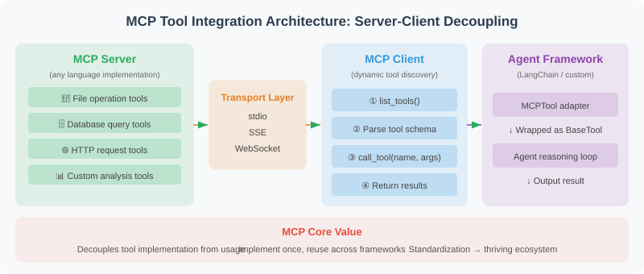

# 17.5 Practice: MCP-Based Tool Integration

## Iteration and Acceptance

Move an existing calculator into a separate process. Discover and call it with structured requests, then verify that malformed input does not break subsequent calls.

- **Success criteria**: Send `initialize`, `tools/list`, and `tools/call` to one stdio process; check request IDs and the result `96` for `12*8`.
- **Failure cases**: Send malformed JSON, invalid request IDs, array/object tool names, and non-object arguments before a valid calculation. Errors must be explicit and the later call must still succeed.
- **Safety boundary**: Expose only the restricted calculator. Connectivity grants no business authorization; external tool descriptions and results cannot expand host permissions.

Retain input lines, responses, process status, and verdicts. See [chapter 18](../chapter_20_evaluation/README.md) for evaluation and [chapter 19](../chapter_21_security/README.md) for permissions.



The diagram shows the Client, Agent, and tool-service boundaries. This exercise actually runs the client-to-calculator subprocess segment; it supplies no ready-made model or framework adapter.

## 1. What Is Supplied

The single service implementation is `reference-agent/src/reference_agent/mcp_server.py`; tests are in `reference-agent/tests/test_mcp_server.py`. Execution lives in `reference-agent/src/reference_agent/tools/calculator.py`. Read these files rather than maintaining a copied, incomplete `handle` implementation in the chapter.

This is a **stdio / JSON-RPC teaching subset using MCP tool message shapes**. Each line contains one JSON object. It supports `initialize`, `tools/list`, and `tools/call`, exposes only `calculator`, and returns text content. Valid notifications without an `id` receive no response. End-of-input closes the process.

Initialization declares the fixed value `protocolVersion="2024-11-05"` without version negotiation or a fully enforced initialization state machine. The example has no batch requests, tool pagination, HTTP/SSE, remote authentication, resource/prompt features, or cancellation. Official SDK interoperability has not been verified. Do not infer complete MCP compatibility or production readiness.

## 2. Validate Before Looking Up a Tool

`main` parses each line, `handle` validates requests and IDs, and `_tools_call` checks the name and argument container before accessing the registry. The calculator then constrains expression content and computational resources.

| Check | Current behavior |
|---|---|
| Request | An object with `jsonrpc="2.0"` and a string `method`; arrays are not supported batches |
| Request ID | The teaching validator accepts strings, integers, finite floats, and `null`; it rejects booleans, arrays, objects, and non-finite numbers. Valid IDs are preserved; invalid IDs yield `null` in the response. This is the example's behavior, not a statement of complete MCP ID rules |
| `params` / `arguments` | Omitted fields default to empty objects; supplied values must be objects. This is not generic `inputSchema` validation |
| Tool name | A non-empty string is required before registry lookup; unknown tools are rejected |
| Tool execution | Missing `expression`, invalid expressions, and arithmetic failures are raised by the function signature or calculator and mapped to the example's execution-error response |

Consequently, `name=[]` or `name={}` cannot reach dictionary lookup and cause an uncaught `TypeError`. Invalid containers and calculator failures have distinct responses; neither should be reported indiscriminately as an unknown tool.

## 3. Distinguish Error Channels

The example returns either a successful `result` or a top-level `error`, never both. Its mappings are below; general codes are defined by the [JSON-RPC 2.0 specification](https://www.jsonrpc.org/specification#error_object).

| Condition | Current response |
|---|---|
| Unparseable JSON | `error.code=-32700` |
| Invalid request shape or ID | `error.code=-32600` |
| Unknown method | `error.code=-32601` |
| Non-object parameters, invalid tool name, or unknown tool | `error.code=-32602` |
| Calculator call raises, such as `1/0` | `error.code=-32603` |

The [MCP 2024-11-05 tools specification](https://modelcontextprotocol.io/specification/2024-11-05/server/tools#error-handling) also defines tool-execution errors inside `result` with `isError=true`, distinct from JSON-RPC `error`. **The companion does not implement that field**; it simplifies tool-call exceptions into `-32603`. This is not a general recommendation for representing business failures in MCP.

A client for a fuller implementation should inspect top-level `error`, then the tool result's `isError`, before consuming successful content. A `result` alone does not establish task success. This chapter tests the implemented subset; adding error semantics requires corresponding source and test changes.

## 4. Recover Within the Same Process

Save and run the following Python from the repository root. It uses only the standard library to send seven stdin lines to **one** service process: discover tools, send three bad requests, then compute `12*8`. The notification without an ID produces no response.

```python
import json
import os
from pathlib import Path
import subprocess
import sys

source = str(Path("reference-agent/src").resolve())
env = dict(os.environ, PYTHONPATH=os.pathsep.join(
    filter(None, [source, os.environ.get("PYTHONPATH")])
))
requests = [
    json.dumps({"jsonrpc": "2.0", "id": "init", "method": "initialize"}),
    json.dumps({"jsonrpc": "2.0", "id": "list", "method": "tools/list"}),
    "{broken json",
    json.dumps({"jsonrpc": "2.0", "id": [], "method": "tools/list"}),
    json.dumps({"jsonrpc": "2.0", "id": "bad-name", "method": "tools/call",
                "params": {"name": [], "arguments": {}}}),
    json.dumps({"jsonrpc": "2.0", "method": "notifications/initialized"}),
    json.dumps({"jsonrpc": "2.0", "id": "after-errors", "method": "tools/call",
                "params": {"name": "calculator", "arguments": {"expression": "12*8"}}}),
]
process = subprocess.run(
    [sys.executable, "-m", "reference_agent.mcp_server"],
    input="\n".join(requests) + "\n", text=True, capture_output=True,
    timeout=5, check=True, env=env,
)
responses = [json.loads(line) for line in process.stdout.splitlines()]
assert len(responses) == 6
assert responses[0]["id"] == "init"
assert responses[0]["result"]["protocolVersion"] == "2024-11-05"
assert responses[1]["id"] == "list"
assert responses[1]["result"]["tools"][0]["name"] == "calculator"
assert [item["error"]["code"] for item in responses[2:5]] == [-32700, -32600, -32602]
assert responses[3]["id"] is None
assert responses[4]["id"] == "bad-name"
assert responses[-1]["id"] == "after-errors"
assert responses[-1]["result"]["content"][0]["text"] == "96"
assert process.stderr == ""
print(json.dumps(responses[-1], ensure_ascii=False))
```

The printed response should contain `id="after-errors"` and text `96`. Closing input allows `subprocess.run` to wait for process exit. Its five-second timeout bounds this client experiment, not individual server tool calls or production recovery.

Starting a new process for every request would not establish recovery after bad input. This service also supplies no durable sessions or business-state restoration.

## 5. Keep SDK Sessions Alive During Use

This is lifecycle pseudocode, not an SDK API example or a tested interoperability claim:

```text
Open transport
  Open and initialize session
    Discover tool metadata
    Host filters tools and binds permitted calls
    Run Agent; await tool completion or cancellation cleanup
  Close session
Close transport
```

Wrappers holding a session must be called while it remains open. Do not return wrappers from a `load_mcp_tools` context, close that session, and run the Agent outside it. Do not move session-bound calls to an unrelated event loop. Returning already-consumed plain results is fine; returning objects that still need a closed connection is not.

Pin SDK, transport, and framework versions and test them separately. Successful discovery still requires host permission checks, backend authorization, argument constraints, and deadlines; a discovered tool is not automatically authorized.

This exercise has no database tool. For database connections, see [chapter 19's permissions and isolation](../chapter_21_security/03_permission_sandbox.md) and [chapter 22's data connections](../chapter_24_data_agent/02_data_connection.md). Enforce permissions in the backend; keyword filtering does not establish read-only access.

## 6. Regression Checks and Exercises

From the repository root in an environment with pytest:

```bash
PYTHONPATH=reference-agent/src python -m pytest reference-agent/tests/test_mcp_server.py -q
```

Install development dependencies first if needed: `python -m pip install -e 'reference-agent[dev]'`. Tests preserve valid IDs, reject invalid IDs without echoing them, reject unknown tools and non-object arguments, suppress notification responses, and recover within one stdio process. They do not validate production authorization, official SDK compatibility, or isolation of arbitrary generated code.

Reader exercise: replace the array tool name with an object, then replace `arguments` with an array, requiring `-32602`. Use a boolean ID, requiring `-32600` with response ID `null`. Use `1/0`, requiring the current `-32603` mapping. Keep a final valid call to establish continued service. Separately design open/call/close and call-after-close tests for the SDK you intend to adopt; mark them unverified until executed.

---

*Previous section: [17.4 Message Passing and State Sharing Between Agents](./04_message_passing.md)*

*Next chapter: [Chapter 18: Agent Evaluation and Optimization](../chapter_20_evaluation/README.md)*
