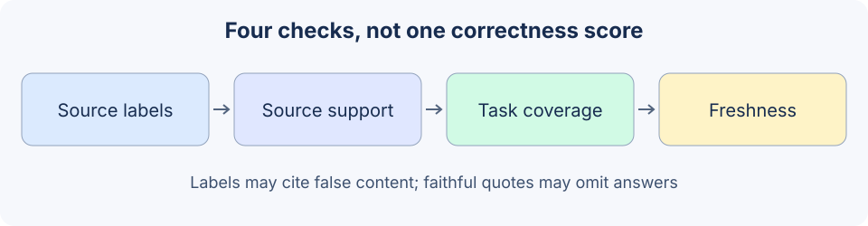

# 19.2 Hallucination and Factuality

Check source existence, support, task coverage and real-world accuracy separately. Retrieval, citations and self-review provide evidence for different questions.



## Classify the failure before choosing a check

| Failure | Observable example | Relevant check |
|---|---|---|
| Invented citation | Answer cites an unknown source label | Compare with the retrieved source manifest and location |
| Unsupported content | Source says seven days; answer says ninety | Independent excerpt/entailment review |
| Incomplete answer | Receipt requirement given; deadline omitted | Required points frozen before generation |
| Invalid or outdated source | Accurate quotation of an expired policy | Version, applicability and authoritative source review |
| False action completion | Answer says “published”; backend has no record | Actual receipt and state |

Instructions to be cautious, cite sources or emit confidence constrain generation. A self-reported 0.99 is not a calibrated probability of correctness. Another agreement from the same model or multiple matching samples can share an error. [19.6](./06_paper_readings.md) distinguishes sampling consistency from factual support.

## A correct label with incorrect content

Reuse `reference_code/evidence_assistant/` from [6.5](../chapter_rag/05_practice_qa_agent.md), rather than maintaining another supposed FactChecker. These fixed English passages make literal matching observable; they do not assess language understanding. Run each block independently from the repository root:

```python
from reference_code.evidence_assistant.rag import Document, DocumentQAAgent, answer_accepted
from reference_code.evidence_assistant.research import check_excerpts, verify_excerpts

source = Document('policy-v1', 'Refund requests are accepted within seven days.')
wrong = '[policy-v1] Refund requests are accepted within ninety days.'
producer = lambda messages: wrong
labels_only = DocumentQAAgent([source], producer).ask('refund deadline')
assert answer_accepted(labels_only) is True
assert labels_only['verification']['semantic_support'] == 'not_checked'
assert check_excerpts('refund deadline', wrong, [source])['code'] == 'unsupported_excerpt'
checked = DocumentQAAgent([source], producer, verifier=verify_excerpts).ask('refund deadline')
assert checked['status'] == 'verification_failed'
assert checked['sources'] == []
print(checked['status'])
```

The default class checks citation labels. Its `answered` status means the configured internal checks passed; it is not automatic task completion. `check_excerpts` checks each `[source] original excerpt` line against the source. A valid paraphrase may fail this deliberately narrow check. It is not a general semantic fact verifier.

## An accurate excerpt may omit an answer

Write two independent required points before running the producer:

```python
from reference_code.evidence_assistant.rag import Document, DocumentQAAgent
from reference_code.evidence_assistant.research import verify_excerpts
from reference_code.evidence_assistant.task_acceptance import check_question_coverage

question = 'What is the refund deadline and required proof?'
specs = [{'question': question, 'requirements': [
    {'id':'deadline', 'description':'seven-day deadline', 'all_of':['seven days']},
    {'id':'proof', 'description':'receipt required', 'all_of':['receipt']},
]}]
qa = DocumentQAAgent([Document('policy-v1', 'Refund requests require a receipt.')],
                     verifier=verify_excerpts)
result = qa.ask(question)
coverage = check_question_coverage(question, result['answer'], specs=specs)
assert result['status'] == 'answered'
assert coverage['status'] == 'failed'
assert coverage['missing_points'] == ['seven-day deadline']
unknown = check_question_coverage('Another question?', result['answer'], specs=specs)
assert unknown['status'] == 'unknown'
print(coverage['missing_points'], unknown['status'])
```

Literal coverage applies to these frozen tasks. It checks neither citations nor arbitrary paraphrases. A new question without a matching specification remains `unknown`. The producer cannot rewrite expectations to fit its output. Final acceptance requires the configured generation status, support and coverage checks, plus separate authorization and source freshness evidence.

## Retain evidence when adding an independent reviewer

A semantic reviewer should receive the original question, candidate, accessible source snapshot and independent specification, then return a structured verdict with reasons and source locations. Treat the candidate as data, not new system instructions. Claim extraction may omit important assertions; check coverage and unextracted content too.

Define `passed/failed/unknown/error`, validate the complete response and check types and source locations. Parsing failure, timeout or missing evidence cannot become `passed`. The callback contract requires the literal boolean `True`; see 6.5 for rejection and exception tests. Additional review calls also consume the call/time budget.

For a real model judge, assess errors on independent human-reviewed samples, record model/prompt versions and review conflicts or unknowns. Shared biases can make producer and judge agree incorrectly. Local contract tests do not establish correctness for all natural-language answers.

Exercise: update the source from seven to ten days while retaining the old answer and specification. Record the invalid old citation, the supported new answer failing the old specification, and the evidence for a reviewed specification change. The host maintains version labels; the two-field `Document` has no automatic version control.

*Next: [19.3 Permissions and Sandboxing](./03_permission_sandbox.md)*
