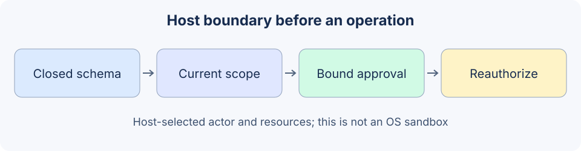

# 19.3 Permissions and Sandboxing

Implement enforceable checks before a narrowly scoped tool operation, then identify the extra requirements for code isolation. `reference_code/security_boundary/` is an in-memory authorization lab, not an arbitrary Python executor.



## Check identity, capability, resource and consent separately

Identity comes from an authenticated host session, not a model-supplied `principal`. Tool permission determines available operations; resource permission determines accessible documents and destinations. Approval confirms one specific action without extending existing authority. [OWASP Excessive Agency](https://genai.owasp.org/llmrisk/llm062025-excessive-agency/) recommends limiting functionality, permissions and autonomy, with complete authorization enforced downstream.

Roles can allocate base capabilities while resource attributes constrain owner, task, time or scope. A function name containing `read` does not prove harmlessness: a download may contact a prohibited address, and a read can disclose data.

The lab's host policy explicitly lists tools, document IDs and destinations. Empty sets grant nothing. The backend checks ownership again, so accidentally allowlisting Bob's document ID still does not let Alice read it.

```python
from reference_code.security_boundary import HostPolicy, proposal_json
from reference_code.security_boundary.regression import new_lab, READ

runtime = new_lab()  # Authenticated actor is the fictional Alice fixture.
assert runtime.execute(READ)['value'] == {
    'document_id':'alice_policy', 'excerpt':'Refund requests require a receipt.'}
other = proposal_json('r2', 'read_document', document_id='bob_policy')
assert runtime.execute(other)['code'] == 'document_denied'
assert runtime.backend.read_calls == 1
runtime.replace_policy(HostPolicy('alice', {'read_document'}, set(), set()))
assert runtime.execute(READ)['code'] == 'document_denied'
print('Owned read succeeds; cross-owner and empty scope are denied.')
```

## Bind approval to content and recheck authority

The host invokes `ApprovalRegistry` to issue an opaque proof bound to the principal, request ID, tool, canonical digest of all arguments and deadline. The model cannot issue a proof through `approved=True`: the closed schema rejects that extra field. A real host must authenticate the reviewer and show the exact action and impact, rather than a generic “continue” prompt.

```python
from reference_code.security_boundary import HostPolicy, proposal_json
from reference_code.security_boundary.regression import new_lab, NOTICE

runtime = new_lab()
token = runtime.approvals.issue('alice', NOTICE, approved=True)
changed = proposal_json('notice1', 'publish_notice', destination='board', text='Changed content.')
assert runtime.execute(changed, approval_token=token)['code'] == 'approval_required'
runtime.replace_policy(HostPolicy('alice', {'read_document'}, {'alice_policy'}, set()))
assert runtime.execute(NOTICE, approval_token=token)['code'] == 'tool_denied'
assert runtime.backend.publish_calls == 0
print('Approval cannot authorize changed content or override revocation.')
```

The runtime reads current policy and checks again immediately before writing. This is a synchronous, single-process fixture. Concurrent services need backend transactions or version conditions for state changes after checking; two Python `if` statements do not prove cross-service atomicity.

## Why string filters do not isolate code

The old example allowed file paths using `resource.startswith(root)`: `/allowed/../private` could match. Missing resources or empty allowlists could also fall through to permission. Its `CodeSandbox` blocked a few AST calls/imports before starting an ordinary child process, which could still read host files with built-in `open`. The `max_memory_mb` field enforced no limit.

This section therefore removes host execution of arbitrary programs. AST validation can define a narrow expression language; it cannot turn full Python into a secure sandbox. A changed `HOME`, temporary directory or timeout does not remove filesystem or network capabilities. For restricted arithmetic, reuse Chapter 3's numeric AST evaluator, which does not execute Python programs.

A real file tool needs a controlled root, resolved containment, symlink policy, race-resistant opening and read/output limits. Network tools separately need redirect, DNS/IP, private-address and egress controls. Checking a string and then passing the original input into an unrestricted operation does not implement those contracts.

## Independently verify any arbitrary-code isolation service

| Capability to constrain | Required evidence |
|---|---|
| Host files/credentials | Explicit task mounts; no container-management socket or host secrets |
| Network | Enforced and tested egress policy outside the model |
| CPU/memory/processes/storage/output | Real quotas; termination and cleanup of the entire task on breach |
| Lifecycle | A task-specific isolation scope; observable failure, cancellation and residue |
| Results | Bounded artifacts and independent verification, beyond exit code zero |

Containers, microVMs and managed services have different configuration and trust assumptions; product names do not establish an absolute safety ranking. [Docker's security documentation](https://docs.docker.com/engine/security/) discusses namespaces, cgroups, daemon attack surface and configuration separately. The local lab does not provide these mechanisms, and no such deployment was tested here.

Exercise: before adding a resource permission, freeze expectations for unauthorized access, empty scope, revocation after approval and retries. Operation counters must show that denied requests never enter the actual operation before connecting a real external service.

*Next: [19.4 Sensitive Data Protection](./04_data_protection.md)*
