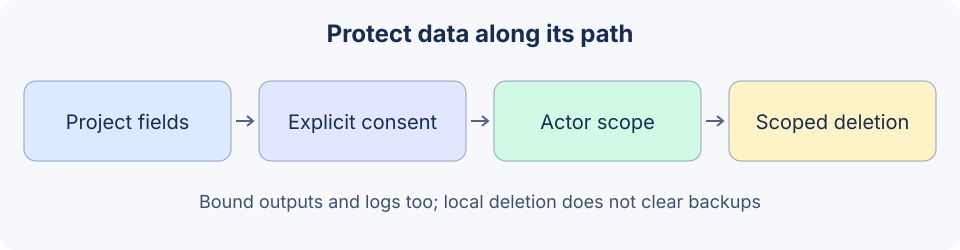

# 19.4 Sensitive Data Protection

Follow data through acquisition, model input, tools, memory, logs and deletion. Send necessary data to necessary places, rather than exporting everything and relying on a regex mask afterward.



## Minimize before detecting

Define allowed fields by task and validate their actual types and sizes. Reject unknown tasks instead of sending every field except a short blacklist. Credentials should not enter model-readable documents or prompts; the system role is not secret storage.

```python
from reference_code.security_boundary import Rejected, project_record

record = {'order_id':'ORD-DEMO', 'status':'shipped',
          'api_key':'SYNTHETIC_KEY', 'customer_name':'Alice'}
minimal = project_record('order_status', record)
assert minimal == {'order_id':'ORD-DEMO', 'status':'shipped'}
try:
    project_record('unknown_task', record)
except Rejected as exc:
    assert str(exc) == 'unknown_projection'
else:
    raise AssertionError('Unknown tasks must not receive all fields.')
print(minimal)
```

Names and contents are fictional fixtures. Free text in an allowed field can still contain private data; projection is not general redaction. Check purpose, origin and recipient at a real boundary, and do not hide a complete nested object in a field named “summary”.

Regexes find some phone, email or credential forms, but miss unfamiliar formats, contextual secrets, encoding and split content, and may misclassify ordinary numbers. Detection records should include type, location and reason. Log-facing records should not retain the original matched value. Merge overlapping replacement spans before editing so stale offsets do not leave content behind.

## The host supplies consent and actor scope

`ScopedNotes` is only a bounded in-memory note store. Writing requires the literal boolean `True`; reading and deletion use the host-selected actor. A model cannot select another user's identity through a tool argument.

```python
from reference_code.security_boundary import Rejected, ScopedNotes

notes = ScopedNotes()
try:
    notes.put('alice', 'n1', 'Fictional preference.', consent='yes')
except Rejected as exc:
    assert str(exc) == 'consent_required'
else:
    raise AssertionError('Truthy text is not consent.')
notes.put('alice', 'n1', 'Fictional preference.', consent=True)
assert notes.get('bob', 'n1') is None
assert notes.delete('alice', 'n1') is True
assert notes.get('alice', 'n1') is None
print('Explicit consent, owner scope and local deletion checked.')
```

The host must obtain actor and consent from the real session; direct strings above are reproducible fixtures. Cross-session access for the same actor is a separate policy decision. A random `session_id` does not authenticate a person. See [4.3](../chapter_memory/03_long_term_memory.md) for persistent memory/index scope.

## Allowlist output and audit fields too

`LocalBackend.read` returns document ID and excerpt, excluding its private field. `Runtime.audit` contains run ID, attempt number, tool, status and a fixed reason code. It omits body text, arguments, approval proofs and raw exceptions. Tests check normal results and synthetic canaries in both output and audit.

An absent canary proves only that the fixed field did not flow there, not that all private data was detected. Audit IDs, counts, timestamps and resource names may themselves be sensitive. Real services also need log access control, retention, search authorization and crash-dump policies. A debugging `print(arguments)` is another data flow.

## Encryption and deletion have separate contracts

This lab has no disk storage or encryption. Persistent storage should use a maintained authenticated-encryption library with separate key, database and access management. The [Fernet 50.0.2 documentation](https://cryptography.io/en/50.0.2/fernet/) explains that a key holder can read and create valid messages and that token creation timestamps remain visible. Encryption does not replace actor authorization.

Separately test key access/rotation, wrong-key and tampering rejection, actor/record binding, caches, replicas, backups and restore permissions. Base64 or homemade XOR must not be called encryption. Deletion requires a schedule for indexes, caches, logs and backups. `ScopedNotes.delete` removes one record from the current object; it does not establish secure erasure or complete lifecycle deletion.

Exercise: add an unknown field and nested object to a normal order, proving projection does not expand. Use identically named Alice/Bob notes to test independent reads/deletion. Submit actual output/audit fields and retention rules for each copy, rather than one generic “redacted” label.

*Next: [19.5 Controllability and Alignment](./05_alignment.md)*
