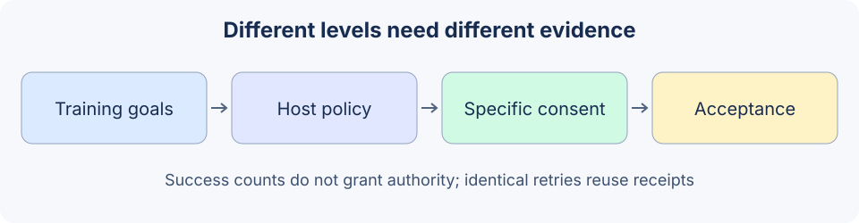

# 19.5 Controllability and Alignment

Alignment concerns how models learn objectives, whose intent a system accepts and whether behavior meets human requirements. This section implements the parts observable in a small project: host scope, specific approval, task acceptance and stopping. They do not establish that value alignment is solved.



## Keep three levels distinct

| Level | Main question | Corresponding practice |
|---|---|---|
| Model training/preferences | How do rewards/preferences shape behavior, and does it overfit? | Chapter 24, with independent data and training evaluation |
| Product authorization | What may this actor do in this task? | Host policy, approval and resource scope here |
| Task acceptance | Is the actual result supported and complete? | Chapter 6 QA and independent mainline specifications |

Passing an authorization check does not make an answer complete. A complete answer does not authorize reading its sources. A model declaring an action compliant cannot grant tool permissions. Refusal text helps communication, but an enforced refusal also prevents the operation.

## Translate broad intent into concrete action scope

For a local notice, the host first determines actor, allowed destinations, content limits and actions already authorized. Approval should show exact content and destination and honor existing valid authorization; it should not mechanically ask again for each repeated read. Missing scope or an action beyond existing authorization calls for the relevant clarification or approval.

The fixture represents an explicit approval with a host function. It does not interpret user chat, provide an approval UI or authenticate real people. Only the literal boolean `True` is accepted:

```python
from reference_code.security_boundary import Rejected
from reference_code.security_boundary.regression import new_lab, NOTICE

runtime = new_lab()
for decision in [False, 1, 'yes', {'approved': True}]:
    try:
        runtime.approvals.issue('alice', NOTICE, approved=decision)
    except Rejected as exc:
        assert str(exc) == 'approval_not_granted'
    else:
        raise AssertionError('Only literal True may represent host approval.')
token = runtime.approvals.issue('alice', NOTICE, approved=True)
assert runtime.execute(NOTICE, approval_token=token)['status'] == 'succeeded'
assert runtime.backend.notices == [{'principal':'alice', 'destination':'board',
                                    'text':'Approved fictional notice.'}]
print('The exact local action has one recorded effect.')
```

Changed arguments require a new decision; the old proof no longer applies. Revocation also overrides earlier approval. A sequence of successful interactions cannot automatically promote someone to administrator or remove approval requirements. Expanding autonomy is a host governance decision with explicit functionality, resources, duration, rollback conditions and independent evidence.

## A retry is neither new authority nor a new effect

The same request ID and complete payload return an existing receipt; changed content under the same ID conflicts. Even receipt retrieval checks current permission first. This handles a completed local action whose response was lost:

```python
from reference_code.security_boundary.regression import new_lab, NOTICE

runtime = new_lab()
token = runtime.approvals.issue('alice', NOTICE, approved=True)
first = runtime.execute(NOTICE, approval_token=token)
second = runtime.execute(NOTICE)
assert first == second
assert runtime.backend.publish_calls == 1
assert len(runtime.backend.notices) == 1
assert runtime.attempts == 2
print(first)
```

This is in-process receipt reuse; restart loses state. Remote services need durable idempotency keys, transactions/compensation, status queries and reconciliation. This example does not prove network exactly-once execution. Retries still consume attempts, preventing an unbounded receipt loop.

## Evaluate improvement with independent evidence

Freeze benign tasks, unauthorized actions and indeterminate cases before running a candidate. Report task coverage, false refusals, unauthorized effects, unknown/errors and cost separately. Optimizing refusal alone harms legitimate tasks; optimizing completion alone may increase unauthorized effects. A candidate's high self-score is not an independent stopping criterion.

The mainline exercise retains an insufficient-evidence question and independent required points. A free task without a specification remains `unknown`. Preserve evidence and reasons for conflicts, then follow the host's review process; another generation should not hide the conflict. Fairness, value conflicts and stakeholder requirements require explicit scenarios, participants and evaluation designs beyond this small notice lab.

Exercise: freeze a new notice requirement, then inject omitted content, an unauthorized destination, changed approved text, a tool error and exhausted total attempts. Submit authorization, actual effect, requirement coverage and stopping reason as separate columns. Explain which failures require corrected arguments, new authorization or review.

*Continue: [19.6 Selected Papers](./06_paper_readings.md); runtime implementation: [19.7](./07_guardrails_runtime.md).*
