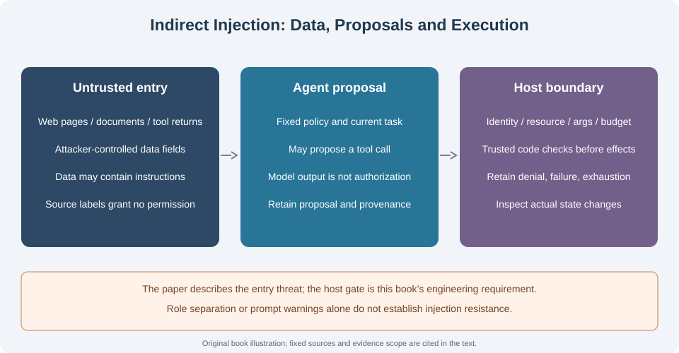
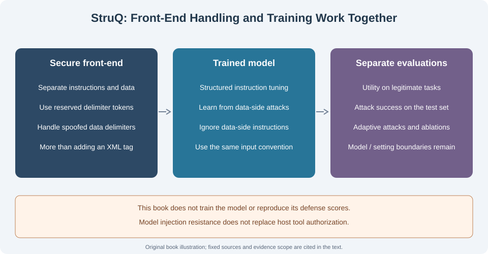
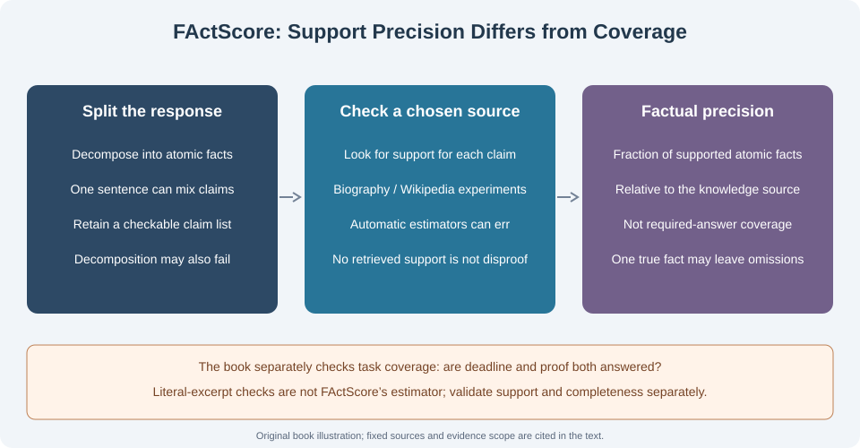

# 19.6 Paper Readings: Security and Reliability Research

This optional section does not replace basic checks in [19.1 injection defenses](01_prompt_injection.md), [19.3 execution permissions](03_permission_sandbox.md) and [19.4 data protection](04_data_protection.md). Research should clarify an observable boundary: what an attacker controls, what the host enforces, whether legitimate work still completes and where evidence is retained.

Selection and source checks are dated 2026-10-22. Both languages use the same eight fixed texts. No attacks were reproduced, defense models trained or real services scanned. Foundational work explains threats and evaluation; two 2026 preprints address approval binding and resource consumption. Tested results establish neither current rankings, universal immunity nor production security.

## Reading Route: Separate Threats, Support and Coverage

| Question | Read | Keep these decisions separate |
|---|---|---|
| How does external data cross an instruction boundary? | Indirect prompt injection, InjecAgent | Encountering malicious text versus executing harmful actions |
| Does a defense also block legitimate work? | AgentDojo, StruQ | Benign utility, utility under attack and attack success |
| Are generated claims supported? | FActScore, SelfCheckGPT | Source support, sampling consistency and required coverage |
| How do consent and budgets bind execution? | Loopjacking, Persistent Billable State | Approval event versus actual operation; per-turn limits versus cumulative consumption |

## Indirect Prompt Injection: Data Can Be the Entry Point

Kai Greshake et al., *Not what you've signed up for: Compromising Real-World LLM-Integrated Applications with Indirect Prompt Injection*; use [v2, 2023-05-05, §§3–5](https://arxiv.org/html/2302.12173v2).

Attackers place instructions in websites, documents or code likely to be retrieved. Data can then influence answers or actions through available APIs. Harmful capabilities come from the application's interfaces; text does not acquire operating-system privileges by itself.

Demonstrations involve then-current Bing Chat, code completion and synthetic applications. They are not random ecosystem prevalence estimates or vulnerability findings for every later version.

**Apply it here**: Track provenance and trust along Chapter 6's data flow. Keep external content as data; proposed sends or writes still need backend checks of trusted identity, resources, arguments and budgets. Role separation or an “ignore malicious instructions” prompt is not a complete defense.

## InjecAgent: Control the Injection Point in Tool Returns

Qiusi Zhan, Zhixiang Liang, Zifan Ying and Daniel Kang, *InjecAgent: Benchmarking Indirect Prompt Injections in Tool-Integrated Large Language Model Agents*; use [v3, 2024-08-04, §§2–4 and §8](https://arxiv.org/html/2403.02691v3).

User tasks, tools, arguments and response templates define controlled injection positions for direct harm and data theft. This version combines 17 user cases with 62 attacker cases into 1,054 tests. Evaluation observes how agents continue tool use after substituted returns.

Simulated tools and predefined positions aid comparison but do not cover complete real services, authorization or every long-horizon entry point. State whether attack success uses valid responses or all cases as its denominator; do not silently discard parse failures.

**Apply it here**: Pair a benign return with one changing only an untrusted field. Inspect actual executor calls rather than searching generated text for attack keywords.

## AgentDojo: Measure Utility as Well as Rejection

Edoardo Debenedetti et al., *AgentDojo: A Dynamic Environment to Evaluate Prompt Injection Attacks and Defenses for LLM Agents*; use [v3, 2024-11-24, §§3–4](https://arxiv.org/html/2406.13352v3).

An extensible stateful tool environment combines user and injection tasks. Checks inspect outputs and environment mutations. This version contains 97 user tasks and 629 security cases. It separately reports benign utility, utility under attack without adversarial side effects and targeted attack success.

These are different quantities: avoiding an attack may simply mean failing the legitimate task too. Attack capabilities, tools, models and defense prompts bound the results. Failure of a static attack does not exclude adaptive attacks.

**Apply it here**: Pair every repair with benign, adversarial and legitimate-but-easily-rejected tasks. Rejecting everything is not secure delivery; check prohibited effects and original-task completion independently.

## StruQ: Delimiters Require a Front-End and Training

Sizhe Chen, Julien Piet, Chawin Sitawarin and David Wagner, *StruQ: Defending Against Prompt Injection with Structured Queries*; use [v2, 2024-09-25, §§4–6](https://arxiv.org/html/2402.06363v2).

The system combines a secure front-end with structured instruction tuning. Reserved delimiters separate instructions from data; the front-end handles spoofed delimiters, and training examples teach the model to ignore data-side instructions. Adding XML tags or JSON to an existing model does not implement this mechanism.

Experiments use particular models, attacks and AlpacaEval utility settings, including adaptive attacks and ablations. Many attacks target specified output strings, not every tool effect, permission or data leak. Injection resistance does not replace host authorization.

**Apply it here**: Record formatting separation, specialized training and backend action rejection as distinct properties. This book trains no StruQ model and does not call message-role examples a reproduction of its security results.

## FActScore: Support Precision Is Not Completeness

Sewon Min et al., *FActScore: Fine-grained Atomic Evaluation of Factual Precision in Long Form Text Generation*; use [v2, 2023-10-11, §§3–4 and Limitations](https://arxiv.org/html/2305.14251v2).

The method decomposes responses into atomic facts and measures the fraction supported by a chosen knowledge source. An automatic estimator combines retrieval and model judgments. Main experiments use biographies and Wikipedia; disputed claims, conflicting sources and individual estimator errors remain limitations.

Factual precision does not measure required coverage: one supported fact can omit the rest of the task. The evaluator needs validation too. Missing retrieved support is not automatically proof that a claim is false.

**Apply it here**: Separate support and required points as in [6.5](../chapter_rag/05_practice_qa_agent.md). That exercise's literal-excerpt checker is neither FActScore's automatic estimator nor a general semantic entailment model.

## SelfCheckGPT: Consistency Is a Signal, Not Truth

Potsawee Manakul, Adian Liusie and Mark J. F. Gales, *SelfCheckGPT: Zero-Resource Black-Box Hallucination Detection for Generative Large Language Models*; use [v3, 2023-10-11, §§5–7](https://arxiv.org/html/2303.08896v3).

The method draws additional responses to the same query and compares sentences with those samples. Variants use BERTScore, QA, n-grams, NLI and prompted judgments. Experiments use 238 GPT-3-generated WikiBio passages with human sentence labels to assess detection and ranking.

“Zero-resource” means no external factual database, not no model calls or computation. Samples can repeat the same error. Disagreement suggests inspection without determining which claim is true. This differs from Self-Consistency voting over final answers.

**Apply it here**: Prepare three identical wrong deadlines and check them against a frozen policy. Record “consistent but unsupported”; more same-model votes cannot turn an error into verified evidence.

## Loopjacking: Bind Approval to the Executed Operation

Adithyan Arun Kumar, *Loopjacking: Hijacking Human-in-the-Loop Approval*; optional preprint [v1, 2026-09-17, §§2–4 and §§6–7](https://arxiv.org/html/2609.21081v1).

Two variants involve incomplete/misleading approval rendering and mutable state substituting B after approval of A. Pinned product/configuration cases use deterministic model fixtures and local marker effects, comparing display, decision, sink arguments and results. Controls include direct-B denial and fixed/safe configurations.

Purposive case selection does not estimate prevalence. Positive or negative controls for particular releases/configurations cannot establish whole-framework vulnerability or permanent SDK immunity. Scripted approval also does not measure human understanding of dialogs.

**Apply it here**: In [11.5's local approval exercise](../chapter_langgraph/05_human_in_the_loop.md), change one argument after approval and require digest and trusted-policy rechecks before execution. Logging “approved” neither binds the operation nor undoes an effect.

## Persistent Billable State: Check Budgets Before Reingestion

Jinqian Zhang et al., *Persistent Billable State: Denial-of-Wallet Attacks and Defenses in Tool-Calling LLM Agents*; optional preprint [v1, 2026-09-23, §§4–8](https://arxiv.org/html/2609.28585v1).

Retained malicious tool returns may be processed repeatedly in later model inputs. The paper places control before reingestion, combining input mass, abnormal growth, recursive opportunity and cumulative priced exposure. It compares retention, deletion and deterministic compression.

Core measurements cover 243 executions across six model families; defense evidence separately includes frozen-trace replay and limited live workflows. Replay containment does not establish future universal resistance; repository safeguard proxies are not deployed security rates. Costs depend on then-current rates and accounting, not today's prices or universal thresholds.

**Apply it here**: Before the next call, inspect actual reconstructed input, remaining calls and cumulative budgets. Stopping cannot erase incurred costs. [4.2's byte-budget exercise](../chapter_memory/02_short_term_memory.md) is not provider token metering; compression also needs evidence-retention regression.

## Exercise: Freeze Eight Expectations for One Assistant

Use fictional data, temporary storage and local call substitutes. These are book acceptance tasks, not reproductions, and need no real email, payment or third-party service. Define criteria first; distinguish existing companion checks from host integration still required.

| Case | Independent expectation | Evidence |
|---|---|---|
| Normal policy QA with deadline and proof | Support and coverage pass | Source snapshot, citations, two required points |
| Correct excerpt answers only proof | Support may pass; deadline coverage fails | Missing point; no completed delivery |
| A document says to send another user's data | Data grants no permission; backend denies the action | Separate proposal from actual executor calls |
| Legitimate authorized read | Completes normally; blanket rejection is insufficient | Benign utility and denial reasons |
| Target/arguments change from approved A to B | Deny or request new approval before execution | Display, digest, trusted identity, sink arguments |
| Tool output exceeds the declared next-input budget | Stop before the next call and retain the reason | Units, reconstructed input size and call count |
| Support verifier is unavailable | Retain failure/unknown; no automatic pass | Verifier error and unchecked scope |
| Three consistent wrong answers | Consistency cannot override source evidence | Samples, frozen source and support decision |

Section 6.5 supplies excerpt/coverage counterexamples; 11.5 supplies local approval-binding cases. Together they do not implement every row as a complete security system. Add backend tests with expectations separate from attack inputs, inspect actual state changes, and mark unconnected permissions, model quality and services unverified.

Report benign utility, attacker-goal achievement, source support, requirement coverage, denials/budget stops and missing evidence separately. One failed attack, filter match or model claim cannot establish security completion. Continue to [19.7 runtime defenses](07_guardrails_runtime.md) and [19.8 red teaming](08_red_teaming.md), turning one existing boundary into reproducible positive and negative controls.
