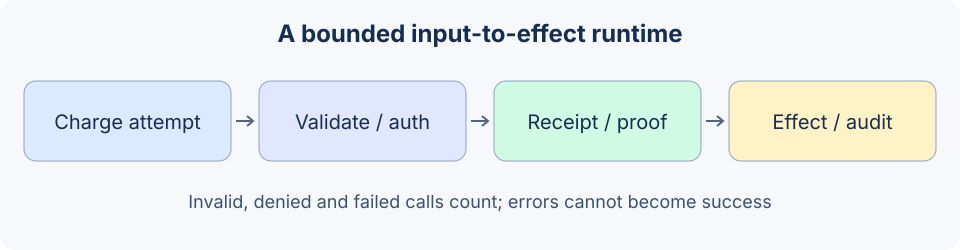

# 19.7 Runtime Guardrails

Guardrails check inputs, proposals, execution and results. Specify each check's input, failure status and enforcement location before choosing a framework. This section runs local mechanisms rather than calling uninstalled third-party configuration a complete defense system.



## Read the runtime as an ordered contract

`runtime.py` implements `execute` in this order:

1. Check total attempts, then charge this attempt; invalid inputs count too.
2. Parse bounded JSON, rejecting duplicate keys, nonfinite constants, extra fields and wrong types.
3. Validate the closed tool table and per-tool argument schema. Identity and approval are not model fields.
4. Check current tool permission, resource scope and document ownership.
5. For writes, look for an existing content-bound receipt. New effects require valid approval.
6. Reauthorize immediately before the operation; the backend also enforces its resource conditions.
7. Return the bounded fixture result and append metadata-only audit.

“Reject on failure” means format, permission or approval failure prevents execution, and checker/tool errors cannot become success. It does not mean the program identifies every unknown attack. Source states are `succeeded/rejected/failed`; fixed reason codes distinguish retries, argument repair, new authorization and stopping.

## Charge malformed input, denial and errors to one budget

```python
from reference_code.security_boundary.regression import new_lab, NOTICE, READ

runtime = new_lab(max_attempts=2)
assert runtime.execute('{')['status'] == 'rejected'
assert runtime.execute(NOTICE)['code'] == 'approval_required'
assert runtime.execute(READ)['code'] == 'budget_exhausted'
assert runtime.backend.read_calls == 0
assert runtime.backend.publish_calls == 0
assert runtime.attempts == 2
assert len(runtime.audit) == 2
print('Invalid and denied proposals consume the same total attempt budget.')
```

Exhaustion stops audit growth, bounding this in-memory list to at most 100 attempts. Proposals are limited to 4096 UTF-8 bytes, notice text to 600 bytes, and approval/note stores to 100 records each. These are teaching limits, not measured production defaults. The local backend has no long-running operations or external responses. Real tools need separate timeouts, cancellation, response limits and per-tenant quotas.

## An error must not leak arguments or become success

This example deliberately fails the actual read. Raw exceptions belong only in controlled internal diagnostics; neither the model result nor this lab's audit copies them:

```python
from unittest.mock import patch
import json
from reference_code.security_boundary.regression import new_lab, READ

runtime = new_lab(max_attempts=2)
with patch.object(runtime.backend, 'read', side_effect=RuntimeError('SYNTHETIC_SECRET')):
    result = runtime.execute(READ)
assert result == {'status':'failed', 'code':'tool_error'}
assert runtime.attempts == 1
serialized = json.dumps([result, runtime.audit])
assert 'SYNTHETIC_SECRET' not in serialized
assert 'arguments' not in serialized
print(result)
```

Process-control exceptions such as `KeyboardInterrupt` are not converted to ordinary tool failures. If a remote effect may have completed before an error, query idempotency records/reconcile rather than blindly resending. Tests cover a local committed effect with a lost response. A fallback text cannot be labeled as success of the original operation.

## Keep soft signals and enforceable conditions distinct

| Check | Condition it can enforce | Additional requirement |
|---|---|---|
| Types/size/tool table | The parser and registry's closed contract | Matching schemas at frontend and backend |
| Identity/resource policy | Trusted actor, capabilities and scope | Real authentication, downstream checks and concurrency conditions |
| Detector/model judge | Its configured rules or classifier | Calibrated errors; failure must not count as a pass |
| Approval | Bound content, actor and expiration | Authenticated reviewer and trustworthy display |
| Isolation service | Actual file/network/resource restrictions | Independent deployment and escape/cleanup assessment |

Regexes provide narrow signals and model reviewers can assess richer content, but neither grants authority. The repository's `reference-agent` `InjectionGuard` is explicitly a bounded lexical screen. Returning from `check_input` means only that its patterns did not match, not semantic safety. Its tests preserve both false positives and false negatives.

When adopting a third-party guardrails framework, pin versions/dependencies and verify whether it wraps inputs, outputs, tool calls or the backend. Test ineffective configuration, parsing errors, timeout, cancellation and alternate entry points. No NeMo or Guardrails AI installation/comparison is performed here; there is no “most mature” ranking, universal latency number or bypass-proof claim.

Exercise: deliberately omit charging one denied request and confirm independent tests catch it. Then simulate a committed action with a lost response and verify that an identical retry adds no second effect. Submit states and actual local effects, not only log screenshots.

*Next: [19.8 Red Teaming](./08_red_teaming.md)*
