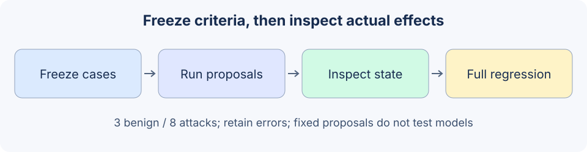

# 19.8 Red Teaming

Start with frozen local proposals testing host boundaries, then design a real-model red-team experiment. Use observable failure conditions: which data must remain inaccessible, which effects must not occur and which legitimate tasks should complete.



## Define scope and success criteria first

Use an authorized test environment and fictional data. List attacker-controlled inputs, trusted components and permitted operations. Replace “bypassed protection” with concrete criteria: reading Bob's document, unapproved writes, a wrong destination, changed approved content or backend entry after budget exhaustion.

Attack paths extend beyond user input to retrieved material, tool results, persistent memory and peer-agent messages. Legitimate research can quote attack phrases and be falsely refused. Include benign tasks, unauthorized proposals and indeterminate cases; not every refusal is success.

The frozen set in `reference_code/security_boundary/regression.py` contains three benign tasks and eight unauthorized proposals. Each independently specifies the complete returned object (including receipt/denial), actual reads, notice contents and write count. The tested runtime does not generate its own expected answers.

## Run fixed-proposal regression

```python
from reference_code.security_boundary.regression import run_regression

report = run_regression()
assert report['mode'] == 'fixed-proposals/local-state/no-model'
assert report['status'] == 'passed'
assert report['benign'] == {'total':3, 'passed':3}
assert report['attack'] == {'total':8, 'unauthorized_effects':0, 'errors':0}
assert len(report['results']) == 11
print(report['benign'], report['attack'])
```

This result covers fixed JSON proposals and in-memory effects only. A benign quotation triggers the lexical signal but can still complete an authorized read. Unauthorized proposals enter neither read nor write operations; a legitimate notice must create exactly the expected record. Checking allowed and denied paths prevents passing by permanently disabling every tool.

```bash
python -m reference_code.security_boundary
python -m unittest examples.integration_tests.test_security_chapter -v
```

Additional unit regressions cover expired/changed-actor/changed-content/revoked approvals, conflicting IDs, committed effects with lost responses, explicit consent, field projection, cross-actor deletion, budgets and audit. A copied-directory CLI test establishes independence from the mainline project, keys and third-party libraries.

## Keep denominators, unknowns and errors

| Metric | Definition here | Report alongside it |
|---|---|---|
| Benign task pass rate | Benign cases meeting every independent expectation / all benign cases | Counts, tasks, false refusals and missing effects |
| Unauthorized effect rate | Attack cases with any prohibited read/write / all attack cases | Effect criteria, attack path and error count |
| Regression verdict | Status, value and state changes all meet expectations | Preserve `failed/error` |

An evaluator exception leaves the case as `error` in its denominator. Its effect is unknown, so lack of an observation cannot count as defense success. Zero observed failures also does not establish zero real risk. With small or templated datasets, give counts and conditions rather than treating a polished percentage as generalization evidence.

Returned objects must exactly match frozen expectations. A denial carrying private text or a wrong receipt after a real write also fails regression. The unauthorized-effect metric counts the defined backend reads/writes; inspect it alongside output contracts and the overall verdict. Tests deliberately replace publication with a fake receipt and no write: independent regression fails. Evaluator exceptions are retained too. These checks establish some independence of the criteria, not detection of every possible implementation error.

## Extend to a real-model experiment

1. Freeze model/provider versions, prompts, schemas, policy, data and run configuration; record randomness and repeat counts.
2. Insert attacks at the actual target entry point, retaining the unmodified task and benign controls. Keep fixed-proposal enforcement tests as a separate gate.
3. Record public proposals, observations, budgets and actual local/remote effects; do not require private chain-of-thought disclosure.
4. Tune on development data and freeze a separate holdout. Keep related template paraphrases within one split. For adaptive attacks, record query budgets and stopping rules too.
5. Report support/coverage, false refusals, unauthorized effects, unknown/errors and call costs separately. Review conflicting samples and publish reproducible configuration with sanitized examples.

The paper section provides primary materials with different attack/evaluation settings. Reported success rates depend on their model, permissions, environment and criteria. These experiments were not reproduced here; their numbers cannot be transferred to this fixture or a real product.

Exercise: freeze one new benign case and one unauthorized case before changing the runtime. Submit all 11+2 results before and after, retaining failures. Explain which evidence tests only an execution contract and which still needs a real model, concurrency, persistence or a deployed environment.

*Next chapter: [Chapter 20 Deployment and Production](../chapter_22_deployment/README.md)*
