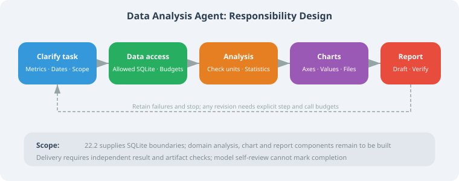
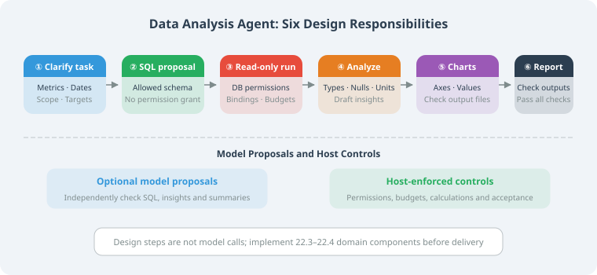

# 22.1 Requirements Analysis and Architecture Design

> **Section Goal**: Design the overall plan for an intelligent data analysis Agent.

---

## Project Background

Data analysis is a core need for many enterprises, but traditional data analysis requires mastering SQL, Python, statistics, and other skills. We want to build an Agent that lets users complete data analysis using natural language.

**User says**: "Help me analyze last month's sales data, compare growth rates by region"

**Agent does**: Connect to database → Write SQL query → Analyze data → Generate visualization charts → Output report



---

## Core Features

| Feature | Description |
|---------|-------------|
| Natural language queries | Describe analysis requirements in English, automatically converted to SQL |
| Data exploration | Automatically understand table structure and data distribution |
| Statistical analysis | Descriptive statistics, trend analysis, comparative analysis |
| Visualization | Automatically generate charts |
| Report generation | Integrate analysis results into structured reports |

---

## Architecture Design

```python
from dataclasses import dataclass, field
from enum import Enum

class AnalysisType(Enum):
    DESCRIPTIVE = "descriptive"    # Descriptive analysis
    COMPARATIVE = "comparative"    # Comparative analysis
    TREND = "trend"               # Trend analysis
    CORRELATION = "correlation"   # Correlation analysis

@dataclass
class AnalysisRequest:
    """Analysis request"""
    question: str                  # User's natural language question
    analysis_type: AnalysisType = None  # Auto-detected
    target_tables: list[str] = field(default_factory=list)
    time_range: dict = field(default_factory=dict)

@dataclass
class AnalysisResult:
    """Analysis result"""
    summary: str                   # Text summary
    data: dict = field(default_factory=dict)  # Raw data
    sql_query: str = ""            # SQL used
    chart_path: str = ""           # Chart file path
    insights: list[str] = field(default_factory=list)  # Insights
```

---

## Component Selection and Dependency Scope

Fix the task, data-access boundary, and independent expectations before choosing components. This chapter ran no controlled model ranking, database benchmark, or chart-library comparison; it cannot claim that a particular model has the highest SQL accuracy.

| Layer | Starting point here | Required evidence before extension |
|---|---|---|
| SQL proposals | The 22.2 fixed provider checks an interface | Live model/SDK versions, data exposure, failures, and business acceptance rate |
| Data access | Standard-library SQLite and `ReadOnlySQLite` | Other drivers, dialects, account/row/column permissions, and resource policies need separate implementation |
| Analysis and charts | Domain designs in 22.3 | Types, units, statistics, plotted values, output files, and actual dependencies |
| Insights and reports | Candidate-report design in 22.4 | Traceable conclusions, missing items, format, and independent delivery requirements |
| Orchestration | Host-defined dependencies in 22.5 | Measure a need before adding state graphs, human review, or parallelism |

Section 22.2 and its tests need only Python's standard library, run from the repository root with Python 3.11+. Model SDKs and data-analysis libraries are unnecessary for that exercise. When assembling 22.3–22.4, record actual components and exact versions in a separate environment and verify the dependencies. Installing several packages does not supply a complete application; these domain extensions are also not prerequisites for the continuing reference project.

## Security and Result Boundaries

| Problem | Supplied or required measure | What it does not establish |
|---|---|---|
| Untrusted SQL proposal | A read-only connection plus native action/table/function permissions; bind values | Regex allowlists, SELECT prefixes, and prompts cannot grant authorization |
| Resource consumption | The 22.2 progress callback, elapsed-time checks, and bounded result rows | LIMIT cannot bound all scans/aggregates; row count does not bound field bytes |
| Data disclosure | Send only allowed schema; enforce identity, purpose, and row/column rules at the business access layer | Read-only access or harmless-looking field names do not make data public |
| Wrong analysis/report | Fixed definitions and independent numeric/artifact expectations; retain failures | Executable SQL, an existing chart, or model self-review cannot establish task completion |

See 22.2 for the actual database implementation, tests, and scope. Identity, row/column business authorization, and complete sensitive-data governance are not supplied by that executor.

## Pipeline Responsibilities



The following is **design pseudocode**, not an implemented `DataAnalysisAgent` class. Components beyond data access need 22.3–22.4 domain implementations and the integration contracts in 22.5:

```text
Receive task and delivery requirements
1. Clarify metrics, dates, currency, permissions, and independent expectations
2. Read allowed schema and propose SQL; stop for clarification when required
3. Execute under host database permissions and resource budgets
4. Check types, missing values, and units; calculate statistics; insights remain proposals
5. Generate charts and check axes, values, and file artifacts
6. Form a report candidate; independently check results and all required deliverables
Save and mark final delivery only when every required condition passes
```

Step count is not model-call count. Models may propose SQL and prose, while the host enforces authorization, budgets, and acceptance. Analysis or report stages may also call a model, so they are not collectively deterministic computation. Record successful proposals separately from correct business answers.

## Summary

This section defines task and component responsibilities. Section 22.2 supplies runnable SQLite boundaries and a SQL-proposal interface; 22.3–22.4 remain domain implementation designs, and 22.5 defines assembly and acceptance. Actual components and a fixed small dataset are still required for a complete domain delivery.

---

[22.2 Data Connection and Querying](./02_data_connection.md)
