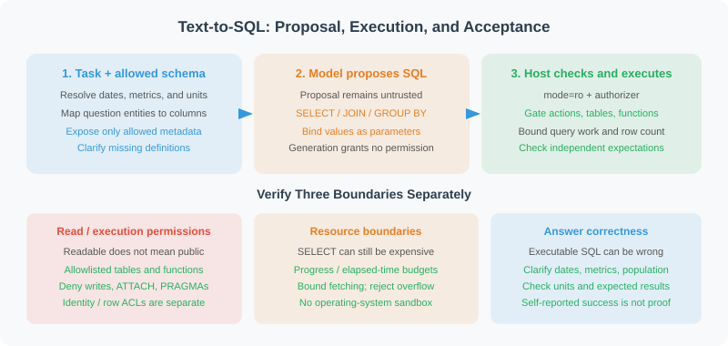

# 22.2 Data Connection and Querying

> **Goal**: Separate the user's question, SQL proposal, host authorization, and business acceptance. Run a bounded, read-only SQLite query.



## Where a Question Can Go Wrong

“Which product had the highest sales last month?” needs definitions: which amount column, whether refunds are deducted, the business time zone, and the reference date. Successful SQL execution establishes that the database accepted the statement; it does not establish those business choices.

Text-to-SQL involves schema linking, query structure, and conditions. Schema linking aligns the user's entities with tables, columns, and values; [RAT-SQL](https://aclanthology.org/2020.acl-main.677/) studies schema/question alignment. This section does not reproduce its training procedure.

| Expression | Required context | Response when missing |
|---|---|---|
| Sales amount | Ordered or collected amount; consistent currency | Clarify the metric |
| Last month | Reference date, business time zone, calendar month or trailing 30 days | Specify the interval |
| Large customers | Threshold and customer population | Request the threshold |
| High return rate | Join keys, denominator, and observation window | Check schema and metric definitions |

For a large schema, retrieve relevant metadata before asking the model for SQL. Selected tables must remain within host permissions. Additional data sources need their own metadata and restricted execution adapters; SQLite syntax and permissions do not automatically transfer to another engine.

## Run the Database Boundary First

Implementation: `reference_code/sqlite_readonly.py`. Tests: `reference_code/tests/test_sqlite_readonly.py`. This complete example runs from the repository root with Python 3.11+ and its standard library:

```python
from pathlib import Path
import sqlite3
import tempfile
from reference_code.sqlite_readonly import ReadOnlySQLite

with tempfile.TemporaryDirectory() as directory:
    path = Path(directory) / "sales.db"
    # Synthetic fixture creation; this write connection is never given to the Agent.
    with sqlite3.connect(path) as seed:
        seed.execute("CREATE TABLE orders(id INTEGER PRIMARY KEY, amount INTEGER)")
        seed.executemany("INSERT INTO orders(amount) VALUES (?)", [(100,), (200,)])

    database = ReadOnlySQLite(path, allowed_tables={"orders"}, max_rows=10)
    rows = database.execute_readonly(
        "SELECT sum(amount) AS total FROM orders WHERE id <= ?", (2,)
    )
    assert rows == [{"total": 300}]
    print(rows)
    try:
        database.execute_readonly("DELETE FROM orders")
    except PermissionError:
        print("Write rejected")
```

Expected: total 300 and a rejected write. The temporary database is removed afterward; this is not a production initialization script.

Constraints are enforced by the connection and engine callbacks, rather than inferred from words in SQL:

| Boundary | Implemented control | Negative case |
|---|---|---|
| Read-only file | URI `mode=ro`, supplemented by `query_only` | Inserts/deletes cannot change the file |
| Tables/actions | SQLite authorizer allows permitted table reads, queries, and a small function set | Unauthorized subqueries, `ATTACH`, modifying PRAGMAs, and extension loading are denied |
| Query work | VM progress callback and elapsed-time check | Expensive cross join is interrupted |
| Result rows | `fetchmany(max_rows + 1)` and explicit rejection | No unbounded `fetchall()` before checking |
| Values | DB-API parameter binding | No value interpolation into SQL text |

An empty `allowed_tables=set()` permits no tables. Metadata exposes only allowed schemas, without sample rows by default. Duplicate or case-conflicting result aliases such as `value`/`VALUE` are rejected: choose different aliases to prevent SQLite row name lookup from silently reusing the first value.

SQLite documents [read-only URI options](https://www.sqlite.org/uri.html) and [authorization during query compilation](https://www.sqlite.org/c3ref/set_authorizer.html). The [query_only documentation](https://www.sqlite.org/pragma.html#pragma_query_only) describes a supplementary control, not a fully read-only environment by itself.

The result budget limits rows, not bytes per cell or row; large fields need additional size and storage policies. Progress callbacks run at approximate VM instruction intervals, and elapsed time is checked at those callbacks. This is not a strict wall-clock limit for arbitrary blocking operations. The module restricts queries against trusted local database files; it supplies no OS sandbox, identity system, row/column business authorization, or complete sensitive-data governance.

## Add a Model Without Merging Proposal and Execution

The same module provides `TextToSQL`: one call to an injected `llm.ainvoke(messages)`, returning an object with string `content`. It proposes SQL without executing it. The caller supplies a reference date, `as_of`. A `NEEDS_CLARIFICATION` response stops conversion rather than inventing a missing business definition.

The following uses a fixed provider and **does not call a live model**. It needs the previous example's `orders` fixture. Define this before creating the database, and call `asyncio.run(propose_and_query(database))` while the temporary directory is still alive:

```python
import asyncio
from types import SimpleNamespace
from reference_code.sqlite_readonly import TextToSQL

class FixedSQLProvider:
    async def ainvoke(self, messages):
        return SimpleNamespace(content="SELECT sum(amount) AS total FROM orders")

async def propose_and_query(database):
    converter = TextToSQL(FixedSQLProvider(), database)
    sql = await converter.convert("What is the total order amount?", as_of="2026-03-01")
    rows = database.execute_readonly(sql)
    assert rows == [{"total": 300}]
    return {"sql": sql, "rows": rows}
```

This checks the provider interface, permissions, and a fixed expected result, not a model's SQL quality. To use a live model, replace the provider, pin model/SDK versions, and retain actual calls as in chapters 10–11. Credentials, costs, and data disclosure require their own configuration.

`TextToSQL` rejects empty/non-string responses and code fences with an identifiable error. A model-proposed `DELETE` must still be rejected by the executor. A wrong but authorized `SELECT` may execute successfully, so every business task also needs an independent expected result.

## Retry and Accept Results Separately

Self-correction can address repairable query errors such as a misspelled column. Retain authorized schema, the previous query, and necessary error information for the next proposal, with a total proposal budget. Do not retry to bypass permissions, missing business definitions, or sensitive-data restrictions.

```text
Freeze task definitions, allowed schema, and independent expectations
Within the total attempt budget:
  Propose SQL; stop to clarify missing definitions
  Host-authorize and execute; stop on denied permissions or exhausted budget
  Feed back repairable syntax/column errors for another proposal
  Check successful results for expected fields, units, range, and values
  Deliver only after business acceptance
```

This is workflow design, not an automatic retry implementation supplied by the repository. Read-only access, executable SQL, and a correct business answer remain separate checks.

`sqlparse` supports tokenization, grouping, formatting, and analysis. Its [official introduction](https://sqlparse.readthedocs.io/en/stable/intro.html) describes an intentionally non-validating parser. It is not a security AST validator for database dialects or execution semantics. `get_type()`, a `SELECT` prefix, and keyword substrings cannot grant permission. For example, `SELECT 'DROP TABLE' AS example` returns harmless text rather than deleting a table.

Filtering sensitive-looking field names is also only an auxiliary display measure: renaming `password` to `note` does not make its values public. Enforce row, column, and tenant permissions at the access layer, with separate masking and use policies. The absence of sensitive-looking column names does not prove that data was not disclosed.

## Reproduce and Practice

```bash
python -m unittest discover -s reference_code/tests -v
```

Tests create real SQLite fixtures and cover aggregation, parameters, read-only enforcement, table permissions, subqueries, forbidden operations, progress budgets, result limits, and model-interface failures. They do not test live-model quality, other SQL dialects, or production authorization.

Exercise: keep the independently expected total at 300, but make the provider count orders. The SQL should execute while business acceptance fails. Then query both rows with `SELECT id, amount FROM orders`, set the row limit to 1, and observe a result-budget rejection. Do not change the expected result merely to make an incorrect query pass.

---

*Previous: [22.1 Requirements and System Design](./01_requirements.md)*

*Next: [22.3 Data Analysis and Visualization](./03_analysis_visualization.md)*
