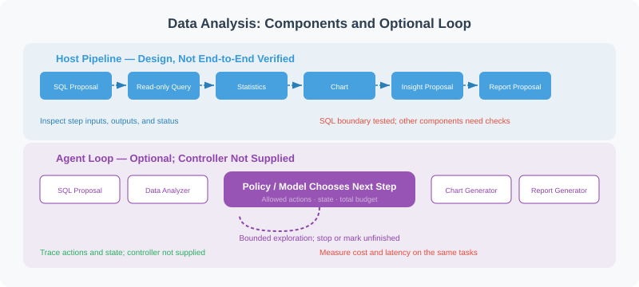
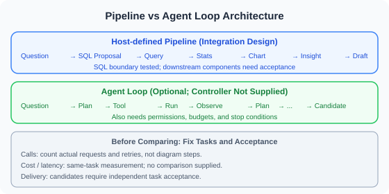

# 22.5 Integrated Design and Runnable Foundation

> **Section goal**: Connect the contracts, acceptance decisions, and failure paths of 22.2–22.4 while distinguishing supplied code from domain components the reader still needs to implement.



`ReadOnlySQLite` and `TextToSQL` from 22.2 are implemented in `reference_code/sqlite_readonly.py`, with real SQLite and fixed-provider tests. Analysis, chart, insight, and report components from 22.3–22.4 still need task-specific modules and acceptance. This section supplies an integration design, not an accepted end-to-end data analysis application.

For a complete small runnable task, start with the local-document project in `reference_code/evidence_assistant/`. `reference-agent/` separately supplies a model tool loop, evaluation, and service foundation. Neither automatically implements the database analysis domain shown here.

## Why start with a host-defined pipeline

The typical task here is “query amounts → calculate statistics → draw a chart → produce a report.” The host can declare these dependencies and request model proposals at designated points. Open exploration may need further queries chosen from intermediate results; an Agent loop with permissions, state, and a total budget can fit that need.



| Consideration | Fixed pipeline | Agent loop |
|---|---|---|
| Who chooses the next step | Host-declared dependency graph | Policy or model within permitted actions |
| Failure diagnosis | Inspect each step's inputs, outputs, and status | Inspect the full action and state trace |
| Budgets | Limits per component and per task | Also requires total calls, time, and result limits |
| Suitable tasks | Analysis with known definitions and deliverables | Exploration that depends on intermediate findings |

No same-task cost or latency comparison was run. Six steps do not establish a fixed model-call count, dollar cost, or advantage over a loop. Retries, model configuration, input size, and acceptance rate affect the outcome.

## Define interfaces and delivery criteria first

| Component | Input → output | Required check |
|---|---|---|
| TextToSQL | Question, reference date, allowed schema → SQL proposal or clarification | Generation proposes; it grants no execution permission |
| ReadOnlySQLite | SQL proposal, bound parameters → bounded rows | Read-only connection, table/function permissions, progress and result limits |
| DataAnalyzer | Query results → statistical summary | Types, missing values, units, sample size, and metric definitions |
| ChartGenerator | Results and chart specification → chart artifact | Axes, units, ordering, paths, and actual values agree |
| InsightGenerator | Question, results, statistics → proposed insights | Separate observations from inference; invent no data |
| ReportGenerator | Existing artifacts → report proposal | Include sources, SQL, time range, units, and missing items |
| Independent task acceptance | Fixed requirements, results, report → accept/reject reason | Model self-review or a saved file cannot establish business correctness |

Resolve dates, metrics, currency, and business timezone before querying; clarify missing definitions. Permission to read a table does not make all rows or columns disclosable to every user. Identity and purpose restrictions belong in the data access layer.

The following is an **integration fragment requiring the stated interfaces**. The caller supplies `analyzer`, `charts`, `insights`, `reports`, and `accept`; complete implementations are not implied. To keep the sequence readable, exceptions go to an outer status manager, and a candidate is not saved as a final report before acceptance:

```python
async def analyze_request(question, *, converter, database, analyzer,
                          charts, insights, reports, accept, as_of):
    sql = await converter.convert(question, as_of=as_of)
    data = database.execute_readonly(sql)
    if not data:
        return {"status": "no_data", "accepted": False}
    stats = analyzer.describe(data)
    chart = charts.auto_chart(data, question)
    observations = await insights.generate_insights(data, stats, question)
    candidate = await reports.generate_report(
        question=question, sql_query=sql, data=data, stats=stats,
        insights=observations, chart_path=chart,
    )
    decision = accept(question, data, stats, candidate)
    if decision is not True:
        return {"status": "needs_revision", "accepted": False}
    return {"status": "accepted", "accepted": True,
            "sql": sql, "report": candidate, "chart": chart}
```

This fragment explains ordering; it does not prove chart, model insight, or verifier correctness. `accept` must check independent task requirements. A production implementation also needs an artifact manifest covering the chart, database version, permissions, and reference date, plus a bounded output directory and candidate cleanup. `lambda *args: True` is not an acceptance implementation.

## Failure, retry, and degradation

| Condition | Action | Permitted delivery |
|---|---|---|
| Unclear metric or time range | Stop and clarify | List unresolved conditions without a definite conclusion |
| Permission denied or query budget exhausted | Stop that query and record the reason | Report failure and unfinished work; do not widen permissions and retry |
| SQL spelling/column error | Supply allowed schema and necessary error within the total proposal budget | Re-execute and recheck the new proposal |
| No rows | Distinguish an empty result, a wrong filter, and missing data | State that the current query is empty; invent no summary |
| Chart generation fails | Record failure; deliver a table only if the task permits | Explicit partial output; a required missing chart leaves the task incomplete |
| Insight/report generation fails | Preserve checked data and the error | Judge partial output by the task contract, not automatic overall success |
| Business result differs from independent expectation | Reject completion and diagnose the metric or query | Keep the failure record and candidate for revision |

A retry controller is a reader extension; current `TextToSQL` makes one model call. Correction context should contain the question, reference date, allowed schema, previous SQL, and necessary error. Treat schema names and errors as data. Every new proposal passes through the same database boundary; “ask the model again” is not a handler for every exception.

## Measure before optimizing

For the same task set, record acceptance rate, actual model requests, input/output tokens, elapsed time, retries, row counts, and failures. Cache keys must include data and permission versions; SQL text alone can wrongly reuse results across users. Invalidation, concurrency, capacity, and candidate cleanup require separate designs.

Do not parallelize dependent steps just to reduce latency. Insights depend on statistics, and the final report depends on insights. Only independent steps with all inputs available can run concurrently, with cancellation, errors, and the total budget retained. No cache implementation or fixed speedup is supplied here.

## Reproduction and exercises

First run the 22.2 practice database and fixed provider with an expected amount total of 300, then execute:

```bash
python -m unittest discover -s reference_code/tests -v
```

This checks the database boundary and proposal interface. An end-to-end analysis/chart/report task still needs a real small dataset, actual components, and acceptance. Database and interface tests do not establish completion of the whole domain application.

1. Fix the task to “sum of order amounts,” expected 300. Change the proposal to `count(*)`: execution should pass while business acceptance fails. Explain the distinct decisions.
2. Make a chart mandatory, then simulate chart failure. Design a status with the missing artifact and reason; report text alone cannot establish completion.
3. Design a retry controller allowing at most three SQL proposals. Identify repairable errors and mandatory stops. Retain the original allowed schema rather than increasing permissions to eliminate an error.

<details>
<summary>Reference points</summary>

The first task checks fields, units, and an independent numeric expectation; valid SQL is not a correct answer. The second preserves completed analysis while marking the overall task incomplete. The third can feed back explicit syntax/column errors; clarification, permission denial, and exhausted budgets stop execution. Failed attempts count, and every new proposal retains database and result limits.

</details>

See [18.8](../chapter_20_evaluation/08_model_routing.md) for model routing comparisons under the same conditions. The next chapter turns to [multimodal Agents](../chapter_25_multimodal/README.md), retaining the delivery pattern of candidate artifacts, host constraints, and independent acceptance.
