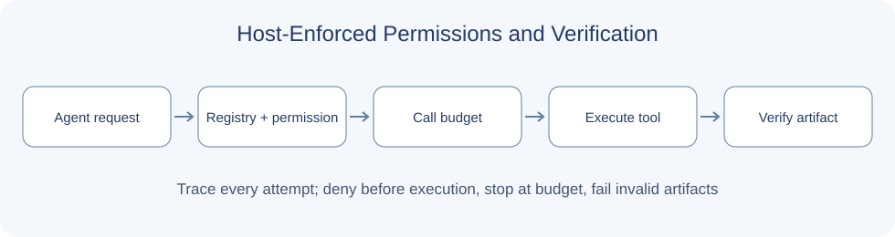

# 8.5 Practice: Building Your First Harness

Enforce tool permissions, call budgets, and artifact verification in the execution path. The complete module is `reference_code/evidence_assistant/harness.py`; run `examples/chapter08/harness_demo.py`.

## Host Enforcement

`Harness.invoke` checks the tool registry, host-supplied permission set, and call budget before executing a function. Denied attempts count toward the budget. External documents and model text cannot change the permission set.



```bash
python examples/chapter08/harness_demo.py
python -m reference_code.evidence_assistant.demo --stage harness
```

```python
from reference_code.evidence_assistant.harness import Harness
harness = Harness({"multiply": lambda a, b: a * b}, frozenset({"multiply"}), max_calls=2)
value = harness.invoke("multiply", {"a": 12, "b": 8})
report = harness.finish(value, lambda actual: actual == 96)
assert report["status"] == "verified"
```

`finish` runs an independent host-provided verifier. A wrong artifact or verifier exception yields `verification_failed`; a completion claim cannot override it.

## Acceptance and Limits

Test that unauthorized functions never execute, denied calls consume budget, exhausted budgets stop execution, and invalid artifacts fail verification. Compare the same fixed tasks before and after integration rather than assuming a predetermined improvement.

The example implements an in-process allowlist, call budget, and verification. Chapter 7 supplies context budgeting. Arbitrary external code requires process or container isolation; temporary directories and keyword filters are not sandboxes. This example does not execute model-generated code. Tests are in `reference_code/evidence_assistant/tests/test_learning_path.py`. Continue to chapters [20](../chapter_20_evaluation/README.md), [21](../chapter_21_security/README.md), and [22](../chapter_22_deployment/README.md) for observability, security, and deployment.
