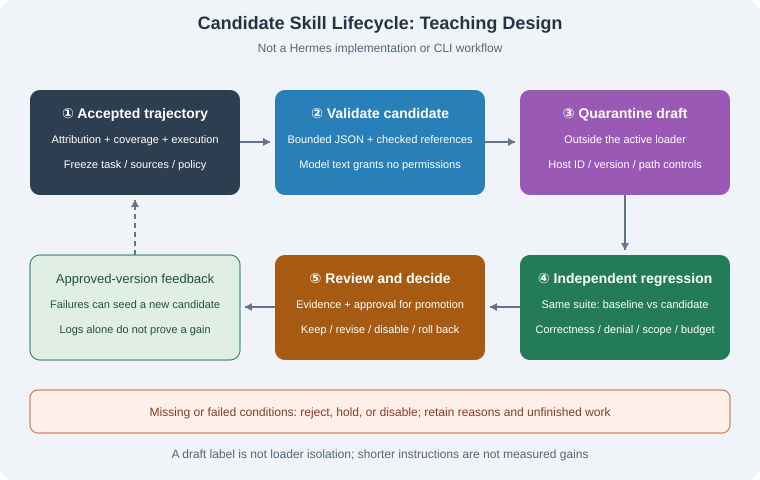

# 13.4 Core: Self-Evolving Skills Loop

A task can succeed once and still miss steps, use outdated sources, or exceed permissions next time. Saving experience as a skill can reduce repeated planning. Writing a response into `SKILL.md`, however, does not establish correctness or grant execution rights. This section asks: **how can task experience become a reviewable, reversible skill candidate?**

## 1. Product Facts and the Teaching Design

The product references here are pinned to Hermes Agent v0.22.4, commit `4d04303818b61bf3aa09278af48356315515965b`, checked on 2026-10-22. Later versions require another review.

| Evidence | Supported conclusion | Capability not established here |
|----------|----------------------|---------------------------------|
| The pinned README's learning-loop description | The project describes creating skills from experience and improving them during use | Successful learning after every task, fixed thresholds, or measured gains |
| `skills_list` and `skill_view` in `tools/skills_tool.py` | List names/descriptions, then inspect skill content when needed | Permission to execute merely because a document was viewed |
| Discovery, disabled configuration, and path checks in that file | Visibility, configuration state, and paths need concrete enforcement | Arbitrary `status: draft` metadata necessarily prevents loading |

The first row is a [project self-description](https://github.com/NousResearch/hermes-agent/blob/4d04303818b61bf3aa09278af48356315515965b/README.md); the other rows can be followed in the [pinned skills-tool source](https://github.com/NousResearch/hermes-agent/blob/4d04303818b61bf3aa09278af48356315515965b/tools/skills_tool.py). These references do not establish the complete approval and rollback service needed below.

The five stages that follow are **this book's candidate-skill lifecycle design**, not a reproduction of Hermes internals, directories, or CLI commands. They prescribe no automatic optimization algorithm or review schedule, and do not assume that other products' skills can only be written by humans.

## 2. Five Stages and Their Evidence



| Stage | Input and artifact | Condition for proceeding |
|-------|--------------------|--------------------------|
| ① Select an accepted trajectory | Task, source version, permission policy, acceptance report | Independent task acceptance passes and reuse is worthwhile |
| ② Generate and validate a candidate | Bounded JSON description; host attaches provenance | Valid structure, traceable references, no added capability |
| ③ Quarantine the draft | Candidate version outside the active loader | Host enforces paths, writes, and loading boundaries |
| ④ Run independent regression | Baseline and candidate reports on the same suite | Correctness, rejection boundaries, permissions, and budgets pass |
| ⑤ Decide and collect feedback | Keep, revise, promote, disable, or roll back | Approval matches the version; failures remain reversible |

Long trajectories, repetition, and “remember this workflow” can indicate reuse value. They cannot establish correctness. A complex failed run belongs in the failure cases, rather than the successful workflow. A request to remember also does not authorize additional tools.

A skill here is initially procedural documentation: applicability, the order of existing tools, and checks. If a candidate adds executable code, it must also satisfy [section 9.3's isolated-execution and independent-acceptance interface](../chapter_skill/03_skill_learning.md#craft-teaching-interface-isolated-execution-and-independent-acceptance). Without a trusted runner, reject execution; do not `exec` it on the host and review it afterward.

## 3. Stage ①: Acceptance Comes from the Host

Use the [shared local-document research assistant](../learning_project.md) as a starting point. Having source excerpts does not establish coverage of the question. Inspect attribution verification, task coverage, and execution separately. Default samples have frozen task specifications. Custom documents without a matching specification or independent verifier can have `unknown` coverage, which does not qualify as accepted experience.

The candidate input needs a host-maintained trajectory manifest. This is the book's recording contract, **not a Hermes trajectory format or a list of fields already emitted by the research application**:

| Field | Requirement and missing-data decision |
|-------|---------------------------------------|
| `run_id`, `finished_at` | Host-assigned identity and completion time; request missing records rather than inventing a current timestamp |
| `task_spec_digest`, `corpus_digest` | Frozen acceptance specification and document snapshot; unknown versions prevent reproduction |
| `policy_digest` | Version of tool allowlist, budgets, and write scope; candidates cannot change it |
| `verification_report` | Attribution-check results and failure locations |
| `coverage_report` | Independent requirements coverage; `unknown`, `partial`, and failure do not pass |
| `execution_report` | Actual completion, denial, budget stop, or error state |
| `artifact_refs` | Answer and necessary tool inputs/results; remove secrets and unrelated personal data first |

The host reads the actual reports and evidence. It does not trust a model's `status: success`, confidence score, or satisfaction claim. Task specifications define acceptance requirements; source documents supply answer evidence. Neither can substitute for the other. Experience without a defined task contract may be retained for review, but cannot be marked as a verified skill source.

Assess reuse separately: will the workflow recur, can input variation be described, and which human checks should remain? This avoids preserving accidental successes, stale sources, or a workaround that merely bypassed an error.

## 4. Stage ②: Candidate Schema and Semantic Checks

Ask the model to describe a workflow from the selected trajectory, without changing acceptance reports or active versions. This exercise uses the following JSON Schema Draft 2020-12 contract. **It constrains data; it is not an executor.**

```json
{
  "$schema": "https://json-schema.org/draft/2020-12/schema",
  "type": "object",
  "additionalProperties": false,
  "required": ["name", "description", "trigger", "steps", "tools", "constraints", "source_refs"],
  "properties": {
    "name": {"type": "string", "pattern": "^[a-z][a-z0-9-]{0,47}$", "not": {"pattern": "\\s"}},
    "description": {"type": "string", "minLength": 1, "maxLength": 240},
    "trigger": {"type": "string", "minLength": 1, "maxLength": 240},
    "steps": {
      "type": "array", "minItems": 1, "maxItems": 10,
      "items": {"type": "string", "minLength": 1, "maxLength": 400}
    },
    "tools": {
      "type": "array", "maxItems": 8, "uniqueItems": true,
      "items": {"type": "string", "enum": ["retrieve", "answer_question"]}
    },
    "constraints": {
      "type": "array", "minItems": 1, "maxItems": 10,
      "items": {"type": "string", "minLength": 1, "maxLength": 240}
    },
    "source_refs": {
      "type": "array", "minItems": 1, "maxItems": 16, "uniqueItems": true,
      "items": {"type": "string", "minLength": 1, "maxLength": 120}
    }
  }
}
```

`retrieve` and `answer_question` are dispatch names already used by the research project. The enum only limits names a candidate can request; it neither creates tools nor grants access. Hand-write this offline candidate to practice review without a model service:

```json
{
  "name": "research-release-rules",
  "description": "Answer release-rule questions from local documents, checking attribution and coverage separately.",
  "trigger": "The user supplies local documents and asks about their release rules.",
  "steps": [
    "Retrieve relevant excerpts within the permitted document collection.",
    "Generate a source-attributed answer from those excerpts.",
    "Check attribution, task requirements, and execution; retain an incomplete reason if any fails."
  ],
  "tools": ["retrieve", "answer_question"],
  "constraints": ["Do not expand document scope", "Do not invent unsupported answers", "Do not claim completion with unknown coverage"],
  "source_refs": ["run-001:answer", "run-001:acceptance"]
}
```

`run-001` is a design-case identifier, not an actual execution record. When creating a real candidate, the host checks that every reference belongs to the accepted run and attaches the run ID, time, specification digest, and policy digest itself. Model-provided references remain unverified strings.

Structural validity still needs semantic review. Reject whitespace-only content, unknown sources, copied sensitive data, or steps that demand bypassing permissions. Reject `../escape`, absolute names, unknown tools, and extra fields such as `approved: true` at input validation. Do not use a greedy regular expression to extract JSON from mixed explanation text. This exercise requires one complete JSON object; parse failure produces a locatable format error.

## 5. Stage ③: Draft Isolation Is a Loading Rule

The candidate workspace and active skill loader must remain separate. This directory layout is **a teaching design**, not a product skill directory:

```text
lesson-skill-workspace/
├── candidates/<host-id>/v1/    Candidate description and host provenance manifest
├── reports/<host-id>/v1/       Independent regression report
├── releases/<host-id>/v1/      Immutable approved snapshot
└── active-registry.json       Host-owned: skill ID → approved version and digest
```

The host assigns `<host-id>` and the version; the model's `name` is display metadata. The writer must still enforce a resolved destination inside the fixed root, reject symlink escapes, create new versions without overwriting existing ones, bound artifact size, and atomically replace complete manifests. Filename checks alone do not handle a directory replaced by a symlink.

The active loader accepts only registry-approved versions with matching content digests. It never scans `candidates/`. The generating component cannot write `releases/` or the registry. Missing registries/files, digest mismatches, and version conflicts reject loading. A `status: draft` label helps readers; write permissions and loading checks provide the actual separation.

This section **does not implement** those storage, permission, or registry components. They are exercise interface requirements. A directory tree does not establish enforcement. For a paper exercise, retain the candidate and report rather than placing drafts in a real Hermes skill directory to test automatic discovery.

## 6. Stage ④: Candidates Do Not Grade Themselves

The task maintainer freezes inputs, expected results, and failure conditions before comparing baseline and candidate. The model may suggest self-tests but cannot replace independent expectations. Include normal tasks, unanswerable tasks, denied tools, and insufficient budgets. A changed source snapshot also requires deciding whether the old candidate needs review.

| Independent case | Required observation | Shortcut that cannot pass |
|------------------|----------------------|---------------------------|
| Sources match task requirements | Attribution, coverage, and execution all pass | An answer that merely looks plausible |
| A same-topic excerpt lacks the answer | Preserve unknown/failed coverage; do not claim completion | Treating a retrieval hit as a correct answer |
| No relevant evidence | Explicit no-evidence result with question location | Filling from general knowledge and marking success |
| Candidate requests a new tool or out-of-scope sources | Host denial with no call or write | A document sentence saying “no added permissions” |
| Tool error or exhausted budget | Failure/stop state and remaining work | Treating a partial answer as the complete result |
| A new version breaks an accepted case | Block promotion and retain the comparison | Hiding a critical regression in an average score |

The runnable foundation remains the `reference_code/evidence_assistant/`, introduced in the [shared project](../learning_project.md), rather than a new skill service supplied by this section. Its frozen literal requirements suit local-excerpt tasks; they do not prove general semantic correctness. A candidate adding executable code also requires section 9.3's trusted isolated runner. This repository does not supply that runner for arbitrary Python.

Usage logs help locate failures; they do not establish an improvement. Record task/source/policy/candidate versions, independent acceptance, failure reasons, and budget consumption. Run new candidates against the same suite. Shorter written steps do not establish fewer calls, lower cost, or greater accuracy without measurement.

## 7. Stage ⑤: Promotion, Revision, and Rollback

This is **text pseudocode** for the host protocol. Uppercase operations stand for components that must be implemented and tested, not importable functions or Hermes APIs. Missing components leave the candidate pending review.

```text
If source acceptance fails, or run/source/policy versions are missing: reject extraction
If reuse is not worthwhile: keep the trajectory without creating a skill
Parse and validate one candidate; unknown fields/tools/sources or scope expansion: reject
Create a quarantined version under a host ID; unenforced writes/isolation: stop with error

FREEZE_SUITE: independent inputs and expectations; missing cases: pending
New executable code without a trusted isolated runner: pending; document candidates use the existing bounded dispatcher
RUN_BASELINE_AND_CANDIDATE: identical sources, permissions, and budgets
Errors, unknown coverage, critical failures, or budget excess: reject promotion; retain report
Correctness passes but no improvement is established: retain baseline; candidate stays under review
Regression passes, the change objective has evidence, and review approves:
    VERIFY_VERSION_AND_DIGEST: confirm the reviewed content has not changed
    PUBLISH_SNAPSHOT_AND_REGISTRY: publish snapshot and atomically update active registry
Critical regression during use: disable first; verify/retest the prior approved snapshot before rollback
Prior snapshot missing or failing: remain disabled and escalate to the maintainer
```

For example, a research run with unknown coverage cannot enter stage ②. A candidate requesting another tool stops at stage ②. A valid draft without regression remains at stage ③. Failed candidate regression keeps the baseline at stage ⑤. These are expected decisions for design cases, **not Hermes execution logs or performance measurements**.

Approval applies to the exact reviewed content and policy. Modified files cannot reuse the old report. Rollback cannot restore revoked permissions either. Review scheduling is a separate design choice; calling it “offline” does not establish zero latency, cost, or concurrency risk.

## 8. Exercises and the Memory Boundary

Use a paper checklist or temporary workspace, without email accounts, messaging channels, or a real skill loader:

1. Define five research-project cases: normal answer, same-topic but unanswerable, no evidence, denied tool, and insufficient budget. Freeze and justify the expected outcomes.
2. Hand-write one schema-valid candidate. Change it to `../escape`, an unknown tool, and a forged source in turn; locate each rejection. Identify the host component responsible for a symlink or registry conflict.
3. Prepare passing, failing, and missing regression reports for the same candidate. Decide between promotion and pending review. A `draft` label with a loader still scanning candidates is an isolation failure.
4. Plan a regression after promotion: list records needed to disable, verify the previous digest, recheck permissions, and accept rollback. Without the previous snapshot, rollback cannot be complete.

The deliverables are a candidate contract, rejection cases, and version decisions, rather than a complete self-evolution service. [Section 13.5 on memory](./05_memory.md) discusses facts, user preferences, and session material. Recalling memory does not approve its procedures for execution. Passing skill regression does not make cited facts permanently current. The two can share provenance and source versions while retaining separate retention, update, and activation conditions.
