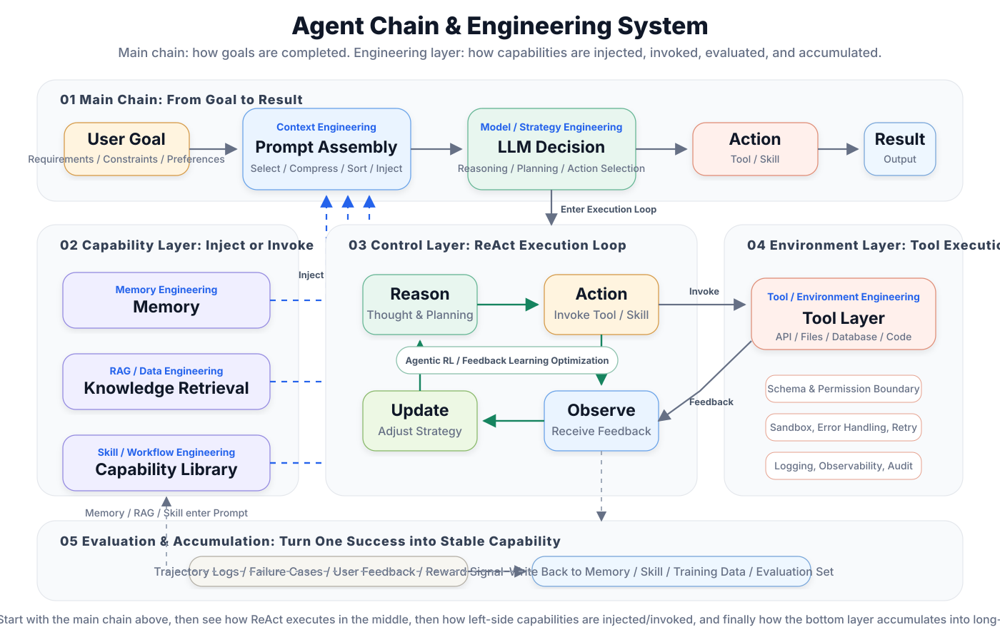
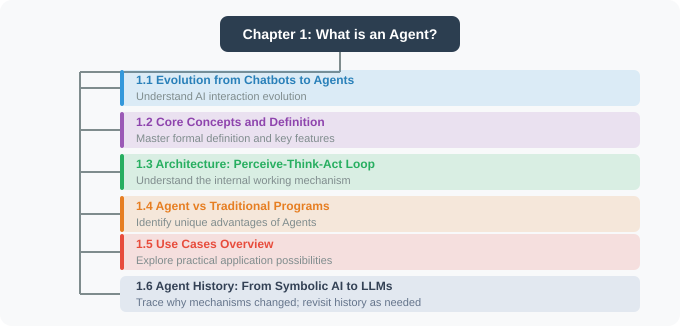
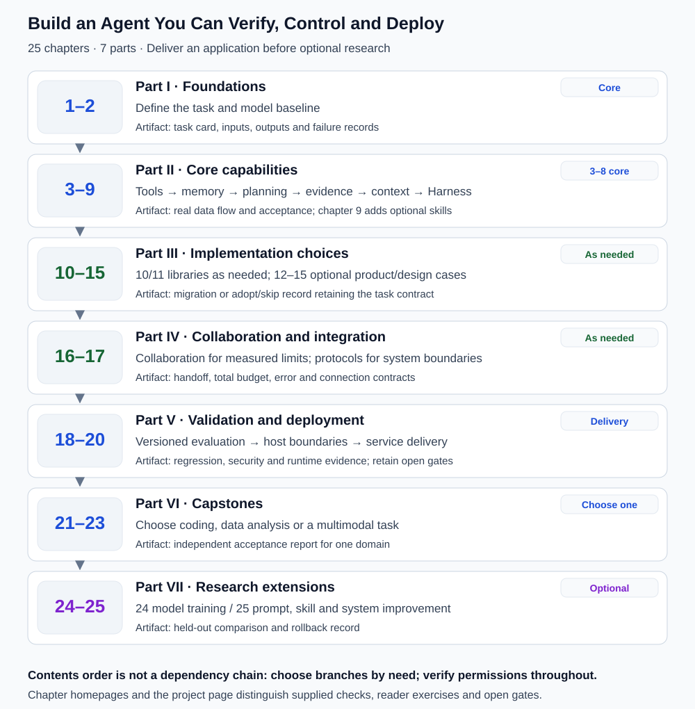

# Chapter 1: What is an Agent?

**Reading level**: Core.

## This chapter's iteration

- **Previous limitation**: A chat reply saying “calculated” or “completed” does not show that the system consulted evidence, executed a calculation, or met the request.
- **This chapter adds**: Write a task card for the foundational exercise: calculate light travel time from the teaching statement `Moon distance is 100 km.`, use the requested seconds or milliseconds, and identify the source. Map the goal, actions, observations, and acceptance. This practices mechanisms for the later local-document research assistant rather than constituting the application.
- **How to verify**: Reader exercise: specify acceptable outcomes and stopping conditions for valid evidence, missing distance, and an unauthorized action request. Deliver the task card and verdict rationale. This chapter supplies no automated grader; a model's completion claim is not evidence.
- **Next step**: Record a model-call baseline in [chapter 2](../chapter_llm/README.md), using [appendix F](../chapter_setup/README.md) for setup. Define what must be verified before adding capabilities.

> 🎯 *"An Agent is not just a chatbot — it is an intelligent entity capable of autonomously perceiving its environment, making decisions, and taking action."*

## Chapter Overview

Welcome to the world of Agent development! In this chapter, we start from the most fundamental concepts to help you build a comprehensive understanding of AI Agents.

If you've used conversational AI like ChatGPT or Claude, you might wonder: "Aren't these Agents?" In fact, there is a fundamental difference. A true Agent doesn't just "talk" — it can "do things." It can use tools, access databases, call APIs, execute code, and even formulate plans and self-correct.

This chapter will help you understand these core differences and lay a solid conceptual foundation for the hands-on development ahead.

The diagram above helps you build a complete Agent intuition: after the user proposes a goal, the system organizes the task, context, memory, knowledge base, and available skills together into a Prompt, which is then fed to the LLM for reasoning and decision-making. The model does not generate a single answer — instead, it advances the task through a `Reason → Action → Observe → Update` loop: first think about the next step, then invoke tools or access files and APIs, then adjust the plan based on external feedback, and iterate until a final result is produced.

Within this loop, `Memory` is responsible for storing long-term preferences, historical decisions, and reusable experiences; `RAG` retrieves reliable materials from documents or knowledge bases; the `Skill Library` captures common task workflows and tool usage patterns. After understanding this diagram, you will more easily see the difference between an Agent and a regular chatbot: a chatbot mainly answers questions, while an Agent continuously completes tasks with goals, tools, and a feedback loop.

## 🎓 Learning Objectives

After completing this chapter, you will be able to:

- ✅ Clearly define what an AI Agent is
- ✅ Understand the evolution of Agents from simple chatbots to complex intelligent entities
- ✅ Master the core architecture of Agents: the Perception-Thinking-Action loop
- ✅ Distinguish the essential differences between Agents, traditional programs, and chatbots
- ✅ Understand typical application scenarios of Agents across various industries
- ✅ Understand the history of intelligent agents, from symbolic AI to the evolution driven by large models

## 📑 Chapter Structure

## ⏱️ Estimated Study Time

Approximately **45–60 minutes** (including thinking exercises)

## 💡 Prerequisites

- No background knowledge in AI or Agents required
- Basic understanding of programming concepts is helpful (but not required)

---

## 🔗 Learning Path

This book has 25 chapters across 7 parts. The application path is task definition → capabilities → implementation choice → verification and deployment → capstone. Training and self-evolution follow applications as optional research. Use the page's left-hand table of contents for chapter order and the [shared project](../learning_project.md) for stage artifacts.

### Three Recommended Routes

Readers from different backgrounds can "skip around" the book along different routes — no need to read linearly from start to finish:

- 🟠 **Concepts and experience**: `1 → 2 → 3 → 8`. Produce a task card and observe tool calls and execution constraints. This short route develops judgment about results and boundaries; it does not constitute application delivery.

- 🔵 **Engineering delivery**: `1–8 → choose from 9–17 → 18–20 → one of 21/22/23`. Chapter 9 covers reuse. Choose chapters 10–11 for integration and state requirements and cases from 12–15 for your setting. Study 16–17 when coordination or external integration solves an identified limitation. Evaluation, safety, and deployment are part of delivery.

- 🟣 **Research improvement**: Complete an application and independent evaluation, then choose `24` for model training or `25` for prompt, skill, and system improvement. Keep the application's regression gates. Neither learning every framework nor training weights is required to improve prompts.

> 💡 **Reading suggestion**: Retain artifacts and acceptance evidence after each addition. Expand scope after the previous stage passes; diagnose a failure in its responsible module instead of adding every technique in sequence.

### Recommended Next Steps

> - 👉 [Chapter 2: LLM Fundamentals](../chapter_llm/README.md) — Understand the Agent's "brain"
> - 👉 [Appendix F: Development Environment Setup](../chapter_setup/README.md) — Set up tools and start building

---

*Ready? Let's start with the history and origins of Agents…*
