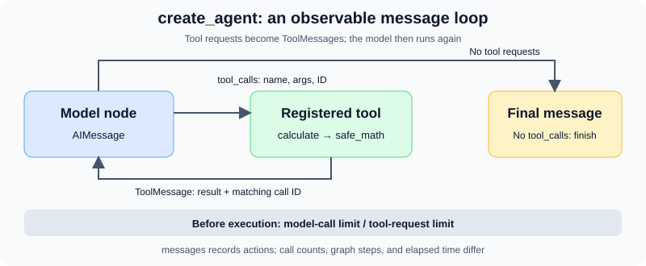

# 10.3 Building Agents with LangChain

The earlier minimal loop can already call tools. This section reduces model, message, and tool adapters while retaining inspectable calls and stopping conditions. The verified environment uses **LangChain 1.4.6, langchain-core 1.6.12, and LangGraph 1.2.16**; installation dependencies are in `examples/requirements.txt`. See the official [LangChain 1.4.6 release](https://github.com/langchain-ai/langchain/releases/tag/langchain%3D%3D1.4.6).

Use `from langchain.agents import create_agent`. It builds a model/tool message loop on the LangGraph runtime. You can complete a single-Agent task through this interface and study chapter 11 when custom state, routing, or recovery becomes useful. See the official [Agents documentation](https://docs.langchain.com/oss/python/langchain/agents).

## Run the Framework with a Fixed Model

After installing the companion dependencies, run from the repository root:

```bash
python -m examples.chapter12.first_agent
```

The directory retains its historical name `chapter12`; this is now chapter 10. The default input is `sqrt(144) + 2 * 3`. Expect `tool_results[0].value=18.0`, `model_calls=2`, `tool_calls=1`, and mode `offline-fixture`.

This executes actual LangChain tool binding, message handling, tool execution, and middleware. `FixedToolChatModel` in `examples/framework_fixture.py` replaces model generation: it first sends the raw user input to the calculator, then echoes the returned tool message. It does not interpret arbitrary language or request an online model, search, or weather service. The calculator actually computes the result.

## Four Interfaces to Inspect

| Interface | Role in this example | Application responsibility |
|---|---|---|
| `@tool` | Build a description and parameter Schema from annotations and a docstring | Allowed operations, input checks, and failures |
| `create_agent` | Connect a model, tools, and middleware | Model choice and exposed tools |
| `messages` | Retain user input, model tool requests, and tool results | History selection and persistence across invocations |
| Call-limit middleware | Bound model and tool requests per invocation | Time, cost, permissions, and independent acceptance |



The only tool is `calculate`, defined in `examples/framework_fixture.py`. It reuses `examples/chapter03/safe_math.py`, which interprets allowed AST nodes, operators, and math functions under expression-length, node-count, exponent, and numeric bounds. It returns `status=ok` with a value, or `status=invalid_expression` with a reason. It cannot execute Python statements. Fact lookup requires a separate source-backed tool.

The docstring becomes a model-visible tool description, and `expression: str` becomes part of the parameter Schema. Clear descriptions help selection; permissions and input checks still belong at execution boundaries. Start with `@tool`. When a custom tool class is necessary, implement its input model and execution methods completely.

## Connect and Observe the Loop

This uses the same interfaces as the companion and runs from the repository root:

```python
import json
from langchain.agents import create_agent
from langchain.agents.middleware import ModelCallLimitMiddleware, ToolCallLimitMiddleware
from examples.framework_fixture import FixedToolChatModel, calculate

agent = create_agent(
    model=FixedToolChatModel(),
    tools=[calculate],
    system_prompt="Use calculate for arithmetic. Report rejected input as a failure.",
    middleware=[
        ModelCallLimitMiddleware(run_limit=3, exit_behavior="error"),
        ToolCallLimitMiddleware(run_limit=2, exit_behavior="error"),
    ],
)
result = agent.invoke(
    {"messages": [{"role": "user", "content": "sqrt(144) + 2 * 3"}]},
    config={"recursion_limit": 16},
)
messages = result["messages"]
print([message.type for message in messages])  # human, ai, tool, ai
print(json.loads(messages[2].content)["value"])  # 18.0
assert messages[2].tool_call_id == messages[1].tool_calls[0]["id"]
```

Inspect the first `AIMessage.tool_calls`: it contains a name, arguments, and a call ID. Tool execution produces a `ToolMessage` with the same ID and appends the result to the messages. The model runs again; a response without tool requests ends the loop. These are observable actions and results, not a complete display of the model's internal reasoning.

The companion's `run()` returns execution status, actual tool results, and call counts. Rejected arithmetic produces `incomplete`. Model/tool limits or graph step exhaustion produce `budget_exhausted`, with a nonzero CLI exit code. `completed` describes this example's execution and tool-result checks; `verification_scope` explicitly leaves independent task acceptance to the application.

## Test Rejection and Exhaustion Separately

```bash
python -m examples.chapter12.first_agent --expression '__import__("os").getcwd()'
python -m examples.chapter12.first_agent --expression '1 / 0'
python -m examples.chapter12.first_agent --max-model-calls 1
python -m pytest examples/integration_tests/test_first_langchain_agent.py -q
```

The first two return `invalid_expression` without an invented numeric result. The third allows the first model call and its tool execution but blocks the second model call needed for the final response, returning `budget_exhausted`. Tests also inject a model that keeps requesting tools, proving that the over-budget call never reaches the calculator. An unregistered tool cannot become a successful result. Outbound sockets are blocked during these tests.

| Limit | Example configuration | What it measures |
|---|---|---|
| Model calls | `ModelCallLimitMiddleware(run_limit=3)` | Model calls within one `invoke` |
| Tool requests | `ToolCallLimitMiddleware(run_limit=2)` | Requests across all tools within one invocation; exhaustion raises an error |
| Graph steps | `recursion_limit=16` | Graph scheduling steps, not a tool-call count |
| Calculator input | `safe_math` bounds | Length, complexity, and numeric range of one expression |

Both middleware use `exit_behavior="error"`, so a limit message cannot be mistaken for normal completion. See the official [prebuilt middleware reference](https://docs.langchain.com/oss/python/langchain/middleware/built-in). Call limits provide no total elapsed-time guarantee and do not isolate arbitrary external code. Persistent state, business permissions, and process timeouts need their own controls.

## Make Live Generation an Explicit Extension

```bash
python -m examples.chapter12.first_agent --real --model gpt-4.1-mini
```

Only `--real` creates `ChatOpenAI` and accesses the configured model service, requiring valid credentials. SDK requests use a 30-second timeout and at most one retry; this does not impose a 30-second deadline on the entire task. Evaluate live-model tool selection, arguments, final-answer accuracy, and cost with a separate task set. The offline tests establish none of those quality measures.

Keep the normal message sequence, one rejected input, and one exhausted-budget record. Continue using `create_agent` when its interfaces meet the task. Move to [chapter 11](../chapter_langgraph/README.md) when you need to define state and routing yourself. Next, [10.4 LCEL](./04_lcel.md) introduces composable data-processing flows.
