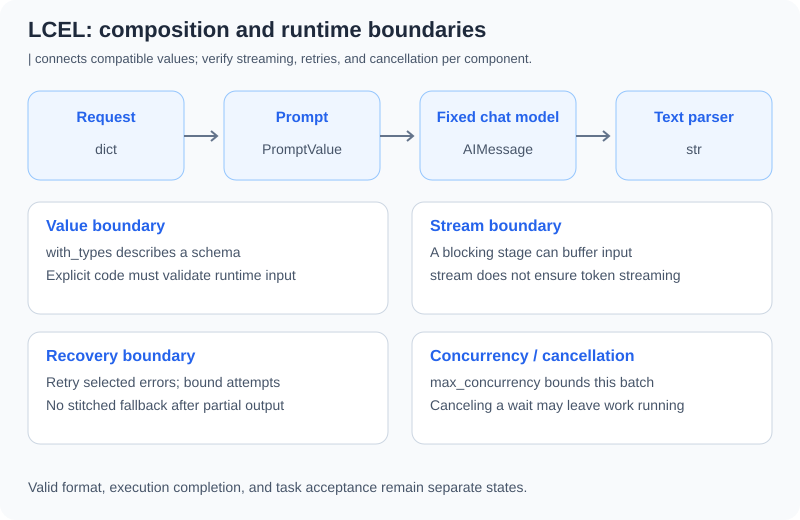

# 10.4 LCEL: LangChain Expression Language

Section 10.2 already used branching and parallel composition. Here we inspect the resulting contracts: values crossing boundaries, runtime validation versus type descriptions, incremental output, and retryable failures. See [10.1](./01_langchain_overview.md) for versions and the offline entry point.



## Interface Compatibility and Runtime Validation Differ

`|` creates a Runnable composition; it does not prove that adjacent functions accept each other's values. Feeding `RunnableLambda(lambda _: {"value": 3})` to a function using `.upper()` fails at runtime. Specify fields, units, and error states rather than relying on the chain's name.

`with_types` supplies schema/type information; it does not establish that every input passed Pydantic validation. In the pinned version, this still returns the original string:

```python
from langchain_core.runnables import RunnableLambda
from langsmith import tracing_context
from reference_code.langchain_patterns import PolicyAnswer

typed = RunnableLambda(lambda value: value).with_types(input_type=PolicyAnswer)
with tracing_context(enabled=False):
    result = typed.invoke("not a PolicyAnswer")
assert result == "not a PolicyAnswer"
```

Invoke validators explicitly for validated inputs. Put parsing and validation into the output chain when required. Valid fields alone do not establish factual correctness.

## Complete JSON, Structure, and Task Requirements

The companion `PolicyAnswer` freezes a tiny exercise contract: a nonblank answer, integer seven-day value, source `fixture-policy-v1`, and no extra fields. `build_structured_chain` first uses standard JSON parsing to require **one complete object**, without duplicate fields or non-finite constants, then uses `PydanticOutputParser`. Tolerant repair of truncated JSON is not treated as contract acceptance.

```python
from langsmith import tracing_context
from reference_code.langchain_patterns import FIXTURE_ANSWER, build_structured_chain

with tracing_context(enabled=False):
    result = build_structured_chain().invoke({"fact": FIXTURE_ANSWER, "question": "refund"})
assert result.policy_days == 7
assert result.source == "fixture-policy-v1"
print(result.model_dump())
```

Change `policy_days` to 30 or `source` to an unknown ID, or supply a whitespace answer, an extra `approved` field, or truncated JSON. Companion tests require rejection; asking the model again does not establish a fix. Seven days is a separately frozen exercise requirement, not a value to impose on every business. More general semantic adequacy still requires independent acceptance.

## A Streaming Interface Does Not Guarantee Token Streaming

```python
from langchain_core.runnables import RunnableLambda
from langsmith import tracing_context
from reference_code.langchain_patterns import build_answer_chain

with tracing_context(enabled=False):
    incremental = list(build_answer_chain("abc").stream({"fact": "fixture", "question": "x"}))
    buffered = list(RunnableLambda(lambda _: "whole value").stream("fixture"))
assert incremental == ["a", "b", "c"]
assert buffered == ["whole value"]
```

The fixed chat model emits the characters of `abc`; the ordinary Lambda returns a whole string. Real providers can use different chunk sizes, tool calls, or structured fragments. The [RunnableSequence reference](https://reference.langchain.com/python/langchain-core/runnables/base/RunnableSequence) explains how blocking components delay downstream streaming. Validation requiring complete JSON may buffer it too. An unaccepted half-object is not a final result.

## Retry Less Than the Whole Business Workflow

This retries a fixed action with no external side effects. It succeeds after one `TimeoutError`, with at most three attempts. Waiting is disabled to make the offline exercise quick:

```python
from langchain_core.runnables import RunnableLambda
from langsmith import tracing_context

attempts = {"count": 0}
def transient(value):
    attempts["count"] += 1
    if attempts["count"] == 1:
        raise TimeoutError("fixed transient failure")
    return value

retry = RunnableLambda(transient).with_retry(
    retry_if_exception_type=(TimeoutError,), stop_after_attempt=3,
    wait_exponential_jitter=False,
)
with tracing_context(enabled=False):
    assert retry.invoke("fixture-ok") == "fixture-ok"
assert attempts["count"] == 2
```

`retry_if_exception_type` limits eligible exceptions. Input validation, permission denial, and failed task acceptance are not all transient transport errors. Online backoff also needs jitter, deadlines, and provider-specific rules. Count the combined SDK, Runnable, and task-level attempts. A timed-out write requires idempotency or an outcome lookup rather than blind replay.

`with_fallbacks` tries alternatives on selected exceptions; it cannot guarantee availability. Alternatives may fail, and emitted stream content cannot be retracted. See [10.8](./08_production_patterns.md) for tested failures before/after the first chunk and the [official fallback reference](https://reference.langchain.com/python/langchain-core/runnables/base/Runnable/with_fallbacks) for parameters.

## Next Step and Exercise

Composition, branches, and parallel work can remain in LCEL. Evaluate [LangGraph](../chapter_langgraph/README.md) for persistent state, pause/resume, or explicit graph nodes. One condition alone does not require another state lifecycle.

Exercise: retain an interface-present/type-incompatible failure, a rejected truncated JSON response, and a non-retryable `ValueError`. Record failure locations and attempt counts, rather than only the last text.

*Previous: [10.3 LangChain Agents](./03_langchain_agents.md)*

*Next: [10.5 Customer-Service Agent](./05_practice_customer_service.md)*
