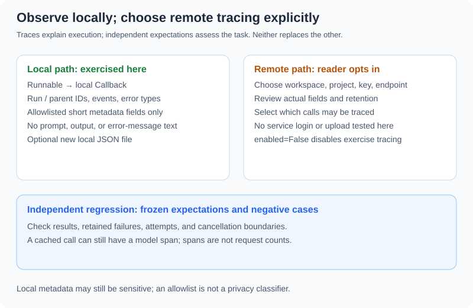

# 10.6 LangSmith Integration and Observability

Begin with local questions: what started, what failed, and which input satisfied acceptance? Then consider voluntarily sending selected data to LangSmith. Versions follow [10.1](./01_langchain_overview.md). No service login, remote dataset creation, or trace upload was performed here.

## Traces, Evaluation, and Task Completion Differ

The [LangSmith quickstart](https://docs.langchain.com/langsmith/observability-quickstart) introduces execution traces and their inspection. A trace shows calls and errors, not undisclosed model reasoning. A terminal run event alone does not establish business completion.



| Record | Question it answers | What it cannot replace |
|---|---|---|
| Lifecycle trace | Which steps started, ended, or failed; which calls are related? | Independent answer acceptance |
| Usage and timing | What usage did the provider return; how long did requests/waits take? | Invented token bills or unmeasured prices |
| Regression report | Do frozen inputs still meet independent expectations? | Impressions from selected successful examples |
| Prompt version | Which template, model, and source versions ran? | Keeping only the latest template |

Cache hits can still produce model lifecycle callbacks. The chapter's test makes four `invoke` calls and records four model-start events while its fixed provider generates only three times. Span counts are not network-request counts. Real usage can be absent, and cost depends on model, billing rules, and cache type; missing data remains unknown.

## Record Local Callbacks First

`LocalTrace` in the companion `local_trace.py` uses real `BaseCallbackHandler` hooks for chain/chat-model starts, ends, errors, run IDs, and parent IDs. It retains only caller-selected short `case_id`/`app_version` strings, without prompt/output text or exception messages.

```python
import json
from langsmith import tracing_context
from reference_code.langchain_patterns import LocalTrace, build_answer_chain

trace = LocalTrace()
with tracing_context(enabled=False):
    answer = build_answer_chain().invoke(
        {"fact": "private-fixture-input", "question": "private-fixture-question"},
        config={"callbacks": [trace], "metadata": {"case_id": "case-1", "app_version": "v1"}},
    )
assert any(item["parent_run_id"] for item in trace.events)
assert "private-fixture-input" not in json.dumps(trace.events)
print({"events": len(trace.events), "dropped": trace.dropped})
```

This fixed chain currently produces eight local events. The recorder has a capacity limit and a `dropped` counter: missing events must not be presented as a complete trace. It supplies no tool events, token accounting, wall-clock metrics, or durable storage. Follow tool execution in [10.3](./03_langchain_agents.md) and [10.5](./05_practice_customer_service.md).

To save this local record in a new file:

```bash
python -m reference_code.langchain_patterns --trace-file /tmp/lc-pattern-trace.json
```

The path must not exist; existing files are not overwritten. Nothing is uploaded to LangSmith. A metadata allowlist is not a privacy classifier: callers must still avoid putting secrets into supposed identifiers.

## Preserve Independent Local Expectations

Freeze the following inputs and expectations before running the target. The second question must ask for clarification; producing text does not mean it was answered:

```python
from langsmith import tracing_context
from reference_code.langchain_patterns import build_intake_flow, FIXTURE_ANSWER

cases = [
    ({"question": "refund policy?"}, "policy", FIXTURE_ANSWER),
    ({"question": "unsupported fixture"}, "unsupported", "Unsupported fixture question; clarify the task."),
]
with tracing_context(enabled=False):
    actual = build_intake_flow().batch([case[0] for case in cases])
checks = [row["intent"] == intent and row["answer"] == answer
          for row, (_, intent, answer) in zip(actual, cases)]
assert checks == [True, True]
print({"passed": sum(checks), "total": len(checks)})
```

This checks the exercise's English rule and fixed response, not general intent or factual quality. Real customer service needs owner-denial, rejected-write, tool-error, and unknown-question cases. Candidate answers cannot rewrite expectations. The repository tests offer a reviewable local alternative requiring no service account.

Prompt management can also start locally. Associate template files, model/SDK versions, source/permission versions, the case suite, and its report with a change. Compare prompts on the same tasks and sampling configuration. Longer or shorter output does not itself establish improvement. Remote Hub pulls/pushes and experiment writes are separate service operations and were not run here.

## Define Data Scope Before Opting into LangSmith

If shared tracing is needed, follow the [official configuration guide](https://docs.langchain.com/langsmith/trace-without-env-vars) for the account, destination, and project. These are optional settings, not an environment file required by this chapter:

```text
LANGSMITH_TRACING=true
LANGSMITH_PROJECT=book-fixture-staging
LANGSMITH_API_KEY=<configure locally through secret management; never commit it>
LANGSMITH_ENDPOINT=<the actual selected regional or self-hosted endpoint>
```

Explicitly select upload-eligible runs and start with fictional fixtures. A project name groups traces; it is not a tenant-authorization boundary. Check recipients, retention, access, and deletion in the actual service configuration.

| Data | Decision before enabling |
|---|---|
| User messages, history, model output | Whether they may be sent; what must be excluded or explicitly masked |
| Tool arguments/results | Whether they contain paths, customer IDs, database rows, or credentials |
| Errors/metadata | Whether they indirectly copy user input or secrets |
| Evaluation cases/prompts | Whether remote copies are allowed and who can change/delete them |

`config={"callbacks": []}` does not mean all environment-enabled remote tracing is disabled. Examples use `with tracing_context(enabled=False)` for this scope, following [programmatic configuration](https://docs.langchain.com/langsmith/trace-without-env-vars), while retaining explicitly supplied local callbacks. Other SDK wrappers, log destinations, and explicit Client operations require separate inspection.

## Verification and Exercise

Run `python -m unittest examples.integration_tests.test_langchain_chapter -v`. Cases cover callback parent relationships, error types, omitted input/output text in this recorder, file creation, and capacity. Network entry points are intercepted and zero requests required. Remote access rights and retention policies were not tested.

Exercise: raise a `ValueError` containing fictional sensitive text. Confirm that the local record stores the type rather than its message. Set capacity to one and observe a nonzero `dropped` value. Deliver both an error trace and an independent task report, explaining why neither substitutes for the other.

*Previous: [10.5 Customer-Service Agent](./05_practice_customer_service.md)*

*Next: [10.7 LangChain Ecosystem 2026](./07_langchain_ecosystem_2026.md)*
