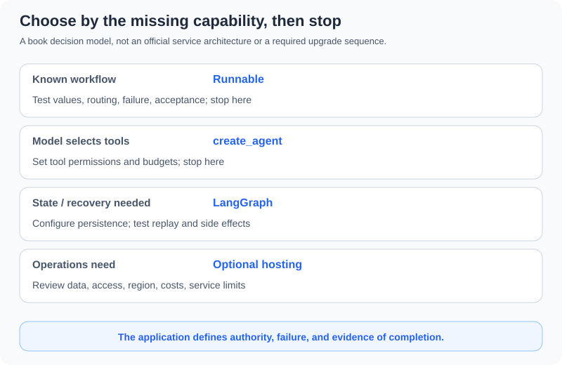

# 10.7 LangChain Ecosystem 2026

Product names are not a learning sequence. Start with what the existing application lacks, separating component composition, state execution, Harness capabilities, and deployment services. Stop at an accepted version when there is no gap. A local question-answering task need not become a managed platform project.

## Reproduction Boundary and Source Date

See [10.1](./01_langchain_overview.md) for tested local versions. Product documentation was also checked on 2026-10-22. Online pages change; their new APIs cannot all be attributed to `langchain==1.4.6`. Deep Agents, MCP adapters, LangServe, and deployment SDKs were not installed or tested for service interoperability here.

| Layer | Entry | Question before adopting |
|---|---|---|
| Components/basic tool Agent | [LangChain](https://docs.langchain.com/oss/python/langchain/overview) | Do Runnable composition or `create_agent` meet the task? |
| Explicit state orchestration | [LangGraph](../chapter_langgraph/README.md) | Do you need state control, checkpoints, suspension, and recovery? |
| Preassembled Harness | [Deep Agents](https://docs.langchain.com/oss/python/deepagents/overview) | Do you need combined file/planning/delegation capabilities and can you constrain them? |
| Observation/deployment services | [LangSmith Deployment](https://docs.langchain.com/langsmith/deployment) | Are services, accounts, operational data, and responsibilities justified? |
| External tool protocol | [LangChain MCP guide](https://docs.langchain.com/oss/python/langchain/mcp) | How are provenance, session lifetimes, parameters, and execution rights checked? |
| Existing HTTP wrappers | [LangServe repository](https://github.com/langchain-ai/langserve) | Are the existing project's versions, security interface, and client compatible? |

The [official overview](https://docs.langchain.com/oss/python/langchain/overview) distinguishes basic Agents from lower-level orchestration. `create_agent` does not require writing your own graph. Runnable branching does not require managed deployment. Add a case that exposes the missing capability before adopting another component.

## Three Concrete Stopping Points



| Task | Smallest initial path | Continue only when |
|---|---|---|
| Fixed inputs/steps and a few independent branches | Runnable flow in 10.2/10.4 | State or recovery points need explicit management |
| Model-selected tools | `create_agent` in 10.3/10.5, with host permissions/budgets | Custom graph nodes, durable checkpoints, or human suspension are required |
| Work spanning requests, restarts, or review | Explicit state/persistence design in Chapter 11 | Operational needs justify a service; test recovery first |

The diagram is this book's responsibility model, not a claim about a fixed internal “State Server.” Durable work requires suitable storage, configuration, and recovery tests. A compiled graph establishes neither restart recovery nor exactly-once side effects.

## Check Entry Points Without a Request

```python
from langchain.agents import create_agent
from langchain_core.runnables import RunnableBranch
from langchain_openai import ChatOpenAI

assert callable(create_agent) and callable(RunnableBranch)
model = ChatOpenAI(model="gpt-4.1-mini", api_key="not-a-real-key", timeout=1, max_retries=0)
assert model.model_name == "gpt-4.1-mini"
# Construction only; no invoke, login, or model request.
```

The invalid placeholder key is used only to construct the adapter. No model is invoked. For actual requests, use the explicit `--real` path from 10.3 with separate configuration. Scripted offline responses do not establish live-model quality. Installing additional provider packages also does not establish identical tool-selection or structured-output capabilities.

### Migrate Contracts Before Names

The [v1 material](https://docs.langchain.com/oss/python/releases/langchain-v1) describes the simplified namespace and `create_agent`. Reproduce legacy `LLMChain`/`AgentExecutor` examples in their original environment; the `langchain-classic` compatibility layer was not tested here.

| Existing concern | Current chapter path | Migration acceptance |
|---|---|---|
| Prompt/model sequence | `prompt | model | parser` | Preserve input fields, message roles, and output expectations |
| Tool Agent loop | `create_agent` | Check actual tools, denial, termination, and budget failures |
| Explicit state workflow | LangGraph when needed | Check state updates, repeated runs, recovery, and side effects |
| Callbacks/traces | Local callbacks in 10.6; opt into services separately | Neither an old `output` field nor empty callbacks is a universal contract |

Migration is not a global class-name replacement. Descriptions, tool arguments, result messages, errors, and budget semantics may change. Run the same cases with a fixed provider before testing live models. If only orchestration needs changing, there is no requirement to change models, data, and permissions simultaneously.

## Harness and Hosting Still Leave Application Responsibilities

The [Deep Agents overview](https://docs.langchain.com/oss/python/deepagents/overview) describes combined Agent capabilities in a Harness. Match each capability to a requirement and execution boundary. Filesystem/delegation features expand resource access; they do not automatically improve every task.

[LangSmith Deployment](https://docs.langchain.com/langsmith/deployment) separates deployment runtime from observability and lists deployment locations. Managed Deep Agents offers a separate hosted path for Deep Agents. No publishing API, network configuration, price, or SLA was tested here. Accordingly, there is no purported one-command deployment that establishes authentication, recovery, and scaling. Business tools, data authorization, and acceptance remain application responsibilities.

MCP is not execution authorization either. Discovering a tool does not grant permission to run it. Keep the client session alive while tools use it. See [17.5](../chapter_19_protocol/05_practice_mcp_integration.md) for protocol boundaries and the runnable teaching subset, rather than reusing a session after its context has closed.

## Selection Exercise

Write two records for one customer-service task: an order query adequately served by 10.5, and a task that actually needs cross-process recovery. Specify the fixed task, missing capability, smallest addition, negative cases, and stopping condition. Keep the simpler version when no new need is demonstrated; a product's existence is not evidence for upgrading.

Deliver a choice table and matching acceptance commands. Service registration and public deployment are not required. Continue to [10.8](./08_production_patterns.md) for production boundaries, or Chapter 11 for more demanding state workflows.

*Previous: [10.6 LangSmith and Observability](./06_langsmith_integration.md)*

*Next: [10.8 Production Patterns](./08_production_patterns.md)*
