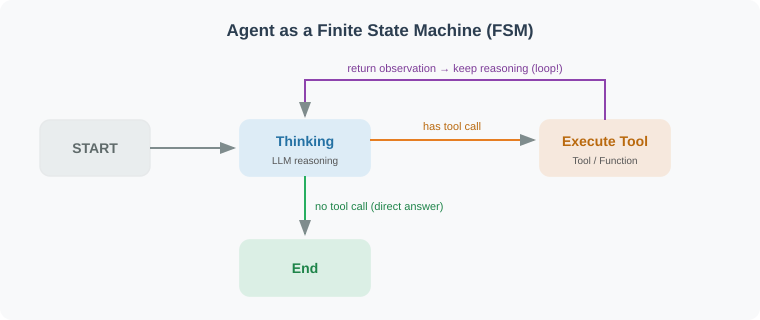

# 11.1 Why Graph Structures?

> **Section Goal**: Compare a minimal linear example with an explicit state model and decide whether graph orchestration helps the current task.

The `A | B | C` example below contains fixed composition without branching, looping, or recovery rules. Tasks that move between failure, confirmation, and resumption need explicit lifecycle design. A graph is one representation; handwritten loops, state machines, and other orchestration implementations are also valid. Consider LangGraph according to lifecycle complexity and maintenance cost.

---

## Theoretical Background: Finite State Machines and Graph Computing

Finite state machines and graph computing provide useful models for understanding this control flow. They do not establish that every Agent needs the same implementation.

### Finite State Machines (FSM)

For control-flow analysis, execution phases can be abstracted as a **finite state machine**, with transitions between a finite set of phases based on inputs and conditions [1]. This does not imply that model outputs, memory, and task data have only finitely many values:



In the FSM model:
- **State**: the current phase the Agent is in (e.g., "thinking," "executing tool," "waiting for human approval")
- **Transition**: a conditional jump from one state to another
- **Action**: the operation performed during a state transition (e.g., calling LLM, executing a tool)

In this example, `TypedDict` describes shared data, Nodes process it and return updates, and Edges describe execution paths. Control phases and shared data are distinct concepts. Recording them explicitly makes branches, stopping, and recovery easier to test.

### Academic Roots of Graph Computing in AI Agents

Graph structures have deep academic foundations in the AI Agent field:

| Academic Field | Graph Application | Connection to LangGraph |
|---------------|-------------------|------------------------|
| **Behavior Trees** (Robotics) [2] | Hierarchical nodes express decisions | Conditional selection is a useful analogy; execution semantics still need separate examination |
| **Dataflow Programming** | Dependencies express how data is consumed | Inspect node inputs and outputs without equating shared state with tensor passing |
| **Workflow Orchestration** (BPM) | Dependencies, retries, and lifecycle are explicit | Compare loop, recovery, and side-effect requirements instead of graph shape alone |
| **Rules and Cognitive Architectures** | Conditions select subsequent actions | Useful for reasoning about routing, without treating the implementations as identical |

> A directed graph may contain cycles; a DAG does not. Repeated ReAct steps can be represented with a back edge or implemented with an ordinary program loop. This section uses the former representation, without concluding that other orchestration systems cannot perform the same task.

---

## Real-World Business Scenario Analysis

Consider tasks with branching, retries, and confirmation. Their execution and stop conditions need to be inspectable, but no particular graph library is mandatory. Compare graph orchestration when handwritten control flow becomes costly or lifecycle requirements such as recovery, parallel aggregation, and approval increase.

### Scenario 1: Multi-Turn Dialogue for Intelligent Customer Service

```
User: "I want to return an item"
  → Identify intent: return
  → Query order status
    → If shipped → follow return process
    → If not shipped → cancel directly
    → If past return window → escalate to human agent
  → Execute operation
  → Confirm result
  → If user is unsatisfied → back to "understand intent" for reprocessing
```

This scenario needs branching, bounded retries, and escalation state. The minimal fixed sequence below has not defined those rules; they can be implemented through explicit control logic or a graph.

### Scenario 2: Code Review Agent

```
Submit code → Static analysis → LLM review
  → If security issue found → Deep security analysis → Generate fix suggestions
  → If performance issue found → Performance analysis → Optimization suggestions
  → If no issues → Pass review
  → All analysis results → Summary report
  → Human review → Approve/Reject
```

This scenario requires: parallel branching (security and performance analyzed simultaneously), dynamic routing (different paths by issue type), and merging (combining analysis results).

### Scenario 3: Data Analysis Agent (Chapter 22 of this book)

```
Natural language question → Understand intent → Generate SQL
  → SQL safety check
    → If unsafe → Regenerate SQL (loop)
    → If safe → Execute query
  → Analyze data → Generate charts → Generate insights → Output report
  → If user asks follow-up → Back to "understand intent"
```

These scenarios choose subsequent actions from intermediate results. An explicit graph makes those paths visible; handwritten loops and state machines can express the rules as well. Compare how easily each implementation can be tested, observed, and resumed.

---

## What This Minimal Linear Example Does Not Express

```python
# Minimal LCEL composition: fixed sequence A → B → C
chain = step_a | step_b | step_c

# Not defined in this snippet:
# 1. Looping: when to retry Step B and when to stop
# 2. Branching: choose B or C from Step A's result
# 3. Parallel aggregation: run B and C, then merge at D
# 4. Cross-request state: what to save and how to resume
```

**A concrete example**: suppose you're building a code review Agent:

```python
# Three composed steps without additional routing or retry logic
review_chain = analyze_code | find_issues | suggest_fix

# Problem scenarios:
# 1. If analyze_code finds the code file is too large → need to split first, then analyze in segments
#    Define splitting and re-entry into analysis separately
# 2. If find_issues discovers a security vulnerability → need an extra security analysis step
#    Define the security condition and subsequent path separately
# 3. If suggest_fix's fix suggestions introduce new problems → need to re-review
#    Define re-review and a total budget separately
```

---

## Expressing the Requirements with an Explicit State Model


The comparison is between the minimal fixed composition above and an explicit graph design, rather than the full capabilities of LCEL and LangGraph:

| Requirement | Minimal `A → B → C` example | Explicit graph design |
|---|---|---|
| Execution paths | Fixed order only | Paths recorded as nodes and edges |
| Loops and stopping | Not defined | Back edges with counts, budgets, and termination reasons |
| Branching | Not defined | Select an edge from state |
| Runtime data | Values passed between steps | Explicit shared state and update rules |
| Human confirmation | Not defined | Design confirmation, authorization, and waiting state |
| Recovery across processes | Not defined | Configure durable storage and recovery rules, then test them |
| Parallel aggregation | Not defined | Define dependencies, merging, and conflict handling |

---

Python conditions, loops, state objects, and other composition mechanisms can implement these rules too. A graph centralizes complex paths and lifecycle design; permissions, budgets, and independent acceptance still require implementation.

## LangGraph's Core Design

LangGraph's design revolves around three core concepts: **State**, **Node**, and **Edge**.

```python
# pip install langgraph

from langgraph.graph import StateGraph, END, START
from typing import TypedDict, Annotated
import operator

# 1. Define State: data shared by all nodes in the graph
class AgentState(TypedDict):
    messages: list        # Message history
    current_task: str     # Current task
    iterations: int       # Loop count (prevent infinite loops)
    final_answer: str     # Final answer

# 2. Define Nodes: each node is a function that receives state and returns updates
def process_input(state: AgentState) -> AgentState:
    """Node function: process input"""
    print(f"Processing: {state['current_task']}")
    return {"iterations": state.get("iterations", 0) + 1}

# 3. Define Edges: connections between nodes (can be conditional edges)
def should_continue(state: AgentState) -> str:
    """Conditional edge: returns the name of the next node"""
    if state.get("final_answer"):
        return "end"
    elif state.get("iterations", 0) >= 5:
        return "end"  # Prevent infinite loops
    else:
        return "continue"

# 4. Build the graph
graph = StateGraph(AgentState)
graph.add_node("process", process_input)
graph.add_edge(START, "process")
graph.add_conditional_edges(
    "process",
    should_continue,
    {"end": END, "continue": "process"}  # Can loop back to itself!
)

app = graph.compile()
```

### When Is LangGraph Worth Comparing?

```python
# Consider comparing an explicit graph when lifecycle maintenance grows:
should_use_langgraph = [
    "Failures, budgets, and stopping in repeated steps are hard to inspect",
    "Growing conditional paths need centralized state inspection",
    "Approval involves waiting, resumption, and duplicate-action control",
    "Long-running work needs explicit storage and recovery experiments",
    "State handoff and aggregation across tasks have maintenance costs",
]

# Retain simple composition, handwritten loops, or state machines when sufficient:
use_lcel_instead = [
    "Simple Prompt → LLM → output",
    "Fixed-step processing pipelines",
    "Existing control logic already expresses and verifies the lifecycle clearly",
]
```

---

## Summary

The core value of graph structures:
- **Loop support**: nodes can point to themselves or previous nodes
- **Explicit state**: shared runtime data is recorded; storage and recovery across processes require separate configuration and tests
- **Conditional routing**: dynamically decide the next step based on state
- **Visualization**: graph structures can intuitively display Agent execution logic
- **Recovery design**: configure storage, resume position, and side-effect rules; the minimal code above does not demonstrate them
- **Confirmation design**: retain waiting state and test authorization, resumption, and refusal; naming a node is insufficient

A simple task need not introduce a graph library. Choose LangGraph according to maintenance, failure, and recovery evidence on the same task.

---

*Next section: [11.2 LangGraph Core Concepts: Nodes, Edges, State](./02_core_concepts.md)*

---

## References

[1] HOPCROFT J E, MOTWANI R, ULLMAN J D. Introduction to automata theory, languages, and computation[M]. 3rd ed. Pearson, 2006.

[2] COLLEDANCHISE M, ÖGREN P. Behavior trees in robotics and AI: an introduction[M]. CRC Press, 2018.
