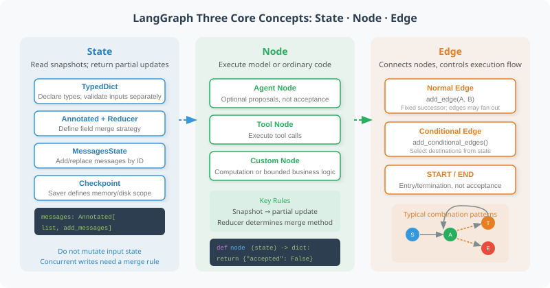

# 11.2 LangGraph Core Concepts: Nodes, Edges, and State

Use an offline release-record exercise to observe state transitions: metadata and rollback checks run in parallel, then a join decides acceptance. Nodes need not call a model, and a graph cannot establish business correctness for you.



## Run first, then inspect the three concepts

This chapter verifies Python 3.11+ and `langgraph==1.2.16`, pinned in `examples/requirements.txt`. Official pages may evolve; the pinned environment and offline tests define the reproducible scope here. From the repository root:

```bash
python -m pip install -r examples/requirements.txt
python -m reference_code.langgraph_patterns core
python -m unittest examples.integration_tests.test_langgraph_chapter -v
```

The implementation is in `reference_code/langgraph_patterns/`: `core.py` accompanies this section; `review.py` and `approval.py` accompany 11.4 and 11.5. Defaults require no model, key, or network. These exercises test lifecycle mechanics, not model comprehension. The model/tool-message loop in 11.3 continues to reuse `examples/framework_fixture.py`.

## State declares fields; a Node returns partial updates

`TypedDict` describes a field contract; it does not validate every external input at runtime. A node reads its current state and returns updated fields. Do not mutate input lists or assume a parallel node has already written its result. The three imported check functions are implemented and return partial `checks` or `accepted` updates:

```python
from typing import Annotated, TypedDict
import operator
from langgraph.graph import START, END, StateGraph
from reference_code.langgraph_patterns.core import (
    audit_input, check_metadata, check_rollback, summarize,
)

class AuditState(TypedDict):
    draft: dict[str, str]
    checks: Annotated[list[dict], operator.add]
    accepted: bool

builder = StateGraph(AuditState)
builder.add_node("metadata", check_metadata)
builder.add_node("rollback", check_rollback)
builder.add_node("summarize", summarize)
builder.add_edge(START, "metadata")
builder.add_edge(START, "rollback")
builder.add_edge(["metadata", "rollback"], "summarize")
builder.add_edge("summarize", END)
app = builder.compile()

result = app.invoke(audit_input({"version": "1.0", "owner": "team"}))
assert len(result["checks"]) == 2
assert result["accepted"] is False  # missing rollback
print(sorted(result["checks"], key=lambda check: check["name"]))
```

`check_metadata` only checks that version and owner are nonempty; `check_rollback` checks a nonempty rollback description. `summarize` requires both named checks to pass. This is a deliberately small acceptance contract, not comprehensive release-quality validation. Add a `rollback` field and run again to observe `accepted=True`.

## Reducers define merging; concurrent writes do not silently pick a winner

| Field rule | Sequential updates | Multiple writers in one super-step |
|---|---|---|
| No reducer | Usually replaces the field | An ordinary single-value field raises `InvalidUpdateError` |
| `Annotated[list, operator.add]` | Concatenates old and new lists | Combines branch updates; business completion order is not guaranteed |
| `add_messages` / `MessagesState` | Adds or replaces by message ID | Still needs correct IDs and application-specific business rules |

Each branch appends only its own check, avoiding duplication of the whole old list. Aggregation uses check names, not parallel list order. Concatenation does not deduplicate and is not a commutative general-purpose merge. Repeated business events and conflicting results need an explicit policy; there is no universal automatic dictionary deep merge. See the [official concurrent-update error](https://docs.langchain.com/oss/python/langgraph/errors/INVALID_CONCURRENT_GRAPH_UPDATE).

For message state, LangGraph's `add_messages` is usually more appropriate than unconditional `operator.add`. A matching ID replaces that message; it does not automatically recognize semantically identical business events:

```python
from langchain_core.messages import HumanMessage
from langgraph.graph import add_messages

messages = add_messages(
    [HumanMessage(content="draft", id="request-1")],
    [HumanMessage(content="corrected", id="request-1")],
)
assert len(messages) == 1
assert messages[0].content == "corrected"
```

## Edges schedule work; compile creates an invocable graph

Two outgoing `START` edges schedule both checks in the same super-step. This does not guarantee CPU speedup or immediate visibility of another branch's writes. `add_edge(["metadata", "rollback"], "summarize")` explicitly waits for both checks. `START/END` are entry/termination markers; reaching `END` only means this invocation ended.

`compile()` checks and constructs the graph, enabling `invoke/stream/get_state`. It does not automatically configure persistence, authorize tools, or validate task results. If a required branch raises, another completed branch cannot establish overall acceptance. See the [official Graph API](https://docs.langchain.com/oss/python/langgraph/graph-api) for node and edge interfaces.

## Checkpoint scope depends on the saver

This executable block rebuilds a graph with the same saver, then demonstrates that a new in-memory saver has no old checkpoint:

```python
from langgraph.checkpoint.memory import InMemorySaver
from reference_code.langgraph_patterns.core import audit_input, build_audit_graph

saver = InMemorySaver()
app = build_audit_graph(checkpointer=saver)
config = {"configurable": {"thread_id": "audit-1"}}
app.invoke(audit_input({"version": "1.0", "owner": "team"}), config)
snapshot = app.get_state(config)
assert snapshot.values["accepted"] is False
assert snapshot.next == ()  # ended, not waiting for approval

rebuilt = build_audit_graph(checkpointer=saver)
assert rebuilt.get_state(config).values == snapshot.values
fresh = build_audit_graph(checkpointer=InMemorySaver())
assert fresh.get_state(config).values == {}
```

In this version, `MemorySaver` aliases `InMemorySaver`. Checkpoints are saved at super-step boundaries, not after every line inside a function. `thread_id` identifies an execution history; missing required configuration raises an error. Reusing a thread may accumulate reducer fields. Use a new thread for a new task; `checks=[]` does not clear an append reducer.

| Data | Actual location in this exercise | After restart or object recreation |
|---|---|---|
| `InMemorySaver` graph checkpoints | The current saver's process memory | Lost; reusing the same thread name cannot recreate them |
| The 11.5 SQLite receipt | Application-owned local database | Can be reopened if the file remains; it is not a graph checkpoint |
| A disk/service checkpointer | A separately installed and pinned saver/backend | Recovery requires verified connection lifetime, serialization, access and resume behavior |

The locked exercise does not install `langgraph-checkpoint-sqlite`. An extension using `SqliteSaver.from_conn_string` must follow its [official context-manager interface](https://reference.langchain.com/python/langgraph.checkpoint.sqlite/SqliteSaver/from_conn_string) and keep the connection alive throughout graph execution. Add a pause/resume test spanning two independent processes before claiming restart recovery. A database choice does not establish multiprocess safety, authorization, or deployment readiness. The [official persistence guide](https://docs.langchain.com/oss/python/langgraph/persistence) distinguishes memory savers from durable backends.

## Errors and budgets belong in the application contract

An expected failed business check can remain in state; a known adapter exception can become structured failure. Programming errors, authorization denials, and cancellation should not all become requests for model retries. `recursion_limit` bounds graph super-steps, not elapsed time, tool calls, or tokens. Section 11.4 adds a separate business attempt budget and verifies that exhaustion never approves.

The integration tests cover concurrent conflicts, message-ID replacement, joins and in-memory checkpoint boundaries. They verify these small contracts and interfaces, not general review quality.

*Next section: [11.3 Build Your First Graph Agent](./03_first_graph_agent.md)*
