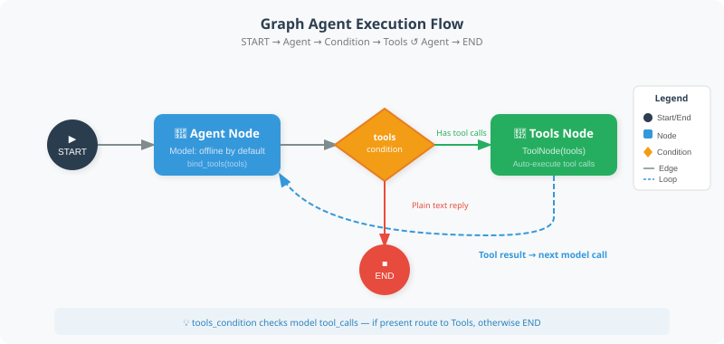

# 11.3 Build Your First Graph Agent

This section expresses a tool loop as an explicit state graph: `agent → tools → agent`, ending when there is no tool request. Follow how messages pass between nodes, how a conditional edge selects the next node, and how an execution limit stops a loop.

The default model is a deterministic offline fixture. It treats the input as an arithmetic expression, requests `calculate`, and returns the tool result unchanged. This verifies the actual framework's tool-call path; it does not demonstrate natural-language understanding or autonomous planning. The complete entry point is [first_graph_agent.py](https://github.com/Haozhe-Xing/agent_learning/blob/main/examples/chapter13/first_graph_agent.py). It shares [framework_fixture.py](https://github.com/Haozhe-Xing/agent_learning/blob/main/examples/framework_fixture.py) with Section 10.3 rather than maintaining a second test model.

## Run the Example First

From the repository root, use an environment with [examples/requirements.txt](https://github.com/Haozhe-Xing/agent_learning/blob/main/examples/requirements.txt) installed. This section is verified against `langgraph==1.2.16`:

```bash
python -m examples.chapter13.first_graph_agent
python -m examples.chapter13.first_graph_agent --stream
```

The default expression is `sqrt(144) + 2 * 3`, whose tool result is `18`. With `--stream`, expect the node sequence `agent → tools → agent`. A final `completed` means this tool loop ended normally. Fixed arithmetic cases and an offline model are not a model-quality evaluation.



The Agent node in the diagram can call a real model. This section substitutes a fixed response for that part while the installed LangGraph still executes the tool node and conditional routing.

## A Runnable Minimal Tool Loop

Run the following code from the repository root in the same environment. All tools, models, and message classes have explicit imports:

```python
from langchain_core.messages import HumanMessage, SystemMessage
from langgraph.graph import START, MessagesState, StateGraph
from langgraph.prebuilt import ToolNode, tools_condition

from examples.framework_fixture import FixedToolChatModel, calculate

model = FixedToolChatModel().bind_tools([calculate])

def agent_node(state: MessagesState) -> dict:
    messages = state.get("messages", [])
    if not messages:
        raise ValueError("provide at least one input message")
    response = model.invoke([
        SystemMessage(content="Use calculate for arithmetic. Preserve tool failures in the reply."),
        *messages,
    ])
    return {"messages": [response]}

graph = StateGraph(MessagesState)
graph.add_node("agent", agent_node)
graph.add_node("tools", ToolNode([calculate]))
graph.add_edge(START, "agent")
graph.add_conditional_edges("agent", tools_condition)
graph.add_edge("tools", "agent")
app = graph.compile()

events = list(app.stream(
    {"messages": [HumanMessage(content="sqrt(144) + 2 * 3")]},
    config={"recursion_limit": 8},
    stream_mode="updates",
))
print([next(iter(event)) for event in events])
print(events[1]["tools"]["messages"][0].content)
```

Follow four connections:

1. `MessagesState` supplies the message-list merge behavior; a node returns its new messages.
2. `agent_node` invokes the model with its bound tool definitions and returns an `AIMessage`.
3. `tools_condition` checks for tool requests, routing to the node named `tools` when they exist and ending otherwise.
4. `ToolNode` executes registered tools and writes `ToolMessage` results. A fixed edge then returns to `agent`.

`calculate` reuses Chapter 3's [restricted arithmetic interpreter](https://github.com/Haozhe-Xing/agent_learning/blob/main/examples/chapter03/safe_math.py). It accepts listed numbers, operators, and functions, with limits on expression length, tree size, exponents, and numeric magnitude. It does not use `eval()` and is not a general sandbox for arbitrary Python. Invalid expressions produce structured tool errors; the host CLI checks them and exits unsuccessfully.

## Observe Stopping Without Treating It as Acceptance

These commands demonstrate a rejected expression and a graph-step limit:

```bash
python -m examples.chapter13.first_graph_agent --expression "__import__('os').getcwd()"
python -m examples.chapter13.first_graph_agent --recursion-limit 1
```

The first returns `tool_failed`; the second catches `GraphRecursionError` and returns `budget_exhausted`. Both exit with code `1`. `recursion_limit` limits graph execution steps. It does not impose a tool timeout or directly count total tool calls: one model message may request several tools. Real applications need separate budgets for tool costs and side effects.

[test_first_graph_agent.py](https://github.com/Haozhe-Xing/agent_learning/blob/main/examples/integration_tests/test_first_graph_agent.py) exercises actual tool round trips, direct termination without a tool request, repeated calls stopped by the step limit, rejected empty input, and unsuccessful CLI exits:

```bash
python -m pytest examples/integration_tests/test_first_graph_agent.py -q
```

## Choosing Between This Graph and Section 10.3

| Choice | What this example makes observable | Additional design or configuration |
|---|---|---|
| Section 10.3's `create_agent` | A tool loop with less assembly code | Task acceptance, permissions, and budget policies |
| This section's `StateGraph` | Explicit nodes, message state, conditional edges, and return edges | Custom state and termination rules, plus the same business acceptance |
| Checkpoints | This example calls `compile()` without a checkpointer | Configure checkpoint storage and a `thread_id`; in-memory storage does not survive process exit |
| Human interruption and resumption | This example has no approval node | Call `interrupt()` at a chosen point, configure a checkpointer and thread ID, and resume with `Command(resume=...)` |

A flow being expressible as a graph does not require every Agent to migrate. A simple loop may keep using `create_agent`; a handwritten loop or state machine is also valid. When lifecycle state, branches, and return paths need independent inspection or modification, compare the value of an explicit graph with its maintenance cost. See the official [Persistence](https://docs.langchain.com/oss/python/langgraph/persistence) and [Interrupts](https://docs.langchain.com/oss/python/langgraph/interrupts) guides for configuration, and the [Graph API](https://docs.langchain.com/oss/python/langgraph/graph-api) for the graph model and step limits.

## Optional: Connect a Real Model

After configuring model-service credentials, explicitly run:

```bash
python -m examples.chapter13.first_graph_agent --real --model gpt-4.1-mini
```

This uses `ChatOpenAI` with a timeout and finite retries and makes real service requests. The default offline tests do not establish service availability, correct tool selection, or a complete final answer; those require separate fixed-task acceptance. `--real` retains the same graph so model messages can be compared with fixture messages.

---

*Next section: [11.4 Conditional Routing and Loop Control](./04_conditional_routing.md)*
