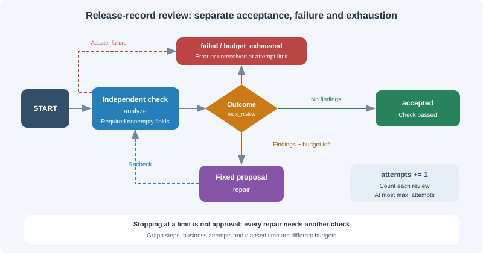

# 11.4 Conditional Routing and Loop Control

The 11.3 `tools_condition` decides whether to enter tools. Here, business routing reviews required release fields, proposes a revision, and independently checks again. Acceptance, a failed check and budget exhaustion are distinct outcomes. Stopping at a limit must never mean approval.



## Run the bounded revision exercise

With the 11.2 locked environment, run from the repository root:

```bash
python -m reference_code.langgraph_patterns review
python -m reference_code.langgraph_patterns review --no-repair --max-attempts 2
```

The first command returns `status="accepted"`, `attempts=2`: a fixed repair supplies a missing rollback description and the second check passes. The second leaves the draft unchanged, returning `status="budget_exhausted"`, `accepted=false`, unresolved `findings`, and exit code 1.

See `reference_code/langgraph_patterns/review.py` for the implementation. It executes no submitted code and calls no model. The reviewer only checks nonempty `version/owner/rollback` strings; the repairer only proposes a fixed rollback description. Separating proposals from independent checks makes adapters replaceable; it is not a general code-review benchmark.

```python
from reference_code.langgraph_patterns.review import run_review

draft = {"version": "1.0", "owner": "release-team"}
result = run_review(draft, max_attempts=3)
assert result["status"] == "accepted"
assert result["attempts"] == 2  # review, repair, independent recheck
assert result["findings"] == []

def keep_draft(draft, findings):
    return draft

failed = run_review(draft, max_attempts=2, repairer=keep_draft)
assert failed["status"] == "budget_exhausted"
assert failed["accepted"] is False
assert failed["findings"] == ["rollback"]
print(failed["status"], failed["attempts"], failed["findings"])
```

## Route by outcome before deciding whether another revision is allowed

This is the actual routing rule. `max_attempts` counts **reviews**, including the first review; there are at most `max_attempts-1` repair opportunities. Passing on the final allowed review is accepted. Unresolved findings on that review exhaust the budget:

```python
from typing import Literal
from reference_code.langgraph_patterns.review import ReviewState

def route_review(state: ReviewState) -> Literal["accept", "repair", "exhausted", "fail"]:
    if state["status"] == "failed":
        return "fail"
    if not state["findings"]:
        return "accept"
    if state["attempts"] >= state["max_attempts"]:
        return "exhausted"
    return "repair"

assert route_review({"status": "running", "findings": ["rollback"],
                     "attempts": 2, "max_attempts": 2}) == "exhausted"
```

The graph connects:

```text
START → analyze
  analyze → accept → END                check passed
  analyze → exhausted → END             findings remain, no attempts left
  analyze → fail → END                  known error or invalid response
  analyze → repair → analyze            revise within budget, then recheck
  repair  → fail → END                  repair adapter failed
```

`add_conditional_edges("analyze", route_review, {...})` maps symbols to nodes. The router neither repairs the draft nor sets acceptance. Do not also add an unconditional success edge from the same source and assume the conditional route cancels it; both may schedule successors. Nodes return partial updates, and the router sees state after those updates are applied.

## Errors must not become “no findings”

The implementation turns expected `AdapterError` exceptions and malformed responses into `failed` with a reason. It never reaches acceptance in these cases. Unexpected programming errors propagate for diagnosis; a bare `except` must not turn every failure into an empty findings list. Structured model output is validated at runtime, and valid types still cannot establish a correct business judgment.

```python
from langgraph.errors import GraphRecursionError
from reference_code.langgraph_patterns.review import AdapterError, run_review

def unavailable(draft):
    raise AdapterError("review unavailable")

result = run_review({}, reviewer=unavailable)
assert result["status"] == "failed"
assert result["accepted"] is False

try:
    run_review({}, recursion_limit=1)
except GraphRecursionError:
    print("graph step budget exceeded; no approval")
else:
    raise AssertionError("expected GraphRecursionError")
```

`recursion_limit` is a separate graph super-step cap at the config's top level. Exceeding it raises `GraphRecursionError`; it is neither elapsed-time control nor the business retry budget. `run_review` leaves room for terminal nodes in its default finite topology. Setting the limit to 1 deliberately reproduces the error above. Live model/network adapters still need their own call, token, time and cancellation policies. Raising the step cap cannot repair faulty routing. See the [official recursion-limit interface](https://docs.langchain.com/oss/python/langgraph/graph-api#recursion-limit).

## Exclusive routing, parallel dispatch and joining differ

| Purpose | Return or connection | Additional contract |
|---|---|---|
| Select one business branch | One conditional mapping symbol | A failure path for unknown/invalid input |
| Schedule several known branches | Multiple edges or target names | Reducers, failures and a join barrier; see 11.2 |
| Dispatch dynamic items | `langgraph.types.Send` with per-item input | Item/concurrency budgets, empty input, result IDs and merging |

Exclusive routing with one string is not parallel fan-out; `Send` was not introduced only in a hypothetical “LangGraph 2.0.” This exercise runs a bounded single-path revision loop, not an implemented dynamic map-reduce workflow. `stream(..., stream_mode="updates")` exposes node updates; a logged update is not proof of business acceptance.

## Acceptance and the next step

Tests cover first-pass success, final-attempt success, persistent failures, malformed review output, adapter failures, programming exceptions and the graph step cap. Make `fixture_repair` keep the original draft and verify that the cap still leaves the task unaccepted. A human handoff requires the explicit pause protocol in 11.5; reaching `END` cannot create a resumable approval automatically.

*Next section: [11.5 Human-in-the-Loop](./05_human_in_the_loop.md)*
