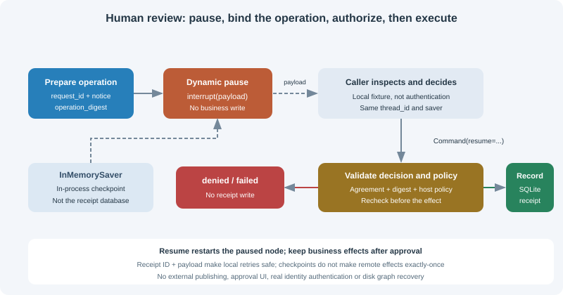

# 11.5 Human-in-the-Loop

Human collaboration needs an explicit pause/resume protocol. Routing to `END` ends an invocation; a checkpointer neither identifies risky tools automatically nor grants approval authority. This exercise records one local release receipt. It sends no email, deletes no files, and makes no payments.



## Run the local approval exercise

With the 11.2 environment, run from the repository root:

```bash
python -m reference_code.langgraph_patterns approval
python -m reference_code.langgraph_patterns approval --decision approve
```

Default denial returns `status="denied"`, `receipt_count=0`, and exit code 1. Explicitly selecting the local approval fixture returns `status="recorded"`, `receipt_count=1`. The CLI uses in-memory checkpoints and an in-memory receipt database; neither continues after exit. These commands demonstrate a protocol, not authenticated approval or an external publishing service.

## interrupt and Command form the dynamic resume protocol

See `reference_code/langgraph_patterns/approval.py`. `prepare` fixes the request ID, notice and digest. `approve` calls `interrupt(payload)`. The caller obtains the pending operation from `__interrupt__` and submits `Command(resume=decision)` using the same thread and saver. Only a valid decision, matching digest and passing host policy allow the separate receipt-writing node to run.

```python
from langgraph.checkpoint.memory import InMemorySaver
from langgraph.types import Command
from reference_code.langgraph_patterns.approval import (
    ReceiptLedger, approval_input, build_approval_graph, local_demo_policy,
)

entries = []
def observe_entry():
    entries.append("entered")

with ReceiptLedger() as ledger:
    app = build_approval_graph(
        ledger, checkpointer=InMemorySaver(), authorize=local_demo_policy,
        on_approval_entry=observe_entry,
    )
    config = {"configurable": {"thread_id": "release-1"}, "recursion_limit": 8}
    paused = app.invoke(approval_input(), config)
    pending = paused["__interrupt__"][0].value
    assert paused["status"] == "waiting"
    assert app.get_state(config).next == ("approve",)
    assert ledger.count() == 0

    # Local policy fixture, not proof of a real user's identity.
    decision = {"approved": True, "reviewer": "reviewer-1",
                "operation_digest": pending["operation_digest"]}
    result = app.invoke(Command(resume=decision), config)
    assert result["status"] == "recorded"
    assert ledger.count() == 1
    assert entries == ["entered", "entered"]  # node restarted on resume
    print(result["status"], result["receipt"])
```

Interrupt values must be serializable. `Command(resume=...)` supplies the return value of `interrupt()`. Resume starts the `approve` function **again from its beginning**, rather than continuing immediately after the pause line. The observation list therefore has two entries, with no business write before approval. Do not swallow the control exception in a broad `try/except`, or change the order of multiple interrupts casually. The [official interrupt reference](https://reference.langchain.com/python/langgraph/types/interrupt) defines node re-execution and resume-value behavior.

## Pausing, agreement and authorization are separate checks

`local_demo_policy` is only a fixed policy fixture allowing the demonstration value `reviewer-1`; it **does not authenticate the person supplying that name**. A real host must authenticate callers, authorize access to this thread and operation, then supply trusted identity to its policy. A self-reported name, `approved=true`, or paused execution cannot establish authorization.

At both decision review and the execution-time recheck, the authorization callback must explicitly return the boolean `True`. Truthy values such as `1`, `"yes"`, or a nonempty dictionary do not authorize execution. An earlier approval cannot bypass the second check.

| Condition | Exercise outcome | Business side effect |
|---|---|---|
| No decision yet | `waiting`, with a pending task | None |
| Explicit denial or policy refusal | `denied` | None |
| Invalid decision type or stale digest | `failed` | None |
| Notice edited after pausing, with the old approval | Execution-time digest check fails | None |
| Approved earlier, but execution-time authorization is no longer explicitly `True` | `failed` | None |
| Agreement, digest and host policy pass | `recorded` | One local SQLite receipt only |

Edited parameters need a new approval request and fresh confirmation. `update_state` edits state; it is neither an approval credential nor a rollback of effects that already occurred. Likewise, `thread_id` locates execution history and is not a credential.

## END, static breakpoints and dynamic interrupts differ

| Mechanism | Saved/pending outcome | How to proceed |
|---|---|---|
| A conditional edge to `END` | An ended invocation; no pending node on that branch | New input can start another run; this is not approval recovery |
| Static `compile(interrupt_before=[...])` | Pauses before configured nodes; does not classify business risk | Inspect pending work and state, then use `invoke(None, config)` |
| `interrupt(payload)` inside a node | A dynamic input request containing the operation | Same thread plus `Command(resume=decision)` |
| An actual node failure | Error and recoverable checkpoint, depending on saver/writes | Fix the cause, then retry pending work with `invoke(None, config)` |

Static breakpoints are useful for debugging but do not implement an approval policy. The dynamic exercise uses no `interrupt_before`, and calling a tool “safe” cannot bypass authorization. The [official interrupts guide](https://docs.langchain.com/oss/python/langgraph/interrupts) distinguishes these pause mechanisms.

## Replay needs business idempotency, not just checkpoints

A crash can occur after committing a receipt and before saving the next graph checkpoint. Retrying that node calls its business write again. `ReceiptLedger` therefore uses a stable `request_id` primary key and full payload: repeating the same operation returns the same receipt; different content with that ID raises a conflict. This is a small SQLite transaction contract, not an exactly-once guarantee for arbitrary remote tools.

The test deliberately raises after committing the receipt, then runs `invoke(None, config)`. The writing node executes twice while the database still contains one receipt:

```bash
python -m unittest examples.integration_tests.test_langgraph_chapter.ApprovalTests -v
```

Remote messages/payments need provider idempotency support or a verifiable execution ledger and reconciliation protocol. Successful graph recovery does not establish a single side effect. Move business effects after approval and make retries safe. Replaying an older checkpoint cannot retract an already sent message.

## Saver scope, budgets and recovery conditions

`InMemorySaver` resumes only while the current saver remains available. Rebuilding with that saver works; constructing a new saver loses its history. A `ReceiptLedger(path)` file can be reopened, but its receipts do not contain LangGraph's pending recovery tasks. Disk checkpointers require separate dependencies, connection lifetime and cross-process tests, as explained in 11.2. This exercise does not implement that backend or recommend a universal production default.

The local graph has a finite topology and an explicit `recursion_limit=8`. This does not expire approval waits or time out a blocking tool. A real host must define expiration, revocation, retry and resource policies; expired approval must not execute. Authentication, approval UI, notifications, cross-process graph recovery and remote services are outside this exercise's implemented scope.

Tests cover zero writes before a decision, denials/invalid approvals, thread isolation, changed operations, node re-entry and replay after a committed effect without duplicate receipts. Verify these boundaries before extending the workflow in 11.6.

*Next section: [11.6 Practice: Workflow Automation Agent](./06_practice_workflow_agent.md)*
