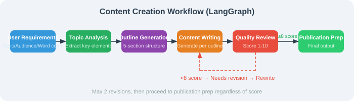

# 11.6 Practice: Workflow Automation Agent

## Iteration and Acceptance

Turn planning and reflection into a stateful, bounded workflow.

- **Success criteria**: Use fixed review sequences: immediate pass, pass after one revision, and persistent failure; check revision counts and final status.
- **Failure cases**: Persistent low scores must stop after two revisions and remain marked unapproved; node errors cannot count as a pass.
- **Safety boundary**: Scores are proxy metrics; check facts and citations manually, and do not publish automatically when the revision budget expires.

Record inputs, expected results, and actual results before extending the system. See [Chapter 18](../chapter_20_evaluation/README.md) for evaluation and [Chapter 19](../chapter_21_security/README.md) for trust and permissions.

This section applies all the LangGraph knowledge learned so far — state management, conditional routing, and loop control — to build a complete workflow automation Agent.

## Scenario: Content Creation Workflow

We choose "content creation" as a practical, real-world scenario. This workflow is well-suited for LangGraph because it naturally includes both **linear flow** (analyze → outline → write) and **cyclic flow** (review → revise → re-review), perfectly showcasing the two major advantages of graph structures.

The workflow includes the following steps:

1. **Topic analysis**: parse the creation requirements, extract key elements (audience, style, structure)
2. **Outline generation**: automatically generate an article outline based on the analysis
3. **Content writing**: write the body section by section following the outline
4. **Quality review**: automatically score and provide improvement suggestions
5. **Iterative revision**: if quality is below standard (< 8 points), revise the content based on suggestions and re-review

This workflow demonstrates LangGraph's most powerful feature — **loops**: when a review fails, the content cycles between "revise → review" until quality meets the standard or the maximum revision count is reached.

### State Design

The design of `ContentState` reflects an important principle: **State should contain all the data needed by each phase of the workflow, as well as metadata that controls the flow direction.** Among these, `quality_score` and `revision_count` are the keys to controlling the loop — the former determines whether revision is needed, and the latter prevents infinite loops.



```python
from examples.chapter13.content_workflow import build_workflow

scores = iter([4, 9])
app = build_workflow(
    review=lambda content: next(scores),
    revise=lambda content: content + " [revised]",
    max_revisions=2,
)
result = app.invoke({"topic": "Tool use"}, config={"recursion_limit": 12})
assert result["revision_count"] == 1
assert result["accepted"] is True
```

The complete graph is `examples/chapter13/content_workflow.py`. It has draft, review, revise, and finish nodes. The default review sequence is fixed; `--always-low` demonstrates budget exhaustion. Add `--real` to use model-backed drafting, review, and revision.

Only revisions consume the revision budget. `accepted=False` is preserved when low quality exhausts the budget. Invalid scores and node errors fail explicitly. Add persistence and recovery only after testing duplicate side effects. This example has no publishing tool.

The graph follows the [official LangGraph Graph API](https://docs.langchain.com/oss/python/langgraph/graph-api).
