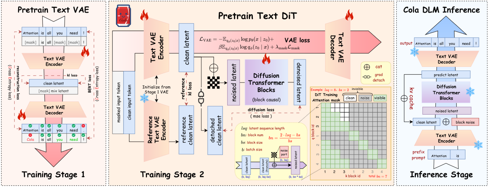

# 2.6 Foundation Model Advances and Selection

Agent success depends on the model, tools, context, and runtime. Define the tasks and pass conditions first, then test candidate models with the same tools and budget.

## Four model trends that affect agents

**Reasoning budgets.** Some models let you allocate more inference compute to difficult requests. Multi-step planning, code edits, and constraint checking may benefit. Short answers and intent classification may be more sensitive to latency. Measure success, end-to-end latency, and cost on the same tasks at different budgets.

**Mixture of experts (MoE).** An MoE router selects a subset of experts for each token. Total parameters affect weight storage, and active parameters affect computation. Inference throughput also depends on batching, hardware, communication, quantization, and the KV cache. Report throughput and peak memory when comparing self-hosted serving costs.

**Open weights.** Open-weight models are candidates for self-hosting, quantization, and fine-tuning. Check the exact weight revision, license, commercial terms, inference framework, and hardware requirements. Record the license and weight revision alongside the evaluation.

**Long context and multimodality.** The text window, output limit, accepted modalities, and callable tools are distinct API properties. Check them for the exact model ID and endpoint. For long-running tasks, also evaluate retrieval, compaction, checkpointing, and recovery. See [long-horizon context strategies](../chapter_context_engineering/03_long_horizon.md) and the [multimodal project](../chapter_25_multimodal/README.md).

## Examples of model and API specifications

These examples were checked on **2026-11-27**. The table distinguishes historical models from a recent endpoint change.

| Role | Model and date | Agent-relevant specification |
|---|---|---|
| Historical reference | GPT-5.5, announced 2026-04-23 | OpenAI lists a 1,050,000-token context window. See the [announcement](https://openai.com/index/introducing-gpt-5-5/) and [model specification](https://developers.openai.com/api/docs/models/gpt-5.5). |
| Historical reference | Claude Opus 4.8, released 2026-05-28 | Claude API documentation lists a 1M-token context window. See the [announcement](https://www.anthropic.com/news/claude-opus-4-8) and [model specification](https://platform.claude.com/docs/en/models/opus-4-8/overview). |
| API compatibility | GPT-6.2 Astra / Sol, API release 2026-11-17 | Both support Responses and Chat Completions. Tool calling uses Responses. See the [OpenAI API changelog](https://developers.openai.com/api/docs/changelog). |

## How to choose a model

1. **Prepare representative tasks.** Cover successful paths, tool failures, permission denials, and recovery. Define verifiable outcomes, such as passing independent tests or matching task state against a business record.
2. **Check the model and endpoint.** Record the model snapshot, tool and structured-output support, input and output limits, and pricing rules before the trial.
3. **Compare under controlled conditions.** Fix the tools, harness, tasks, and budget and repeat runs. Record success rate, cost per successful task, P95 latency, and the rate of human intervention.
4. **Set an upgrade threshold.** Start with a working baseline. Measure whether a stronger model improves enough on failed cases to justify the cost and latency. Keep a fixed regression set for model or harness upgrades.

A useful results row is `model snapshot | harness commit | dataset version | success rate | cost per success | P95 latency | failure category`. Record any changes to the framework, tools, or budget. See [Chapter 20 on evaluation](../chapter_20_evaluation/README.md).

## Further reading

### Selected model research (2026)

### [Cola DLM: Continuous Latent-Space Diffusion Language Model — A New Paradigm for Non-Autoregressive Text Generation (2026)](https://arxiv.org/abs/2605.06548)

> 🧬 **One-liner**: Moves text generation from "token-by-token autoregressive" to "hierarchical diffusion in a continuous latent space," unifying the theoretical framework of AR, discrete denoising, and continuous-token-space methods.

**Core problem**: Mainstream large language models generate strictly autoregressively (AR), token by token, but the AR paradigm is inherently limited by serial decoding and struggles with global planning. Discrete denoising language models and continuous-token-space methods have each been explored, yet there is no unified theoretical framework to compare them horizontally and combine their strengths.

**Method**: Cola DLM (Continuous Latent Diffusion Language Model) proposes a hierarchical continuous latent-variable language model: first use a **Text VAE** to map text into a continuous latent representation, then use a **block-causal diffusion Transformer** to model the global semantic prior in the latent space, and finally decode to generate text. Under a rigorous probabilistic definition, it places Cola DLM alongside AR models, discrete denoising language models, and continuous-token-space methods within a single theoretical framework for comparison. The overall workflow is shown below:

> Image source: Cola DLM paper (source: 2026, arXiv:2605.06548, ByteDance Seed)

**Key results**: In strict comparison against an autoregressive baseline of roughly 2 billion parameters across 4 research questions and 8 benchmarks, strong scalability was verified; code and checkpoints are open-sourced under Apache 2.0.

**Relation to this chapter**: Corresponds to 2.7 Foundation Model Architecture Explained. It represents an important frontier exploring the shift of language models from the autoregressive paradigm toward the diffusion paradigm, helping readers understand the diversified architecture directions of future foundation models.

---

### [ByteDance Seed 2.0: The Frontier of Intelligence for Real-World Complexity (2026)](https://arxiv.org/abs/2607.00248)

**Published**: June 30, 2026 | [arXiv:2607.00248](https://arxiv.org/abs/2607.00248)

**Core contribution**: ByteDance released the Seed 2.0 model family, taking real user needs as the starting point and building a reliable forward-looking evaluation system. It focuses on overcoming two enduring challenges — long-tail knowledge and complex instruction following — while reaching world-leading levels in reasoning intelligence, visual understanding, and search capability. The model card demonstrates Seed 2.0's initial ability to solve complex long-horizon tasks through many real-world use cases, serving hundreds of millions of users.

**Relation to this chapter**: Corresponds to this chapter's "Frontier Foundation Model Landscape." It is an important release milestone of a top-tier domestic large model in the second half of 2026, alongside the Qwen3 and GLM-5.1 families representing the latest progress in the competitive landscape of domestic foundation models, with direct reference value for those selecting Agent backbone models.

---

### [Soofi S 30B-A3B: A Sovereign Open-Source Mixture Mamba-Transformer MoE Foundation Model (2026)](https://arxiv.org/abs/2607.09424)

**Published**: July 10, 2026 | [arXiv:2607.09424](https://arxiv.org/abs/2607.09424)

**Core contribution**: Soofi S 30B-A3B is a sovereign open-source MoE hybrid Mamba-Transformer foundation model for German and English. Its hybrid design activates only 3B of the 30B parameters per token, and its inference cache remains **near-constant** as context grows — giving it significant throughput advantages over dense models in long-context, high-concurrency deployment scenarios. Pretrained on roughly 27 trillion tokens with deliberately increased German weighting, it matches dense 14–27B models on combined English and German benchmarks, leads 17 open-source foundation models on aggregated code metrics in both languages, and surpasses all European sovereign baselines. It achieves the highest English-German evaluation score among fully open-source models, exceeding Olmo 3 32B and Apertus 70B. Weights, intermediate checkpoints, the complete data-source manifest, hyperparameters, and training/evaluation code are all open-sourced under permissive terms.

**Relation to this chapter**: Corresponds to 2.7 Foundation Model Architecture Explained. Soofi S represents the latest large-scale validation of the Mamba-Transformer hybrid architecture in an MoE configuration — its near-constant inference-cache property has direct engineering value for long-context Agent deployment, and together with Cola DLM (diffusion paradigm) it showcases the diversified exploration of foundation-model architectures beyond autoregressivity.
