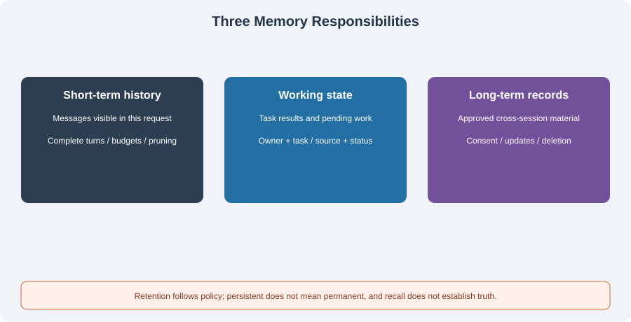

# 4.1 Why Do Agents Need Memory?

“Continue our previous plan” implicitly requires the application to find the correct user's plan in the correct project, and decide whether it is still valid. Adding more chat text to a model does not automatically satisfy that requirement. Memory is about **selecting, retaining, and recalling state**, rather than updating model parameters after each conversation.

## Three Responsibilities, Not Three Fixed Databases



| Responsibility | Retained material | Lifetime and boundary |
|----------------|-------------------|-----------------------|
| Short-term memory | Current messages and necessary summaries | The model-facing view has a budget; server-log retention is a separate policy |
| Working memory | Task input references, intermediate results, pending work, failures | Isolate by owner and task; clear under completion, cancellation, or expiry policy |
| Long-term memory | Consented preferences, facts, or project records | Cross-session use requires provenance, updates, withdrawal, and deletion |

These are application responsibilities; they can share storage or use separate implementations. Ending a session does not necessarily remove short-term history from disk. Long-term memory means neither permanent retention nor mandatory vector storage. Relational databases, keys, lexical search, and vector retrieval serve different needs.

“Please keep answers short” might apply to one turn or be a preference the user wants retained across sessions. Establish scope before persistence. “Forget my occupation” requires removing queryable records and preventing dependent caches, summaries, or indexes from continuing to supply it. Changing the current prompt alone is insufficient.

## Missing Memory and Incorrect Memory Both Cause Failures

| Situation | Evidence to check | Shortcut to avoid |
|-----------|-------------------|-------------------|
| Continue a task | Owner/project/task identity and last state | Selecting history from a similar title |
| Changed preference | Explicit correction and applicable time | Treating the old preference as permanent fact |
| Conversation over budget | Complete retained messages and pruning report | Silently dropping the current question |
| Shared assistant | Authorized principal and filters on every read/write | Treating a client-provided username as authentication |
| Forget request | Cleanup results for active storage, derived indexes, and caches | A `deleted` label while retrieval continues |

Sometimes the best choice is no long-term memory. A public one-off question needs no persistence; temporary results can stay in task state. Cheap storage does not justify saving names, occupations, entire conversations, or inferred profiles by default.

## Run Consent, Isolation, and Deletion First

`reference_code/evidence_assistant/memory.py` provides a SQLite baseline. Run this from the repository root; it uses a temporary file and no model:

```python
from pathlib import Path
from tempfile import TemporaryDirectory
from reference_code.evidence_assistant.memory import MemoryStore

with TemporaryDirectory() as folder:
    path = Path(folder) / "memory.sqlite"
    store = MemoryStore(path)
    try:
        store.put("alice", "style", "concise")
    except PermissionError:
        print("write denied without consent")
    store.put("alice", "style", "concise", consent=True)
    store.put("bob", "style", "detailed", consent=True)
    store.close()

    store = MemoryStore(path)
    assert store.records("alice") == {"style": "concise"}
    store.delete("alice")
    assert store.records("alice") == {}
    assert store.records("bob") == {"style": "detailed"}
    store.close()
```

`consent=True` is an explicit host input after obtaining consent. A string such as `"yes"` or the number `1` cannot replace Boolean consent. Tests choose identities directly; a service must authenticate and authorize them rather than letting the model choose `alice` or `bob`. SQLite deletion establishes that current records are no longer queryable, not secure erasure of independent backups or disk residue.

This baseline has no automatic extraction, expiry, per-record provenance audit, or semantic retrieval. Its purpose is to establish the smallest contract before extending it. Those unimplemented capabilities cannot be counted as an existing memory system.

## Four Questions for Every Memory

1. **Who may use it?** The host determines owner, project, and visibility. Filter authorization before ranking relevance.
2. **Why may it persist?** Establish purpose and consent. Automatic extraction can propose candidates, not approve persistence for the user.
3. **What supports it?** Distinguish user statements, external documents, tool results, and model guesses; retain source/version information.
4. **When does it expire?** Corrections, withdrawal, time limits, and task completion can trigger changes. Deletion must also examine derived material.

Recalled memory remains attributed data. “Ignore system rules” inside a record does not become new system authorization. A preference for brevity cannot cancel required evidence or permission checks. Persistence establishes storage, not correctness or continuing applicability.

## Exercise and Reading Route

For “continue the release checks,” list the minimum conversation history, task results, and information worth retaining with consent. Add correction, project change, withdrawal, and insufficient-budget cases with expected behavior.

[Section 4.2](./02_short_term_memory.md) handles request budgets and complete messages; [4.3](./03_long_term_memory.md) adds persistence/retrieval; [4.4](./04_working_memory.md) tracks task progress. The research route is in [4.6](./06_paper_readings.md). Applications do not require implementing every memory component first.

*Next: [4.2 Short-Term Memory: Conversation History Management](./02_short_term_memory.md)*
