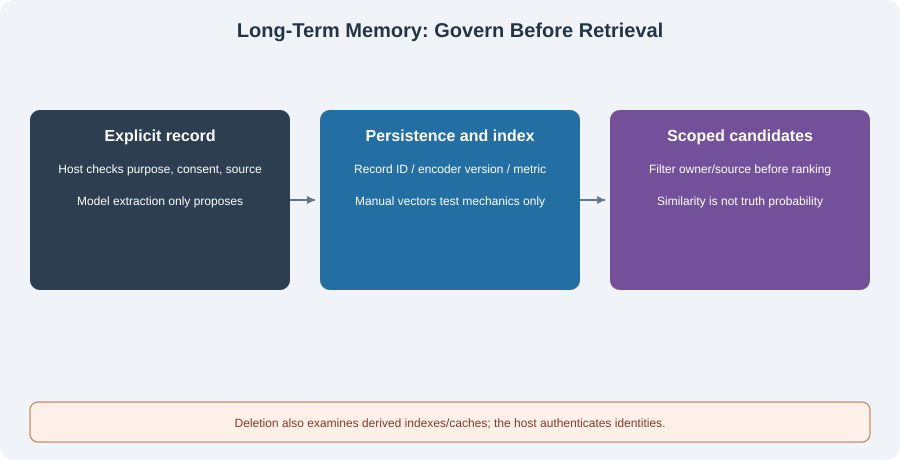

# 4.3 Long-Term Memory: Vector Databases and Retrieval

Long-term memory crosses sessions, not owner, project, or consent boundaries. Decide which records may be retained, updated, retrieved, and deleted before choosing an index. Vector storage selects similarity candidates; it does not replace governance.

## From Key Lookups to Vector Retrieval

“What is my answer-style preference?” can be answered by a known key. “Which deployment risks did we discuss?” may require searching many records. Lexical search, structured filtering, and vectors can work together. SQL and natural-language applications are not opposites.



A vector index represents records and queries in one encoding space and selects neighbors by distance. A neighbor can be semantically similar or merely on the same topic without answering the question. Equal dimensions do not establish compatible encoders. Changes to model versions, preprocessing, or metrics require review and often reindexing.

Cosine similarity measures vector direction. Scores such as `0.4` or `0.9` are not universal relevance thresholds across languages, corpora, and models. `1 - distance` is not a correctness probability and has the meaning used here only for a cosine-distance collection. Zero vectors have no usable cosine direction.

## Runnable Exercise: Real Chroma, Manual Fixed Vectors

This section uses Chroma 1.5.9 pinned in `examples/requirements.txt`. `VectorMemory` in `reference_code/memory_rag/vector_memory.py` receives explicit vectors, disables the default embedding function, and downloads/calls no embedding model. Compare the query API with the [pinned collection source](https://github.com/chroma-core/chroma/blob/1.5.9/chromadb/api/models/Collection.py).

These three-dimensional vectors are **manual fixtures** for storage, metrics, filtering, and deletion. They are neither an English nor a Chinese semantic encoder. Run from the repository root:

```python
from tempfile import TemporaryDirectory
from reference_code.memory_rag import VectorMemory

with TemporaryDirectory() as folder:
    memory = VectorMemory(folder)
    assert memory.search("alice", [1, 0, 0]) == []
    memory.put("alice", "style", "Use concise answers.", [1, 0, 0],
               source="explicit:1", consent=True)
    memory.put("alice", "topic", "Discuss deployment.", [0, 1, 0],
               source="explicit:2", consent=True)
    memory.put("bob", "style", "Use detailed answers.", [1, 0, 0],
               source="explicit:3", consent=True)
    hits = memory.search("alice", [1, 0, 0], source="explicit:1")
    assert [hit["id"] for hit in hits] == ["alice:style"]
    assert abs(hits[0]["cosine"] - 1.0) < 1e-6
    memory.delete("alice")
    assert memory.search("alice", [1, 0, 0]) == []
    assert len(memory.search("bob", [1, 0, 0])) == 1
```

Alice's and Bob's same-direction vectors can both score highly. Bob's record still must not appear in Alice's query. Isolation precedes relevance. A trusted host supplies `owner`; letting a client choose it does not authenticate anyone. This filter is a data-access component, not a complete multi-tenant service.

The implementation enforces these boundaries:

- Every read, write, and deletion has an owner scope. Record IDs include the owner, so identical preference names do not overwrite another owner.
- Persistent writes require `consent is True` and explicit `source`. The host must verify that source; model-provided provenance is not automatically trusted.
- Empty collections return no results; result counts are bounded. Combined predicates use `$and`, avoiding zero-result-count requests.
- `include` requests documents/metadatas/distances. IDs come from result fields, rather than being optional include entries.
- Validate dimensions, finite numbers, nonzero norms, and the collection's encoding-version contract before mixing records.

Source and owner filters apply together. Tests also read persisted records from a second Python process. This establishes persistence, not real-encoder recall, preference extraction, or production throughput.

## Extracting a Candidate Does Not Approve Persistence

Automatic extraction can reduce sorting work, but a model can misunderstand irony, confuse people, or copy secrets. Separate proposals from host actions:

```text
Conversation/tool result -> extract candidate, without persistent write
                         -> check schema, provenance, sensitivity, purpose, conflicts
                         -> obtain explicit consent for the applicable scope
                         -> host writes record/version with correction/deletion access
Failure or denial        -> retain a locatable reason; parse failure is not “nothing to remember”
```

Use a clear object schema rather than requesting an array while requiring a JSON object response. Valid syntax establishes parseability, not facts, consent, or permissions. The companion has no extraction model, PII detector, or approval service. Exercises use manually supplied records, without simulated confidence scores approving personal data.

## Corrections, Conflicts, and Deletion

| Situation | Required handling | Implemented scope here |
|-----------|-------------------|------------------------|
| Explicit correction to a known key | Authenticate, obtain consent, update and relate the correction | Same-owner updates; complete version auditing remains additional work |
| Conflicting factual sources | Preserve differences/provenance; request confirmation when needed | Highest vector score does not decide truth |
| Expired preference or changed purpose | Stop using it and apply retention policy | No TTL scheduler supplied |
| Withdrawal | Delete queryable records and inspect derived copies | Owner-scoped logical SQLite/Chroma deletion is tested |
| Old summaries/caches in answers | Invalidate affected artifacts and recheck | No cross-system deletion propagation service supplied |

Archiving is not a substitute for deletion. Retention obligations, backups, and secure erasure need their own policies. One database deletion cannot establish removal of every copy. Updates and retrieval also do not raise a record to system authority: add recalled material as reference data following [section 4.2](./02_short_term_memory.md).

## Verification and Exercise

```bash
python -m reference_code.memory_rag vectors
python examples/chapter04/long_term_memory.py
python -m unittest discover -s examples/integration_tests -p test_memory_rag_chapters.py -v
```

First test denied writes, same-name records across owners, empty storage, combined filters, bad dimensions, zero/non-finite vectors, and post-deletion queries. Before introducing a real encoder, separately freeze independently labeled relevance cases and measure recall, false hits, and deletion propagation. Manual fixture vectors cannot establish semantic quality.

*Next: [4.4 Working Memory: The Scratchpad Pattern](./04_working_memory.md)*
