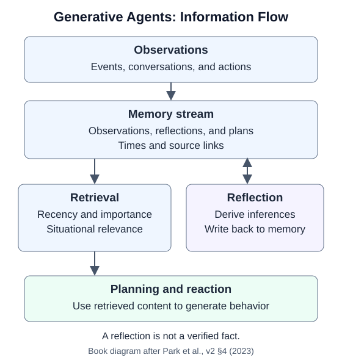
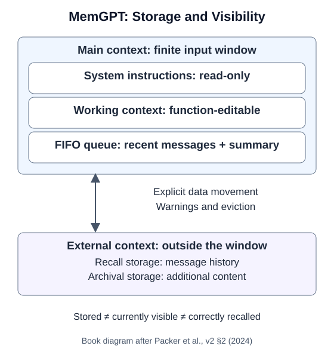
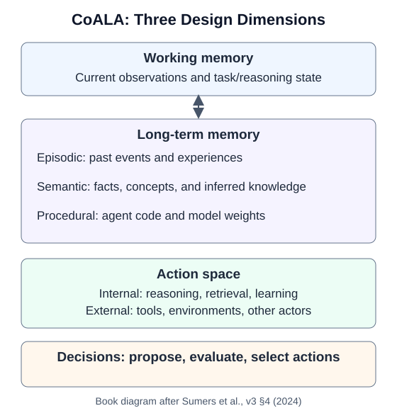

# 4.6 Paper Readings: Eight Design Views on Agent Memory

This section is optional. Complete [the memory practice in 4.5](05_practice_memory_agent.md), then use a paper to explain a concrete tradeoff. The main project requires controlled writes, isolation, recall, and deletion; graphs, automatic consolidation, and multimodal memory are extensions.

Selection and source verification are frozen at 2026-10-22. Both languages cover the same eight works, linked to the versions or final conference text below. We discuss research designs and their evidence boundaries. We have not reproduced their results, and a paper about a named system does not replace current product documentation.

## Reading Route: Start with a Question

| Your problem | Suggested reading | What you should explain afterward |
|---|---|---|
| You do not know where state belongs | CoALA, MemGPT | Memory categories and storage locations are different dimensions |
| Stored experiences are hard to use in the current task | Generative Agents, MemoryBank | The tradeoffs introduced by retrieval and compression |
| An answer joins sources or facts from different times | HippoRAG, Zep | Which problems graph indexing and temporal information address |
| You cannot tell whether memory helps | LongMemEval | How to check recall, reading, and answer correctness separately |
| Compression loses visual details or distinctions | C3M | How summaries, source pointers, and reading budgets work together |

These are complementary views, not a ranking in which every newer method replaces earlier ones. Read two closely and complete the exercise; return to the others when the project needs them.

## Generative Agents: Using Experiences in Decisions

Park et al., *Generative Agents: Interactive Simulacra of Human Behavior*; first published in 2023. We use [v2, 2023-08-06, Sections 4 and 6](https://arxiv.org/html/2304.03442v2).

In a simulation of 25 residents, observations enter a memory stream. Retrieval combines recency, importance, and relevance; generated reflections return to memory for later planning. Evaluations concern behavioral believability and component ablations, rather than factual correctness or business authorization.



**Apply it here:** distinguish observations from inferred conclusions. Keep an inference's sources and inject an incorrect reflection to check whether it overrides original facts. High importance cannot grant tool permissions.

## MemGPT: Managing Access to a Limited Context

Packer et al., *MemGPT: Towards LLMs as Operating Systems*; first published in 2023. We use [v2, 2024-02-12, Sections 2–3](https://arxiv.org/html/2310.08560v2).

Main context contains system instructions, editable working context, and a FIFO message queue. Functions move information between it and external recall/archival storage. A queue manager warns about capacity and evicts messages. External information must be explicitly brought into context. Experiments cover extended conversations and document analysis.



**Apply it here:** persistence does not imply present visibility or correct retrieval. Virtual context does not make one inference window infinite. Bound retrieval calls and returned content; record omissions and overflows. [The layered-memory exercise in 4.7](06b_memgpt_practice.md) is our simplified implementation, not a reproduction.

## MemoryBank: Decay and Repeated Access

Zhong et al., *MemoryBank: Enhancing Large Language Models with Long-Term Memory*; [v3, 2023-05-21, Sections 2 and 4](https://arxiv.org/html/2305.10250v3).

The system organizes conversations, event summaries, and user portraits, retrieves memories, and explores simplified decay and reinforcement: $R=\exp(-t/S)$. Here $t$ measures elapsed time since learning or reset, while recall increases $S$. Evaluation includes qualitative real-dialogue analysis and quantitative simulated-user dialogues.

**Apply it here:** frequent access does not establish truth or importance. Compare time decay against retaining explicitly confirmed preferences; record stale uses and omissions separately. Lower retrieval weight, archival, and user-requested deletion are different operations. Decay cannot implement deletion.

## CoALA: Separating Memory, Actions, and Decisions

Sumers et al., *Cognitive Architectures for Language Agents*; first published in 2023. We use [TMLR version v3, 2024-03-15, Sections 4–5](https://arxiv.org/html/2309.02427v3).

CoALA organizes and compares language agents. It distinguishes working memory from long-term episodic, semantic, and procedural memory; procedural memory includes code and model weights. Internal/external actions and decision procedures are separate dimensions, not a mandatory retrieve–reason–learn–act pipeline.



**Apply it here:** place task state, preferences, source passages, and tool implementations on a diagram, then label each store's readers and writers. A taxonomy helps design; it does not establish the best architecture. Writing a skill into procedural memory still requires independent acceptance.

## HippoRAG: Connecting Distributed Evidence with a Graph Index

Jiménez Gutiérrez et al., *HippoRAG: Neurobiologically Inspired Long-Term Memory for Large Language Models*; NeurIPS 2024. We use [v3, 2025-01-14, Sections 2–3](https://arxiv.org/html/2405.14831v3).

Offline triple extraction and synonym links build a graph. Query entities link to nodes; Personalized PageRank spreads scores, which are aggregated to rank source passages. The authors compare methods on multi-hop QA. This does not establish that vector retrieval cannot support cross-document reasoning or that graphs always win.

**Apply it here:** measure missed cross-passage evidence with [Chapter 6's baseline](../chapter_rag/README.md) before adding a graph. Hold the corpus, reading budget, and answerer fixed. Measure evidence recall and answer support separately, including extraction errors and offline indexing costs.

## Zep: When a Fact Holds and When It Is Learned

Rasmussen et al., *Zep: A Temporal Knowledge Graph Architecture for Agent Memory*; [v1, 2025-01-20, Sections 2–4](https://arxiv.org/html/2501.13956v1).

The paper describes episode, semantic-entity, and community subgraphs. It distinguishes fact-validity time from ingestion time and invalidates conflicting edges. Authors evaluate retrieval and answering on DMR and LongMemEval; results under those versions and settings do not establish a current product ranking.

**Apply it here:** if you learn on October 22 that a preference changed to tea on October 1, retain both dates. Ask about the current preference and September's preference. A newly received record may describe an old fact; ingestion order alone cannot decide replacement. Check extracted dates against sources.

## LongMemEval: Let Evaluation Shape the Design

Wu et al., *LongMemEval: Benchmarking Chat Assistants on Long-Term Interactive Memory*; [ICLR 2025 final paper, Sections 3–5](https://proceedings.iclr.cc/paper_files/paper/2025/file/d813d324dbf0598bbdc9c8e79740ed01-Paper-Conference.pdf).

Its 500 questions cover information extraction, multi-session reasoning, temporal reasoning, knowledge updates, and abstention. The paper separates indexing, retrieval, and reading, examining value granularity, index keys, queries, and reading strategies. Compression into isolated facts can discard details.

**Apply it here:** write expectations independently and locate the failing stage. Retrieving a labeled passage does not establish a correct answer. Include unknown questions. Our exercise below borrows the problem categories; it uses none of the benchmark data and yields no comparable benchmark score.

## C3M: When Is It Safe to Merge Similar Records?

Chen et al., *C3M: Cross-Session Multimodal Memory Maintenance for Long-Horizon Tasks*; optional preprint [v1, 2026-09-24, Sections 2–3](https://arxiv.org/html/2609.29735v1).

Before the final query is known, C3M maintains a bounded active index over persistent source text/images. Updates distinguish same, later-state, distinct, and uncertain relations. Query-time expansion budgets pages, nodes, images, and text. Experiments use MemLens's 195-question agent subset.

**Apply it here:** similarity nominates candidates; it does not authorize a merge. Prepare similar records with different dates or visual details and test whether summaries and sources preserve the distinction. This research extension is optional. We have not reproduced its multimodal models or experimental results.

## Exercise: Ask Six Questions About One History

The following data are authored for this book. Write expected answers manually before selecting the local memory store from 4.5 or another implementation. Temporal versions require an explicit data-model extension: the current preference table overwrites by key and cannot preserve full history.

```text
Owner: alice; explicit storage consent exists for these test records.
r1: Recorded 2026-09-10: write reports in Chinese; current drink preference is coffee.
r2: Recorded 2026-10-02: drink preference changes to tea effective 2026-10-01.
r3: Recorded 2026-10-03: the next report should cover only the third quarter.
Isolation control: bob also explicitly consents to b1 (2026-10-03): write reports in English; drink preference is water.
```

| Question | Independent expectation | Failure to observe |
|---|---|---|
| Which report language? | Chinese, from r1 | A retained record is not retrieved |
| Which language and quarter for the next report? | Chinese and Q3, from r1+r3 | Only one requirement is answered |
| Drink preference on 2026-09-20? | Coffee, using r1 and r2's effective date | Current preference answers a historical question |
| Drink preference on 2026-10-03? | Tea, from r2 | Old information overrides a new state |
| What is alice's birthday? | Insufficient information; abstain | A retrieval hit prompts fabrication |
| Can bob read alice's r1–r3? | No alice records returned; bob may read their own b1 | A matching query crosses owner isolation |

Then revoke alice's stored records. Check that the local active records and queryable index no longer return them, while bob's b1 still returns English and water. Logical deletion in the demo does not establish physical erasure from backups, logs, or disk remnants; those need their own lifecycle handling.

Report each question's sources, expectation, observed result, and failing stage before comparing policies. Change one factor, such as retrieval count or temporal versioning, while keeping other inputs and budgets fixed. This small scope exposes useful tradeoffs and keeps the project moderately challenging.

Next: return to [4.5](05_practice_memory_agent.md) to inspect write/deletion contracts, or continue to [Chapter 5](../chapter_planning/README.md) to examine how memory affects planning and stopping.
