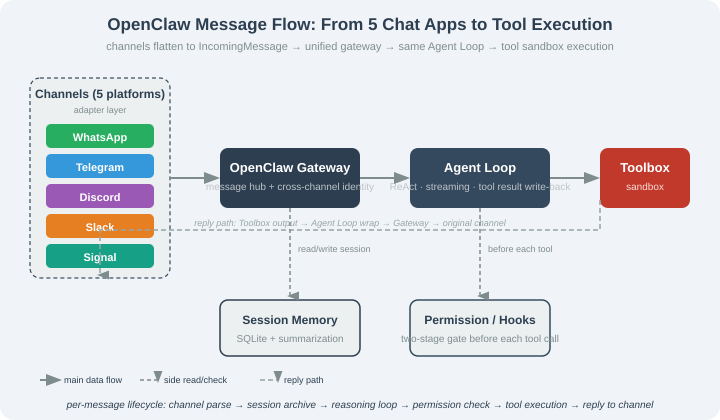

# 12.1 OpenClaw Panorama: From Clawdbot to OpenClaw

> 🦞 *"How a weekend project became a phenomenon — and why its name changed three times."*

---

## Why OpenClaw Matters

Start with a chat-entry question: after a message arrives, who checks identity, selects the session, and authorizes a tool? This connects a minimal Agent with a personal-assistant product.

**OpenClaw** is a case to study through entry points, state, and extension boundaries. Its author recounts the prototype and renaming in the [official introduction dated January 29, 2026](https://openclaw.ai/blog/introducing-openclaw). Repository popularity is not evidence of engineering quality.

---

## A Brief Naming History

The author's [naming retrospective](https://openclaw.ai/blog/introducing-openclaw) supports this sequence. Unsupported prototype repository names and precise intermediate dates are omitted.

| Time | Name or stage | Supported detail |
|---|---|---|
| November 2025 | Clawd / WhatsApp Relay prototype phase | The author dates Clawd's beginning to November 2025 and describes the relay experiment |
| Between names | Moltbot | A rename followed trademark concerns, before another naming change |
| January 29, 2026 | OpenClaw | The official introduction announces the name on this date |

The source-check anchor is [v2026.10.5](https://github.com/openclaw/openclaw/releases/tag/v2026.10.5), [commit 1b58cb9](https://github.com/openclaw/openclaw/commit/1b58cb9a1b4f4353e1add63c8506db4d890962e8), with its [MIT license](https://github.com/openclaw/openclaw/blob/1b58cb9a1b4f4353e1add63c8506db4d890962e8/LICENSE). This fixes identity and source version, not execution verification of every example in this chapter.

What this history teaches:

1. **Naming is engineering** — a wrong name brings recurring trademark/SEO/community costs.
2. **Check third-party implementations separately** — similar names, interfaces, or multiple implementation languages establish neither source lineage nor architecture quality.
3. **OpenClaw chose the community-driven route** — the biggest divide from Claude Code (closed source).

---

## OpenClaw's Place in the Harness Spectrum

| Case | Reading focus |
|---|---|
| [12, OpenClaw](./README.md) | Chat entry points and session boundaries |
| [13, Hermes](../chapter_hermes/README.md) | Memory and skill candidates |
| [14, Claude Code](../chapter_claude_code/README.md) | Code-operation boundaries |
| [15, DeepSeek Harness](../chapter_deepseek_harness/README.md) | Plugin interfaces and lifecycle |

These are teaching perspectives, not claims of product exclusivity.

The "user key" difference is decisive:

| Harness | Primary interface | User key |
|---------|-------------------|----------|
| OpenClaw | Chat apps | `@bot` in WhatsApp/Telegram/Discord/Slack/Signal |
| Hermes | Chat apps + CLI + TUI | Same + `hermes` command |
| Claude Code | Terminal CLI | `claude "fix this bug"` |
| DeepSeek Harness | Web UI + CLI + TUI | Browser 127.0.0.1:3080 / `dsh` |

> 📌 OpenClaw moved the user key from CLI to chat app — a structural change: inputs become shorter and more colloquial, demanding stronger context summarization and ambiguity tolerance.

---

## Three Fundamental Differences from Claude Code

| Dimension | OpenClaw | Claude Code |
|-----------|----------|-------------|
| License | MIT open source | source-available |
| Target scene | Personal assistant, life tasks | Software engineering |
| Interaction | Chat apps + CLI + TUI | Terminal CLI |
| Skill system | Skills (Markdown) + plugins (TS) | Skills / MCP / Hooks |
| Extension | Community + ClawHub market | Private + team config |
| Sandbox | Terminal safety + Docker (recommended) | Permission modes |

Key takeaways: **scene** (not capability) is the dividing line; **license ≠ safety**; **entry point determines design** — a chat entry means "messages must fit in ~1.6K chars," driving summarization and task-decomposition submodules that a CLI entry doesn't need.

---

## The 4 Core Subsystems

### Gateway (message hub)

Normalizes all channels into `IncomingMessage`/`OutgoingMessage`. The flow across the four subsystems is:

### Agent Loop — streaming inference → tool-call parsing → execution → write-back; with compression and permission checks.

### Toolbox — file / shell / web / message / calendar / skill / memory tools for daily tasks.

### Skills & Plugins — `SKILL.md` (Markdown + optional script) registers new capabilities; the format is compatible with Claude Code.

> 💡 These four map directly onto Chapter 8's "six engineering pillars": Gateway ⊂ Channels; Agent Loop ⊂ loop + context; Toolbox ⊂ tools; Skills ⊂ skill system.

---

## Section Summary

| Topic | Key point |
|-------|-----------|
| Positioning | Cross-platform open-source personal assistant in your chat apps |
| Naming | Clawdbot → Moltbot → OpenClaw |
| Spectrum | Multi-channel · consumer · community-driven |
| Core subsystems | Gateway / Agent Loop / Toolbox / Skills |
| vs Claude Code | entry (chat vs CLI), scene (life vs coding), license (MIT vs source-available) |

---

*Next section: [12.2 Installation & 4 Deployment Modes](./02_install_and_deploy.md)*
