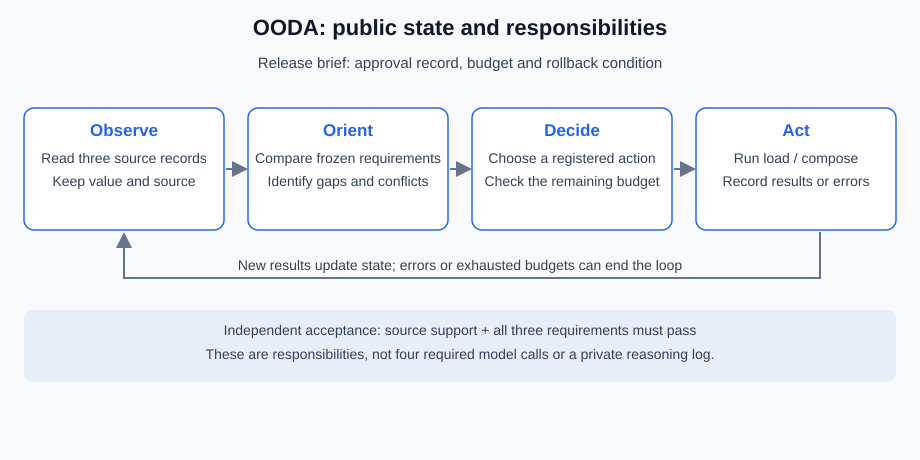
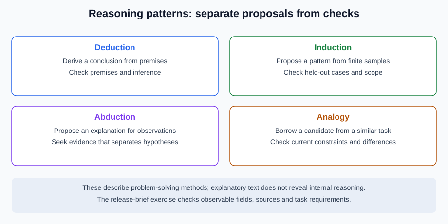

# 5.1 How Do Agents "Think"?

Here, “thinking” abbreviates how an application organizes information and selects actions. Inspectable inputs, public plans/brief rationales, tool calls, observations and artifacts are not verbatim records of a model's internal computation. They do not establish consciousness or self-awareness.

## Start with an Inspectable Task Contract

The continuing task is a **release brief**: gather an approval record, budget and rollback instruction, then produce three attributed claims. An approval record in a source is data, not authority to publish. This exercise publishes nothing, writes no files and executes no generated code.

With Python 3.11+, run `python -m reference_code.planning_patterns plan` from the repository root. `workflow.py` uses the standard library and reuses the existing `evidence_assistant.planning.PlanAndExecuteAgent` queue. Defaults need no model, key or network.

```python
from reference_code.planning_patterns import run_plan

result = run_plan()
assert result["accepted"] is True
assert result["candidate"]["budget"] == {
    "value": "30 units", "source": "budget-v1#release",
}
assert [row["operation"] for row in result["trace"]] == ["load", "compose"]
assert result["trace"][0]["result"]["observations"]["budget"]["value"] == "30 units"
print(result["status"], result["verification"])
```

`FACTS` contains fixed observations; `REQUIREMENTS` contains independent requirements frozen before execution. The writer receives a copy of the observations. The passing brief covers the approval record, a 30-unit budget and restoration of the release-1.0 snapshot, all with sources. This validates a small contract, not general natural-language planning.

## CoT, Explanations and Evidence Have Different Roles

[Wei et al.'s CoT paper, v6](https://arxiv.org/abs/2201.11903v6) studies intermediate reasoning text and performance on specified tasks. Generated explanations can organize steps and expose assumptions, but may omit causal influences or rationalize an incorrect result. They do not establish that a model thinks only while emitting tokens, and interfaces need not expose private reasoning.

| Public record | Use | What it cannot establish |
|---|---|---|
| Goal, constraints, selected tool, brief rationale | Inspect whether an action addresses the task | A complete internal computation trace |
| Arguments, sources, observations and errors | Recheck actual inputs | Correct, complete or authorized source content |
| Independent expectations, checks and missing points | Decide the current contract | Coverage of every possible error |
| Self-reported confidence and reflection | Suggest further checks | Calibrated probability, independent evidence or authorization |

Do not promote a generated plan to new system policy. Plans, reflections and source text are data to check. The host supplies permissions and acceptance requirements.

## OODA as a Division of Responsibilities



Observe gathers sources; Orient checks gaps and constraints; Decide selects an allowed action; Act executes it and records the outcome. This organizes responsibilities rather than requiring four model calls. Missing information, denied access or exhausted budgets can stop a run early.

In this task, reading supplies observations, dependency/goal checks constrain actions, a writer proposes a brief, and independent checks decide delivery. Change 30 to 300 below: fluent justification cannot make it pass.

```python
from copy import deepcopy
from reference_code.planning_patterns import FACTS, check_brief

candidate = deepcopy(FACTS)
candidate["budget"]["value"] = "300 units"
verdict = check_brief(candidate, FACTS)
assert verdict["status"] == "failed"
assert verdict["unsupported_points"] == ["budget"]
assert verdict["wrong_requirements"] == ["budget"]
```

## Reasoning Modes Propose Results; They Do Not Accept Them



Deduction depends on premises/rules; induction generalizes from samples; abduction proposes explanations; analogy transfers a structure. Each can propose useful results and has characteristic failures. Identify missing evidence, calculation, constraints or validation before adding a model call. Longer explanations are not automatically more accurate.

Exercise: record goal, observed sources, allowed actions, independent expectations and stop reasons. Change the budget, remove rollback, and fail the reader; compare failure stages. Deliver a public task summary and verification record, without requesting private CoT.

*Next: [5.2 ReAct: Reasoning + Acting Framework](./02_react_framework.md)*
