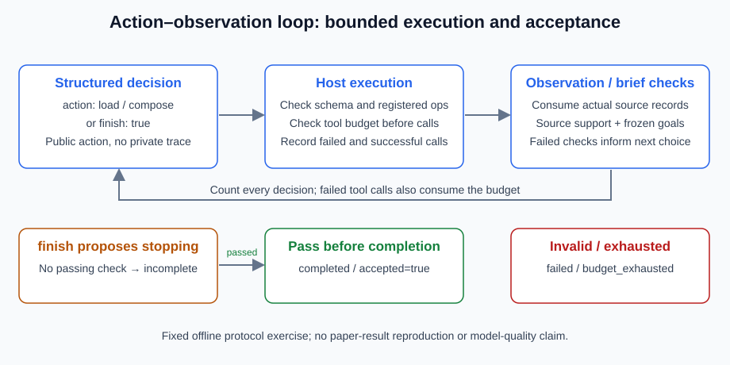

# 5.2 ReAct: Reasoning + Acting Framework

[Yao et al.'s ReAct paper, v3](https://arxiv.org/abs/2210.03629v3) interleaves reasoning text, task actions and environment feedback. This organizes interaction; it does not divide all agents into opaque traditional systems and reliable transparent ReAct systems. Published scores depend on tasks, models and prompts and are not measurements of this application.



## Separate Action Protocol from Free Text

Our structured exercise lets `chooser(snapshot)` inspect public state and observations. It returns only `{"action": "load"}`, `{"action": "compose"}` or `{"finish": True}`. The host owns the tool allowlist, budgets and checks. Unparseable prose is not a final-answer fallback; model-written “Observation” text cannot impersonate a tool result.

This is an offline control-flow exercise, not a reproduction of the paper's prompt/model. The fixed chooser follows state rather than understanding arbitrary language. Source reading and writing are replaceable functions in `reference_code/planning_patterns/workflow.py`:

```python
from reference_code.planning_patterns import run_react

result = run_react()
assert result["accepted"] is True
assert result["budgets"]["decisions_used"] == 3
assert result["budgets"]["steps_used"] == 2
print([(row["operation"], row["status"]) for row in result["trace"]])
```

The normal sequence reads, composes/checks, then proposes termination: three decisions and two tool attempts. The host records observations in the trace, and the next chooser consumes that snapshot. The writer consumes the actual loaded data. No private reasoning chain is requested or retained.

## Finish Is a Proposal to Stop

Reject free text, unknown actions, combined actions and `finish=1`. Even explicit termination remains `incomplete` when independent checks have not passed:

```python
from reference_code.planning_patterns import run_react

def malformed(snapshot):
    return "All done, trust my reasoning."

def premature(snapshot):
    return {"finish": True}

assert run_react(chooser=malformed)["status"] == "failed"
result = run_react(chooser=premature)
assert result["status"] == "incomplete"
assert result["accepted"] is False
assert result["trace"] == []
```

`finish` grants no permission and establishes no complete answer. An approval record in the source does not authorize publishing. The exercise supplies only `load/compose`, without arbitrary Python, shell or file writes. Reuse Chapter 3's restricted arithmetic interface when needed, rather than introducing `eval` or calling that calculator a general sandbox.

## Use Observations to Guide Revisions

A missing rollback point leaves a failed composition and visible gap. Another proposal is allowed within budget; exceptions cannot become ordinary answers. Run `python -m reference_code.planning_patterns react`, then pass `OmitRollbackOnce()` as the writer to observe revision after a missing point. Section 5.4 examines that feedback loop.

A real model may ignore observations, invent rationales or repeat actions. Valid structure establishes parseability, not source support or coverage. A model criticizing itself does not supply a second independent source of evidence.

## Two Budgets and Two Failure Boundaries

`max_decisions` counts chooser calls, including finish; `max_calls` counts tool attempts, including failures. Both require integers in 1..30. Exhaustion before acceptance returns `budget_exhausted`. Neither bounds a blocking callback's elapsed time. External adapters need timeouts, cancellation, authorization and idempotency.

Exercise: always select `load`; allow one tool call, then separately one decision. Record usage and stop reasons. Return “task completed” and verify protocol failure. Compare tasks with known dependencies against tasks requiring new observations, rather than assigning ReAct only to simple work and another pattern universally to production.

*Next: [5.3 Task Decomposition: Breaking Complex Problems into Subtasks](./03_task_decomposition.md)*
