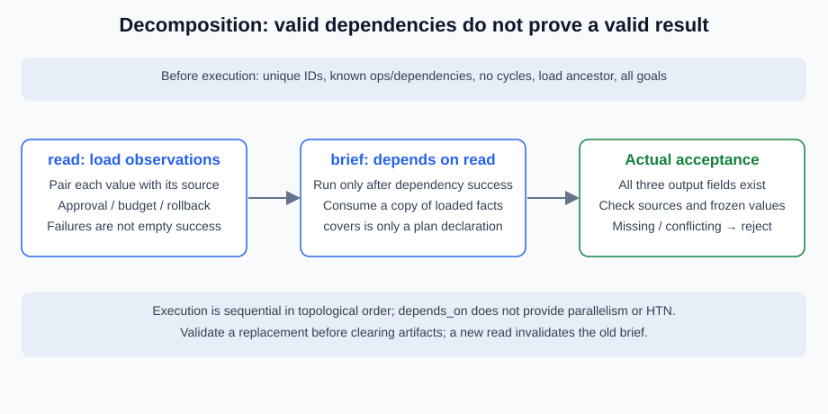

# 5.3 Task Decomposition: Breaking Complex Problems into Subtasks

Decomposition means more than a longer to-do list. Each step needs inputs, dependencies, permitted actions, artifacts and covered goals, enforced during execution. The brief requires an approval record, budget and rollback instruction, not arbitrary summary text.



## Replace an Unchecked List with a Bounded DAG

`Node(id, operation, depends_on, covers)` describes a plan node. `validate_plan` accepts lists of at most 12 nodes and rejects duplicate IDs, missing dependencies, cycles, unregistered actions and omitted goals. It does not consume an infinite generator. A `compose` node must have a `load` ancestor rather than relying on incidental list order.

```python
from reference_code.planning_patterns import default_plan, validate_plan, run_plan

proposal = list(reversed(default_plan()))
ordered = validate_plan(proposal)
assert [node.id for node in ordered] == ["read", "brief"]
result = run_plan(nodes=proposal, max_steps=2)
assert result["accepted"] is True
assert result["budgets"]["steps_used"] == 2
```

Even reversed input produces dependency order `read → brief`. Execution remains sequential; this exercise implements no parallel scheduler. Independent nodes may be parallelizable, but shared writes and dependent reports still require merge/join rules. Lack of dependencies does not establish thread safety.

This exercise retains only the latest source snapshot. The `load` actually consumed by `compose` must be a declared dependency ancestor; otherwise composition rejects the snapshot rather than consuming another branch's data. Multiple loads are not automatically merged. Branch artifacts need a separate explicit selection/join protocol.

## Declared Coverage and Actual Coverage Need Different Checks

`covers` checks omissions in the plan and constrains what each operation may claim. It cannot establish that an artifact meets those goals. A writer can still omit rollback, change a budget or invent a source. Independent `check_brief` checks fields, original observations and frozen values without reading the writer's self-score.

```python
from reference_code.planning_patterns import Node, run_plan

missing_goal = [Node("read", "load"),
                Node("brief", "compose", ("read",), ("budget",))]
result = run_plan(nodes=missing_goal)
assert result["status"] == "failed"
assert result["trace"] == []  # rejected before calling any tool

cycle = [Node("a", "load", ("b",)),
         Node("b", "compose", ("a",), ("approval", "budget", "rollback"))]
assert run_plan(nodes=cycle)["status"] == "failed"
```

Both errors stop before tools run, leaving an empty trace. Cycles cannot be resolved by blindly following list order; omitted goals cannot be delegated to a final fluent paragraph.

## Attempted, Completed and Verified Are Different States

Only a successful read supplies observations. A failed composition/check never enters the completed-node set. When replanning is allowed, a new queue replaces the old one and conservatively invalidates all artifacts, requiring another read. This is easier to verify but spends more calls. Selective reuse would require versioned artifacts, dependency invalidation and idempotency, which are not implemented.

`Session` keeps public trace, candidate and verification separately. Callbacks receive copies; changing a proposed budget cannot change observations or independent requirements. The task uses three fixed structured records and makes no general autonomous decomposition claim.

## What Hierarchical Decomposition Still Needs

Splitting a release into checks, approval and deployment is another modeling layer. JSON containing `leaf/composite` does not implement an HTN planner. Recursive designs need depth, total-node, expansion-call, branch and total-attempt limits, plus checks for missing goals, repeated actions and impossible leaves. This exercise supplies neither HTN nor recursive model planning.

Exercise: remove rollback from `covers`, then separately only from the output. Record static rejection versus dynamic verification failure. Model a task using intermediate artifacts, identify valid parallelism and barriers, and explain which late results cancellation should reject. Deliver a dependency graph, goal map and failure trace without executing generated code or file writes.

*Next: [5.4 Reflection and Self-Correction Mechanisms](./04_reflection.md)*
