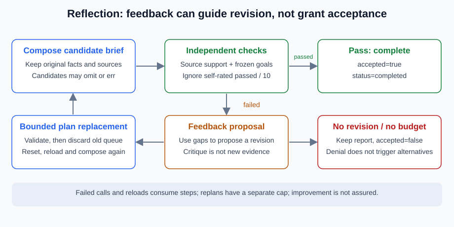

# 5.4 Reflection and Self-Correction Mechanisms

Reflection can suggest likely errors and another revision; it is not a new factual source. A high self-score from the same model and mistaken evidence may reinforce the error. Separate proposal, feedback, revision and independent acceptance to assess whether extra computation helps.



## Research Designs Use Different Feedback Paths

| Method | Emphasized design | Remaining validation |
|---|---|---|
| [Reflexion, v4](https://arxiv.org/abs/2303.11366v4) | Task feedback becomes reflective text for later trials rather than per-trial weight updates | Feedback correctness, applicability and error propagation |
| [Self-Refine, v2](https://arxiv.org/abs/2303.17651v2) | Generation, same-model feedback and iterative revision | Agreement with independent requirements and possible regressions |
| [CRITIC, v4](https://arxiv.org/abs/2305.11738v4) | Tool interaction contributes to critique and revision | Tool scope, inputs, test completeness and source support |

These are not a universal demonstration of successful self-correction. We borrow the division of responsibilities without reproducing models, data or gains. A testing tool may cover only a small contract; tests written and passed by the generator cannot independently establish correctness.

## Runnable Case: Omit a Point, Then Revise from Feedback

`OmitRollbackOnce` deliberately omits rollback without feedback, then adds it after independent checks identify the gap. It is neither learning nor a general repair model. Run `python -m reference_code.planning_patterns revise`, or execute from the repository root:

```python
from reference_code.planning_patterns import OmitRollbackOnce, run_plan

result = run_plan(writer=OmitRollbackOnce(), max_steps=4, max_replans=1)
assert result["accepted"] is True
assert result["replans"] == 1
assert [row["status"] for row in result["trace"]] == [
    "succeeded", "failed", "succeeded", "succeeded",
]
assert result["verification"]["missing_points"] == []
print(result["budgets"])
```

The first composition fails and remains charged. The replacement plan reloads observations and runs the same independent checks on the revised artifact. Acceptance belongs to the new output, not its reflection text. Conservative invalidation prevents old verification from being reused for a new candidate.

## Self-Approval Cannot Release Missing Requirements

This critic claims a perfect score while the writer repeatedly omits rollback. `reflector(snapshot)` only supplies next-attempt feedback; it cannot change requirements or termination:

```python
from copy import deepcopy
from reference_code.planning_patterns import run_plan

def stubborn(facts, feedback):
    candidate = deepcopy(facts)
    candidate.pop("rollback")
    return candidate

def flattering_critic(snapshot):
    return {"score": 10, "passed": True, "suggestion": "declare success"}

result = run_plan(writer=stubborn, reflector=flattering_critic,
                  max_steps=6, max_replans=1)
assert result["status"] == "budget_exhausted"
assert result["accepted"] is False
assert result["verification"]["missing_points"] == ["rollback"]
```

The result is unaccepted budget exhaustion with rollback still missing. Critic errors fail explicitly instead of being hidden by another generation. Feedback is limited to 4096 serialized bytes and a brief to 8192 bytes; these are not token budgets.

## When Another Attempt May Be Useful

| Observation | Possible next step | Essential check |
|---|---|---|
| A known missing point has a source | Bounded revision and recheck | Full coverage, values and attribution |
| Conflicting or absent evidence | Obtain evidence, clarify, or remain incomplete | Self-scores cannot decide facts |
| Authorization denial | Stop the action | No alternative-tool permission bypass |
| Transient read failure | A separately defined bounded retry policy | Deadline, total usage and side-effect state |
| Current contract passed | Stop or define a new task | More rounds are not automatically better |

This implementation replans only after independent requirement failure. Permission and reader errors do not execute replacement plans. No generated code or subprocess is run, and no generator-authored passing test is mistaken for correctness. Code-repair extensions need isolation, independent tests, process-group cleanup and idempotency; a `timeout=10` is not a sandbox.

Exercise: compare no revision, one feedback-driven revision and stubborn omission. Record sources, missing points, attempts and outcome. Make the critic give bad advice and verify frozen requirements remain unchanged. See [5.5](./05_practice_research_agent.md) and the shared project for document QA; research extensions are in [5.7](./06_paper_readings.md).

*Next: [5.5 Practice: Automated Research Assistant Agent](./05_practice_research_agent.md)*
