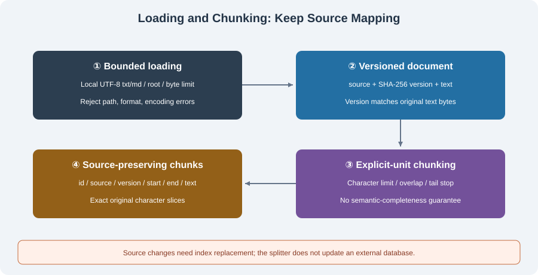

# 6.2 Document Loading and Text Splitting

Retrieval cannot find an answer that extraction never captured. Before chunking, check completeness, readability, and authorization. After chunking, check that each piece maps back to a specific source version. A function returning a string is not a complete data pipeline.



## Loading Must Return More Than Text

A minimal document record needs source identity, content version, text, and extraction status. Add page, heading, row/column, or character locations by format. A shared `source="unknown"` loses the distinction between documents.

| Format | Extraction checks | Unsafe assumption |
|--------|-------------------|-------------------|
| UTF-8 text/Markdown | Encoding, byte limit, source, newlines, original version | A heading always defines a complete semantic unit |
| PDF | Per-page results, empty-page causes, reading order, scanned pages | Text extraction supplies OCR or always returns nonempty strings |
| Word | Paragraph/table order, headers, relevant comments and tracked changes | Moving every table to the end preserves meaning |
| Web page | Authorized URL, status, size, redirects, retrieval time, main content | Removing navigation yields complete trustworthy text |
| Tables/CSV | Rows/columns, units, encoding, missing values | Arbitrary character cuts preserve number interpretation |

Test PDF/Word/web adapters with fixed samples separately. The runnable core here supports local `.txt`/`.md` only, without networking or extra parser installation. Batch imports must report failures as well as successes. Printing errors and returning only successes can make partial ingestion look complete.

## Runnable Loading: Root, Size, and Version

`load_text` in `reference_code/memory_rag/core.py` reads one UTF-8 document within a specified directory. It rejects out-of-root paths/symlinks, unsupported formats, oversized files, and invalid encodings without replacing errors with empty text. Source identity is root-relative; the version is SHA-256 of original bytes.

```python
from pathlib import Path
from tempfile import TemporaryDirectory
from reference_code.memory_rag import load_text

with TemporaryDirectory() as folder:
    path = Path(folder) / "policy.md"
    path.write_text("退款期限为七天。\n保留订单编号。", encoding="utf-8")
    document = load_text(folder, "policy.md", max_bytes=1000)
    assert document.source == "policy.md"
    assert document.text == path.read_text(encoding="utf-8")
    assert len(document.version) == 64
    old_version = document.version
    path.write_text("退款期限为十天。", encoding="utf-8")
    assert load_text(folder, "policy.md").version != old_version
```

This bounds a trusted local directory; it is not an OS sandbox against another process concurrently replacing directories. Services also need access authorization, concurrency rules, sensitive-data policy, and auditing. Cleaned/summarized text needs a separate transformation version rather than pretending its positions still address original PDF bytes.

## Establish Chunking Invariants First

Chunking can use characters, tokenizer tokens, paragraphs, headings, or tables. State the unit. This implementation uses **Unicode code-point windows**, establishing termination, bounds, and source mapping without claiming intelligent semantic segmentation.

```python
from pathlib import Path
from tempfile import TemporaryDirectory
from reference_code.memory_rag import load_text, split_document

with TemporaryDirectory() as folder:
    path = Path(folder) / "policy.md"
    path.write_text("退款期限为七天。\n保留订单编号。\n" * 4, encoding="utf-8")
    document = load_text(folder, "policy.md")
    chunks = split_document(document, max_chars=20, overlap=4)
    assert chunks[0]["start_char"] == 0
    assert chunks[-1]["end_char"] == len(document.text)
    for chunk in chunks:
        assert 0 < len(chunk["text"]) <= 20
        assert chunk["text"] == document.text[chunk["start_char"]:chunk["end_char"]]
        assert chunk["source"] == document.source
        assert chunk["version"] == document.version
    for left, right in zip(chunks, chunks[1:]):
        assert right["start_char"] == left["end_char"] - 4
    print(len(chunks), "exact source slices")
```

Each chunk contains `id/source/version/start_char/end_char/text`. Positions are half-open Python character indices, not UTF-8 bytes, tokens, or PDF page coordinates. Windows need not preserve grapheme clusters or complete concepts. IDs depend on source, version, parameters, and positions. Identical input is reproducible; changed source/parameters yield different IDs.

The invariant is `0 <= overlap < max_chars`. Every next start advances, and reaching the end terminates immediately. Empty documents produce no chunks; invalid parameters fail before iteration. Overlap does not create independent evidence, so merge answers using source/position deduplication.

## Extending Beyond Fixed Windows

| Strategy | Benefit | Remaining checks |
|----------|---------|------------------|
| Character windows | Simple hard bounds and source positions | Can split sentences, units, or tables |
| Paragraph/recursive separators | Prefer natural breaks | Long unbroken text still needs a hard limit; do not manufacture separators |
| Markdown structure | Heading context | Fenced `#` is not a heading; process the final section; synthetic prefixes are not source text |
| Token splitting | Bound length for one tokenizer | Model encodings differ; terminate the tail; validate decoding and source mapping |
| Tables/code structure | Preserve rows, columns, functions, or classes | Oversized-unit rejection/splitting and necessary surrounding context |

Overlap mitigates boundary loss; it does not guarantee a complete sentence in some chunk when the sentence itself exceeds the window. Heading paths and units can be metadata or clearly marked added context. Do not rewrite `text` and retain offsets that falsely refer to unchanged original content.

There is no universal optimum such as “500 characters for QA, 1500 for summaries.” Freeze tasks and compare answer-bearing recall, citation traceability, context budgets, and final coverage. Smaller chunks are not necessarily more precise; larger ones are not necessarily useful context.

## Propagating Updates and Failures

Changed documents require new-version chunks, corresponding index replacement, and stale-cache invalidation. Merely appending random-ID chunks while old records remain searchable does not update the knowledge base correctly. This splitter generates versioned identities; **it does not replace an external vector index**. The index caller still needs old-version removal and rollback for failed updates.

Deletion also examines chunks, vectors, summaries, and answer caches. Preserve authorization scopes when chunking rather than expecting the generator to infer them later. Extraction failure, empty text, missing provenance, and unverifiable excerpts need distinct states; the business layer decides whether partial ingestion can proceed.

## Verification and Exercise

```bash
python -m reference_code.memory_rag chunks
python -m unittest discover -s examples/integration_tests -p test_memory_rag_chapters.py -v
```

Tests cover short/empty documents, unbroken text, tail termination, invalid parameters, Chinese/emoji, size limits, out-of-root links, source changes, and deterministic IDs. Add a unit explanation crossing a chunk boundary and assess whether it still answers the question. If not, adjust the strategy and recheck coverage rather than counting chunks alone.

*Next: [6.3 Vector Embeddings and Vector Databases](./03_embeddings_vectordb.md)*
