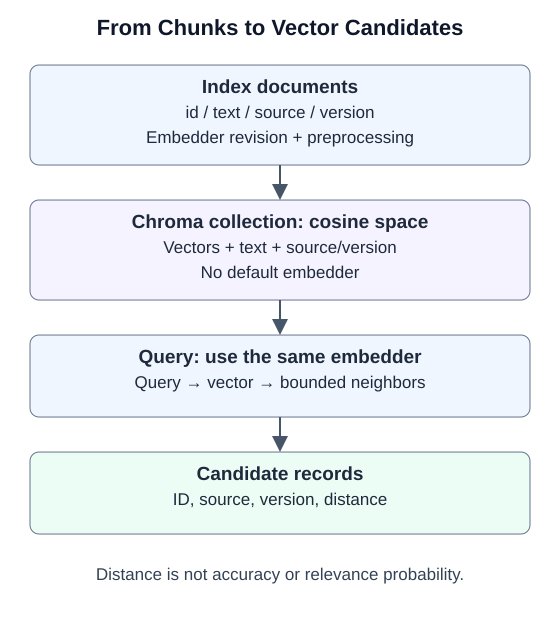

# 6.3 Embeddings and Vector Databases

Following [source-preserving chunking in 6.2](02_document_loading.md), store attributed passages in real Chroma and inspect distances, filters, reopening, and deletion. The implementation lives separately in `reference_code/vector_retrieval/`: a small storage layer rather than another application framework.

## Similarity Does Not Verify a Fact

An embedder maps text to vectors. Documents and queries need the same model revision and preprocessing to share a comparison space. Matching dimensions alone do not establish compatibility. Changing the model, chunking, or preprocessing calls for a new index and regression evaluation before switching readers.

Compare cloud and local embedders on your questions: evidence recall, answer support, latency, storage, and data-handling requirements. Cloud calls incur service charges; local models still involve downloads, hardware, maintenance, and licenses. Neither larger dimensions nor a newer release alone establishes task suitability.



The companion explicitly selects cosine distance. For nonzero vectors $x,y$:

$$
\begin{aligned}
\operatorname{cos}(x,y)&=\frac{x\cdot y}{\|x\|\|y\|}\\
d_{cos}&=1-\operatorname{cos}(x,y)
\end{aligned}
$$

Similarity is theoretically in $[-1,1]$, and distance in $[0,2]$, subject to floating-point error. Neither is accuracy nor a relevance probability. Interpret `1-distance` only after establishing the metric; default L2 distance does not have this meaning. Chroma's [configuration documentation](https://docs.trychroma.com/docs/collections/configure) defines its metrics and index parameters.

Chroma stores float32 vectors. The wrapper first scales by the maximum absolute component, then applies L2 normalization so tiny or huge finite Python values do not become all-zero or infinite vectors in storage. Collection metadata records this rule. It preserves cosine direction, not exact arithmetic or semantic quality.

## Retain Source and Embedding Revisions

A `Record` retains `id`, `text`, `source`, and `version`. Map 6.2's chunk dictionaries by these fields. Original offsets remain in the loading/chunking records; this vector wrapper does not additionally persist them. Record `version` distinguishes content revisions, while collection metadata stores `embedding_id` and dimension.

| Entry point | Contract | Failure behavior |
|---|---|---|
| `VectorStore(path, embed, embedding_id=..., dimension=...)` | Explicit cosine space; no default embedder; same-named collection must match provenance/configuration | Reject incompatibility; use a new collection |
| `add(records)` | At most 100 chunks per batch, 2000 per collection; nonempty source/version/text, unique IDs, finite nonzero vectors | Validate this batch before writing; reject duplicate IDs |
| `search(query, limit=..., source=..., min_cosine=...)` | Same injected embedder for documents/queries; return IDs, sources, versions, distances | Return early for an empty collection; propagate other errors |
| `records()` / `delete_source(source)` | Read current records or delete a named source | Deletion is not archival or proof of physical erasure |

`embed(texts)` must return vectors in input order. If a provider's batch response has indices, the adapter must validate completeness and restore input order. The caller declares `embedding_id`; it does not detect an adapter falsely reporting its revision.

This is a single-writer local exercise. Concurrent updates, multi-call transactions, and online migration are outside its scope. Storage failures may require inspection and rebuilding; catching every exception and returning an empty list would disguise failure as missing evidence.

## Run Offline: Make a Wrong Ranking Visible

From the repository root, use Python 3.11+ and the pinned `examples/requirements.txt` environment. This validation uses ChromaDB 1.5.9.

```bash
python -m reference_code.vector_retrieval
python -m pytest examples/integration_tests/test_vector_retrieval.py -q
```

This complete database exercise uses `fixed_embeddings`, which accepts only the companion's fixed text and returns manually assigned 3D vectors. It deliberately places the 500 document closer to the query than the 404 document. It exposes a ranking error; it is not a semantic embedding model.

```python
from tempfile import TemporaryDirectory
from reference_code.vector_retrieval import VectorStore
from reference_code.vector_retrieval.fixture import build_fixture, fixed_embeddings

with TemporaryDirectory() as directory:
    store = build_fixture(directory)
    hits = store.search('404', limit=3)
    assert [hit.record.id for hit in hits][:2] == ['http500-v1:0', 'http404-v1:0']
    assert abs(hits[1].distance - 0.2) < 1e-6
    only_404 = store.search('404', source='http404.md')
    assert [hit.record.id for hit in only_404] == ['http404-v1:0']
    assert store.search('birthday', min_cosine=0.8) == []
    reopened = VectorStore(directory, fixed_embeddings,
                           embedding_id='book-fixture-v1:exact-text', dimension=3)
    assert len(reopened.records()) == 3
    reopened.delete_source('http404.md')
    assert reopened.records(source='http404.md') == []
    assert len(reopened.records()) == 2
```

Even first place for the 404 document would establish only retrieval order. A `source` filter selects data; when callers can choose it, it cannot implement authentication or tenant authorization. See [4.3](../chapter_memory/03_long_term_memory.md) for memory consent and owner isolation.

## Before Connecting a Real Embedder

Check response count, ordering, dimension, finite values, and model revision on a small batch before injecting the adapter. Retain original text and stable IDs. Create independent questions covering answerable and unanswerable cases. Select thresholds on a development set rather than repeatedly tuning against test expectations.

Chroma's [`query` and `get` documentation](https://docs.trychroma.com/docs/querying-collections/query-and-get) distinguishes similarity search from conditional reads. In this version, IDs are always returned and are not an `include` item. Multiple metadata conditions use [logical filter expressions](https://docs.trychroma.com/docs/querying-collections/metadata-filtering). The companion accepts only a single source filter, avoiding arbitrary model-generated filter dictionaries.

**Validation boundary:** real Chroma writes, cosine distances, filtering, reopening in a separate process, and source deletion run in tests. Incompatible revisions, duplicate IDs, and malformed vectors are rejected. No embedder was downloaded or called; semantic recall, production load, and backup erasure remain untested.

Next: [6.4 Retrieval Strategies and Reranking](04_retrieval_strategies.md) uses the same record IDs to correct this fixture's ranking.
