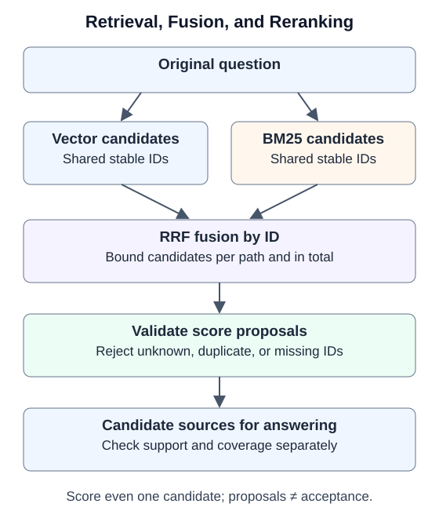

# 6.4 Retrieval Strategies and Reranking

[The fixture in 6.3](03_embeddings_vectordb.md) ranks a 500 document above a 404 document for query `404`. Add lexical retrieval, rank fusion, and validated reranking proposals over the same source IDs. Observe what each stage changes; none directly accepts an answer.



## Both Retrieval Paths Need the Same Identity

Lexical retrieval exposes identifier and term matches; vector retrieval finds neighbors in an embedding space. They may complement each other, or both miss evidence. If lexical results use `doc_0` while vector results use unrelated UUIDs, the same passage cannot be fused. Text-only deduplication can conflate distinct sources or versions.

Both companion paths use `Record.id`, retaining `source` and `version`. Conflicting content under one ID is rejected. Equal text with different IDs remains attributed separately. Content deduplication would need an additional provenance mapping.

`bm25_search` uses BM25's term frequency, inverse document frequency, and length normalization. Its teaching tokenizer supports ASCII identifiers and adjacent CJK bigrams, rather than general Chinese semantics or every language. Fixed `k1=1.2,b=0.75` are exercise choices, not optimal values. See [Robertson and Zaragoza's review](https://www.staff.city.ac.uk/~sbrp622/papers/foundations_bm25_review.pdf) for the method's background.

## Fuse Ranks Rather Than Assuming Comparable Scores

Cosine similarity and BM25 scores mean different things. Decimal notation does not make them directly additive. The companion uses Reciprocal Rank Fusion (RRF):

$$
\operatorname{RRF}(d)=\sum_{L:d\in L}\frac{1}{k+\operatorname{rank}_L(d)}
$$

Ranks start at one. A document absent from a list receives no contribution from it. The exercise sets `k=60` and bounds candidates per path; duplicate IDs within a path are rejected to prevent extra votes. RRF scores are not confidence. See [Cormack et al., SIGIR 2009](https://cormack.uwaterloo.ca/cormacksigir09-rrf.pdf).

The sequence is bounded vector candidates plus bounded BM25 candidates, fusion by ID, then a candidate limit. Reranking cannot recover evidence missing from every initial list. More candidates increase downstream reading costs; quantity alone does not establish quality.

## A Reranking Score Remains a Proposal

`rerank(query,candidates,scorer,...)` requires exactly one `{id,score}` proposal per candidate, with finite scores in $[0,1]$. Missing, duplicate, unknown IDs and malformed output are rejected. Scorer exceptions propagate.

Even one candidate must be scored and pass the threshold. A small set cannot be labeled relevant merely because it is small. Validation establishes proposal format and identity, not evidence support or complete coverage of the final answer. Those require downstream independent acceptance.

When connecting a real reranker, treat source text as data, preserve fixed evaluation rules, and bound per-candidate and total input. Instructions embedded in candidates must not control the workflow. Prompt wording cannot replace host permissions and budgets. The companion does not implement live model calls, truncation policies, or a semantic verifier.

## Complete Offline Exercise

Run this code from the repository root with the pinned dependencies. `fixture_scorer` assigns predefined scores for query `404` and the fixed documents. It makes the mechanism observable; it is not a general reranking model.

```python
from tempfile import TemporaryDirectory
from reference_code.vector_retrieval import hybrid_search, rerank, Ranked, query_variants
from reference_code.vector_retrieval.fixture import build_fixture, fixture_scorer, RECORDS

with TemporaryDirectory() as directory:
    store = build_fixture(directory)
    hybrid = hybrid_search(store, '404', limit=3)
    assert hybrid[0].record.id == 'http404-v1:0'
    assert len({hit.record.id for hit in hybrid}) == 3
    proposed = rerank('404', hybrid, fixture_scorer, min_score=0.5)
    assert [hit.record.id for hit in proposed] == ['http404-v1:0']
    assert rerank('404', [Ranked(RECORDS[1], 1.0)], fixture_scorer) == []
    assert query_variants('404', [' 404 ', 'missing resource path']) == ['404', 'missing resource path']
```

Fusion places the 404 source first, and the fixture scorer retains only that candidate. The isolated 500 candidate is rejected as well. No answer is generated. The CLI keeps `answer_accepted` at `false` so a ranking exercise cannot count as completed QA.

## Query Expansion: Preserve Intent and Bound Work

Expansion can try synonyms, abbreviations, or temporal constraints, but a model may change the information need. `query_variants` retains the original, removes duplicates, and limits proposals to two and each query to 200 characters. It does not establish semantic equivalence. The example validates proposal shape only; it never embeds `missing resource path`, and the fixed embedder does not support arbitrary text.

When connected to retrieval, every retained query consumes call and candidate budgets. Merge by stable IDs and evaluate support and coverage against the **original question**. Record expansion failures explicitly. Whether to fall back to the original query is a predefined caller policy, not a silent success path.

## Compare Benefits on Independent Questions

Freeze sources, versions, and expectations before comparing vector retrieval, BM25, fusion, and reranking. Include exact identifiers, cross-passage requirements, and absent evidence. Record evidence Recall@k, input size, time, and answer acceptance. Track candidate relevance, citation presence, source support, and requirement coverage separately. Change one policy at a time, keeping models, chunking, and budgets fixed.

Tests cover real storage, same-ID fusion, duplicate/conflict rejection, irrelevant single candidates, malformed reranking output, and propagated errors. Both languages' Python blocks actually execute. Expected ordering on fixed data does not establish quality gains on real corpora; live model cost and latency are untested.

Next: [6.5 Document QA Agent](05_practice_qa_agent.md) passes candidate sources to separate answering and acceptance stages.
