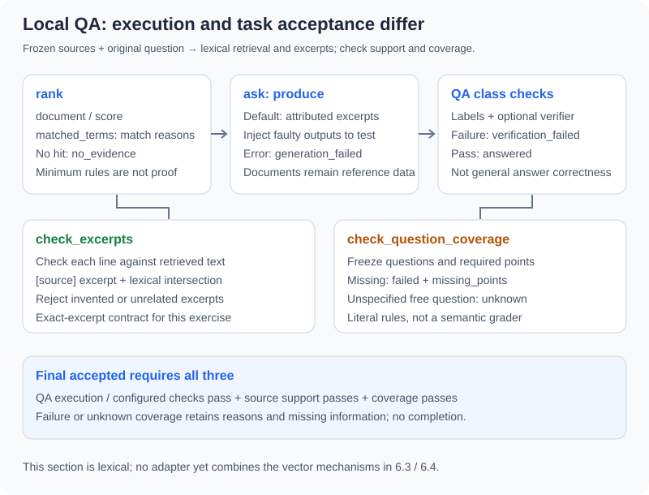

# 6.5 Practice: Intelligent Document Q&A Agent

Use a fictional refund policy for an inspectable local exercise: retrieve material, produce attributed excerpts, then check source support and question coverage separately. Defaults call neither a model nor an embedding service and need no key. Reuse `reference_code/evidence_assistant/` directly rather than maintaining another Q&A class with the same name.

## Iteration and Acceptance

- **Previous limitation**: A retrieval hit and citation label may still leave the actual question unanswered; producing text is not enough for delivery.
- **This chapter adds**: Explainable lexical matches, retained retrieval/generation/verification states, independent excerpt checks, and frozen task requirements.
- **How to verify**: Preserve expected and actual outcomes for success, same-topic missing answers, unrelated material, fabricated content, bad citations, verifier rejection/errors, and changed sources. Every Python block below runs independently from the repository root.
- **Next step**: Use the [local-document research assistant](../learning_project.md) for several questions and an overall call budget; continue to [Chapter 7](../chapter_context_engineering/README.md) to control the actual model input further.



## Read the Three Interface Contracts First

| Existing module/entry | Used here | What it does not establish |
|---|---|---|
| `rag.py`: `Document(source, text)`, `rank`/`ask` | In-memory material, explainable lexical ranking, state-bearing answers | No built-in persistent index, content versions, or multi-format loader |
| `research.py`: `check_excerpts`/`verify_excerpts` | Each `[source] original excerpt` line maps to a retrieved original and shares lexical terms | No general semantic entailment for paraphrases/summaries or real-world source authenticity |
| `task_acceptance.py`: `check_question_coverage` | Independently frozen literal requirements for a matching question; `unknown` without a specification/verifier | Not a general natural-language grader, citation checker, or permission check |

`rank` returns `document/score/matched_terms`; the score counts distinct matched terms. The baseline uses English words and basic Chinese bigrams, filtering generic phrases. Filtering and minimum-match rules reduce some weak hits; they establish neither semantic retrieval nor a correctness probability.

`ask` returns a dictionary containing `status/answer/retrieved_sources/sources/retrieval/generation/verification/retryable`. Its default producer quotes retrieved material. An `answerer(messages)` can replace generation, but its output still needs acceptance. Fixed system rules, reference data, and the current question remain separate messages.

`answered` means this class's configured checks passed. **Without a verifier, only citation labels are checked; `answer_accepted(result)` cannot manufacture source support or question coverage.** That result records `semantic_support=not_checked`. Final acceptance here additionally requires independent source checks and `coverage.status == "passed"`. `sources` contains citations used by an answer passing the class's checks; `retrieved_sources` is the candidate list. Failed answers cannot present that entire list as verified citations.

## Normal Path: Freeze the Question and Requirements First

The task asks for the refund deadline and required proof. Documents, question, and requirements are fixtures. English text makes lexical matches easy to inspect; this is not a language-understanding benchmark. The seven-day and receipt requirements are fixed before invoking the producer, which cannot rewrite them:

```python
from reference_code.evidence_assistant.rag import Document, DocumentQAAgent, answer_accepted
from reference_code.evidence_assistant.research import check_excerpts, verify_excerpts
from reference_code.evidence_assistant.task_acceptance import check_question_coverage

question = "What is the refund deadline and required proof?"
# Freeze requirements independently of the answer producer.
tasks = [{"question": question, "requirements": [
    {"id": "deadline", "description": "seven-day refund deadline", "all_of": ["seven days"]},
    {"id": "proof", "description": "receipt required", "all_of": ["receipt"]},
]}]
documents = [Document("policy-v1",
    "Refund requests are accepted within seven days and require a receipt.")]
qa = DocumentQAAgent(documents, verifier=verify_excerpts)
hits = qa.rank(question)
assert hits[0]["document"].source == "policy-v1"
assert hits[0]["score"] == len(hits[0]["matched_terms"])
retrieved = [hit["document"] for hit in hits]
result = qa.ask(question)
support = check_excerpts(question, result["answer"], retrieved)
coverage = check_question_coverage(question, result["answer"], specs=tasks)
accepted = (answer_accepted(result) and support["status"] == "passed"
            and coverage["status"] == "passed")
assert accepted is True
assert result["sources"] == ["policy-v1"]
print({"qa": result["status"], "support": support["status"],
       "coverage": coverage["status"], "accepted": accepted})
```

Expected `qa/support/coverage` values are `answered/passed/passed`, with `accepted: True`. `verify_excerpts` supplies the QA class's independent Boolean callback; the separate `support` dictionary preserves detailed reasons. Both check excerpts only. `check_question_coverage` calls no generator and independently checks the two requirements. Case/whitespace normalization tolerates formatting changes, not replacing seven days with ten.

The exercise freezes documents during the call, so `rank` and `ask` use the same list. A service must not silently change data or permissions between them. Source labels are unique in this fixture; an external-data adapter must additionally check duplicate/invalid identities, retain stable versions, and preserve the retrieved snapshot.

## Related Material Can Still Leave the Task Incomplete

A receipt-only policy provides a valid excerpt without a deadline. An arbitrary question also cannot inherit another question's expectations:

```python
from reference_code.evidence_assistant.rag import Document, DocumentQAAgent
from reference_code.evidence_assistant.research import verify_excerpts
from reference_code.evidence_assistant.task_acceptance import check_question_coverage

question = "What is the refund deadline and required proof?"
tasks = [{"question": question, "requirements": [
    {"id": "deadline", "description": "seven-day refund deadline", "all_of": ["seven days"]},
    {"id": "proof", "description": "receipt required", "all_of": ["receipt"]},
]}]
qa = DocumentQAAgent([Document("policy-v1", "Refund requests require a receipt.")],
                     verifier=verify_excerpts)
result = qa.ask(question)
coverage = check_question_coverage(question, result["answer"], specs=tasks)
assert result["status"] == "answered"  # A supported excerpt, not a complete answer.
assert coverage["status"] == "failed"
assert coverage["missing_points"] == ["seven-day refund deadline"]

free_question = "What is the refund owner's birthday?"
free = qa.ask(free_question)
unknown = check_question_coverage(free_question, free["answer"], specs=tasks)
assert unknown["status"] == "unknown"
absent = qa.ask("Mars weather?")
assert absent["status"] == "no_evidence"
assert absent["generation"]["status"] == "not_started"
print({"missing": coverage["missing_points"], "free_question": unknown["status"],
       "unrelated": absent["status"]})
```

These are three different outcomes: a hit missing the seven-day requirement, a hit with no matching task contract, and no retrieval hit. None establishes completion. `unknown` means no criterion was configured, not proven unanswerability. `no_evidence` means this retrieval found no candidate, not that no evidence exists anywhere.

`ask` performs no retries. `retryable` is a hint for the host, not permission to rewrite queries indefinitely until something is retrieved. New queries need query/call limits and acceptance against the original question. Repeating a request with no evidence does not supply the answer.

## A Valid Label Can Still Cite Unsupported Content

Inject a fixed faulty output, without making a real model request:

```python
from reference_code.evidence_assistant.rag import Document, DocumentQAAgent, answer_accepted
from reference_code.evidence_assistant.research import check_excerpts, verify_excerpts

policy = Document("policy-v1", "Refund requests are accepted within seven days.")
wrong = "[policy-v1] Refund requests are accepted within ninety days."
# A scripted faulty producer, not a real language-model call.
producer = lambda messages: wrong
labels_only = DocumentQAAgent([policy], producer).ask("refund deadline")
assert answer_accepted(labels_only) is True
assert labels_only["verification"]["semantic_support"] == "not_checked"
support = check_excerpts("refund deadline", labels_only["answer"], [policy])
assert support["code"] == "unsupported_excerpt"
assert support["status"] == "failed"

checked = DocumentQAAgent([policy], producer, verifier=verify_excerpts).ask("refund deadline")
assert checked["status"] == "verification_failed"
assert answer_accepted(checked) is False
assert checked["sources"] == []
assert checked["retrieved_sources"] == ["policy-v1"]
print(checked["status"], support["code"])
```

This is why default `answered` is insufficient for delivery. With the excerpt verifier, ninety days cannot be found in the seven-day source, so the result is `verification_failed`. The retrieved `policy-v1` remains in `retrieved_sources`, while `sources` is empty. If free paraphrases are later allowed, use an appropriate independent support checker or human review rather than reducing the rule to label presence.

## Preserve Failures Instead of Empty Strings or Replacement Success

```python
from reference_code.evidence_assistant.rag import Document, DocumentQAAgent, answer_accepted

policy = Document("policy-v1", "Refund requests are accepted within seven days.")
for output, status, error in [
    ("  ", "generation_failed", "empty_or_non_string_answer"),
    (None, "generation_failed", "empty_or_non_string_answer"),
    ("Seven days.", "verification_failed", "missing_citations"),
    ("[invented] Refunds take seven days.", "verification_failed", "unknown_citations"),
]:
    result = DocumentQAAgent([policy], lambda messages: output).ask("refund")
    assert result["status"] == status
    stage = "generation" if status == "generation_failed" else "verification"
    assert result[stage]["error"] == error
    assert answer_accepted(result) is False

def broken_verifier(question, answer, documents):
    raise RuntimeError("fixed verifier failure")

for verifier, error in [
    (lambda question, answer, documents: False, "task_requirements_not_met"),
    (lambda question, answer, documents: 1, "task_requirements_not_met"),
    (broken_verifier, "verifier_error"),
]:
    result = DocumentQAAgent([policy], verifier=verifier).ask("refund")
    assert result["status"] == "verification_failed"
    assert result["verification"]["error"] == error
    assert result["generation"]["status"] == "succeeded"
print("output, citation, and verifier failures retained")
```

| Overall state | Actual meaning |
|---|---|
| `retrieval_failed` | Retrieval or source-label validation raised; not equivalent to no hit |
| `no_evidence` | Retrieval is empty; generation has not started and verification has not run |
| `generation_failed` | Generation raised or returned whitespace/non-string output |
| `verification_failed` | Missing, unknown/unretrieved citations, or configured verifier rejection/error |
| `answered` | Class-level checks passed; delivery still depends on required support and coverage |

Provider `TimeoutError`/`ConnectionError` retains its type and is marked retryable; a normal `RuntimeError` is not treated as transient. `KeyboardInterrupt` is not converted into success or an ordinary result. Verifiers must return exactly Boolean `True`. Exceptions retain `verifier_error`; another generated answer cannot conceal a broken acceptance criterion.

## Recheck Old Answers and Expectations After Source Changes

```python
from reference_code.evidence_assistant.rag import Document, DocumentQAAgent
from reference_code.evidence_assistant.research import check_excerpts, verify_excerpts
from reference_code.evidence_assistant.task_acceptance import check_question_coverage

question = "What is the refund deadline?"
tasks = [{"question": question, "requirements": [
    {"id": "deadline", "description": "seven-day deadline", "all_of": ["seven days"]},
]}]
old = Document("policy-v1", "Refund requests are accepted within seven days.")
old_result = DocumentQAAgent([old], verifier=verify_excerpts).ask(question)
updated = Document("policy-v2", "Refund requests are accepted within ten days.")
new_result = DocumentQAAgent([updated], verifier=verify_excerpts).ask(question)
assert check_excerpts(question, old_result["answer"], [updated])["status"] == "failed"
coverage = check_question_coverage(question, new_result["answer"], specs=tasks)
assert new_result["status"] == "answered"
assert coverage["status"] == "failed"  # A policy change requires a specification review.
print(new_result["sources"], coverage["missing_points"])
```

`Document` contains only a source label and text. Here the caller supplies `v1/v2`; **there is no automatic version management**. Excerpt checks can reject answers quoting an old body, but do not decide whether a policy change is legitimate. The ten-day revision no longer satisfies the old seven-day requirement. Review the source and business contract before freezing a revised expectation; the producer cannot update tests to match its answer.

[Section 6.2](./02_document_loading.md) supplies original SHA-256 versions and character offsets. An adapter should map chunk IDs, source versions, and positions into the QA citation manifest, then check against the actual retrieved snapshot. Duplicate sources, stale-index removal, permission changes, and cache invalidation also belong to that adapter contract; the two-field `Document` does not implement them automatically.

## Where to Stop and How to Continue

| Existing exercise | Relationship to this section | Separate integration still required |
|---|---|---|
| [6.2 Loading/chunking](./02_document_loading.md) | Exact text, stable source versions, and positions | Map loaded chunks to the QA citation manifest |
| [6.3 Vector storage](./03_embeddings_vectordb.md), [6.4 Fusion/reranking](./04_retrieval_strategies.md) | Separate `reference_code/vector_retrieval/` mechanisms return candidates, not answers | No adapter currently combines them with this QA class; preserve identity, version, budgets, and failures |
| This lexical QA | Positive/negative cases, excerpt support, frozen requirements | No PDF/Word/web ingestion, semantic encoder, conversation history, or deployed service |
| [Research project](../learning_project.md) | Already combines local documents, multiple questions, context, and Harness budgets | Default specifications apply only to bundled tasks; custom documents need their own specification or verifier |

From the repository root:

```bash
python examples/chapter06/doc_qa_agent.py
python -m unittest examples.integration_tests.test_rag_qa_chapter -v
python -m reference_code.evidence_assistant --format json
```

The first command shows raw QA stage states without this section's full coverage specification. The third is a separate, specified multi-question application. Neither establishes that every retrieval technique in the chapter is combined into one product. Code and tests here use no extra dependency or online call. Real-model quality, semantic retrieval, multi-excerpt adequacy, and production permissions need separate testing.

Exercise: add a question requiring two sources and freeze two required points first. Remove one source, change a key number, and return an unsupported paraphrase. Submit match reasons, stage states, support decisions, missing requirements, and the final outcome. Close this evidence loop before choosing vectors, additional formats, or a more complex Agent loop.

*Next chapter: [Chapter 7: Context Engineering](../chapter_context_engineering/README.md)*
