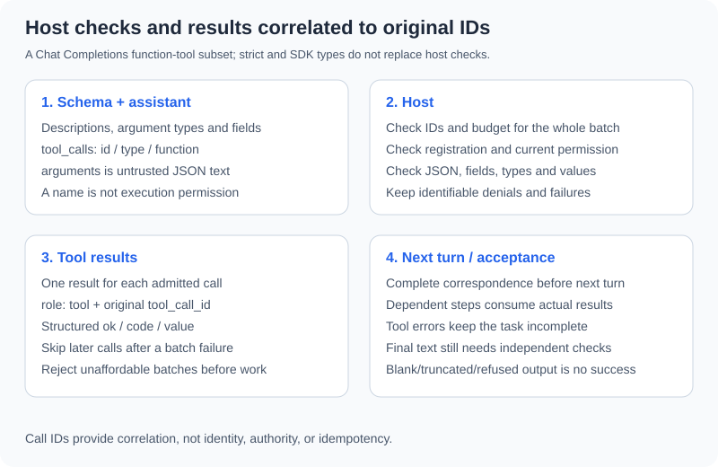

# 3.2 Function Calling Mechanism Explained

This section uses **Chat Completions function-tool messages**. The locally tested OpenAI SDK version is 2.54.0. The fixed provider needs neither SDK nor key; SDK-type and HTTP-mock tests use the integration environment. Official documentation was checked on 2026-10-22; installing an SDK does not establish model support for every setting.



## Schema Describes Capabilities, Not Permission

```python
from reference_code.tool_calling import tool_specs

schema = next(tool for tool in tool_specs() if tool["function"]["name"] == "calculate")
assert schema["type"] == "function"
assert schema["function"]["strict"] is True
assert schema["function"]["parameters"]["required"] == ["expression"]
assert schema["function"]["parameters"]["additionalProperties"] is False
print(schema)
```

The full object is `tool_specs` in `reference_code/tool_calling/core.py`. `strict`, string types, required fields, and forbidden extra properties describe admissible shape. The [official function-calling guide](https://developers.openai.com/api/docs/guides/function-calling) gives supported-schema/configuration conditions for strict mode: objects forbid additional properties and declared properties are required. This example selects the mode explicitly.

The host still checks JSON, size, types, fields, resource/value ranges, and authorization. Schema cannot establish truth, necessity, or the correct user's resource. Other providers, offline substitutes, and saved messages also require validation. Type annotations or dataclasses alone are not runtime validators.

## Return Each Result to Its Original Call ID

```python
import json
from reference_code.tool_calling import ToolHost, function_call

call = function_call("calc-demo-1", "calculate", {"expression": "12 * 8"})
assistant = {"role": "assistant", "content": None, "tool_calls": [call]}
result = ToolHost().execute(call["function"]["name"], call["function"]["arguments"])
tool_message = {"role": "tool", "tool_call_id": call["id"], "content": json.dumps(result)}
messages = [{"role": "user", "content": "Calculate 12 * 8"}, assistant, tool_message]
assert messages[-1]["tool_call_id"] == messages[-2]["tool_calls"][0]["id"]
assert json.loads(messages[-1]["content"])["value"]["value"] == 96
print([message["role"] for message in messages])
```

The roles are `user/assistant/tool`. Retain the assistant call message, then append one tool result per call with the original `tool_call_id`. A result is not an ordinary assistant answer. The full loop sends these observations back to the provider before independently accepting the final answer.

An ID correlates protocol messages; it supplies neither authentication, permission, nor a cross-retry idempotency key. The companion checks the entire batch before execution and rejects missing, duplicate, or reused IDs. Unsupported message forms fail. Its IDs accept 1–64 ASCII letters, digits, underscores, or hyphens: a declared teaching-subset restriction.

## SDK Types Do Not Validate Business Arguments

```python
from importlib.metadata import version
from openai.types.chat import ChatCompletionMessage
from reference_code.tool_calling import ToolHost, function_call

assert version("openai") == "2.54.0"
# Deserialize an artificial SDK message, without a client or request.
wire = function_call("sdk-demo-1", "calculate", {"expression": True})
message = ChatCompletionMessage(role="assistant", content=None, tool_calls=[wire])
call = message.tool_calls[0]
assert isinstance(call.function.arguments, str)
result = ToolHost().execute(call.function.name, call.function.arguments)
assert result["code"] == "invalid_arguments"
print(result)
```

This creates an artificial SDK message only. `arguments` remains a JSON string; local message typing does not perform the calculator's business checks. The host rejects a Boolean expression. Tests additionally use the real SDK with `httpx.MockTransport` to inspect serialization and three-round ID correspondence. No service request, server-side strict behavior, or model-selection quality is tested.

## Controlling Proposals Differs from Controlling Execution

| Chat Completions setting | Proposal behavior | Host responsibility |
|---|---|---|
| `tool_choice="auto"` | Answer or propose a tool | Check requirements even without tools |
| `"none"` | No tool call requested | Preserve requirements; invent no results |
| `"required"` | Require tool use | Check arguments, permission, correctness |
| Named function object | Select one tool | Still enforce authority and valid arguments |
| `parallel_tool_calls=False` | Restrict same-turn proposals for this configuration | Validate the actual batch; this is no execution timeout |

Consult the [Chat Completions reference](https://developers.openai.com/api/reference/python/resources/chat/subresources/completions/methods/create) for field shapes. Responses uses different call/result objects; this section does not mix them. Multiple proposals do not automatically execute concurrently. A dependent proposal waits for the previous result.

## Errors, Stopping, and Further Protocols

Every admitted batch receives a result for each ID. After a failure, later calls receive `skipped_after_failure` without execution. The task then stops incomplete; denial is not an invitation to bypass permission. A batch exceeding remaining tool budget is rejected before admission, without sending unresolved calls onward.

Truncation, refusal, malformed messages, provider errors, and blank final content do not establish completion. Continue to [3.3](./03_custom_tools.md) for failure/recovery contracts. MCP adds discovery/session/transport conventions, not execution authority; see [17.5](../chapter_19_protocol/05_practice_mcp_integration.md).

Exercise: construct two calls with one result per distinct ID, then repeat, omit, or misassociate an ID. Locate protocol versus argument failures and submit messages plus execution counts.

*Next: [3.3 Designing and Implementing Custom Tools](./03_custom_tools.md)*
