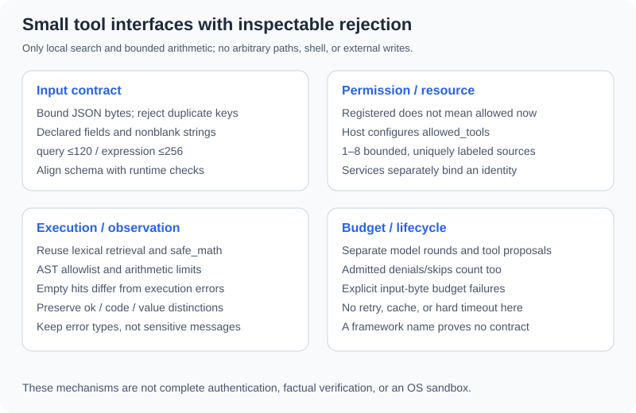

# 3.3 Designing and Implementing Custom Tools

Define resources, arguments, results, and failures before writing model-visible descriptions. A callable function is not automatically appropriate for model exposure. Broader capabilities add validation, authority, and side-effect obligations; an unsupported “tool design beats model capability” ranking cannot replace task tests.



## Small Interfaces with Complete Contracts

| Tool | Arguments | Result | Exclusions |
|---|---|---|---|
| `search_documents` | Nonblank query, at most 120 characters | Up to two local hits with source/text/sha256 | No network, paths, or source-authenticity check |
| `calculate` | Nonblank expression, at most 256 characters | Bounded finite number | No files, imports, general Python execution, or unit interpretation |

`ToolHost` accepts 1–8 injected documents, each at most 2000 UTF-8 bytes with a unique source label. It reuses lexical retrieval and `safe_math`; it implements neither vector encoding, a general schema engine, nor an OS sandbox.

## Validate Before Executing

```python
from reference_code.tool_calling import ToolHost

host = ToolHost()
for raw in ['{"expression":true}', '{"expression":"1+1","extra":1}',
            '{"expression":"1+1","expression":"2+2"}', '[]',
            '{"expression":NaN}', '{"expression":', '{"expression":" "}']:
    assert host.execute("calculate", raw)["code"] == "invalid_arguments"
print("malformed or out-of-contract arguments rejected before execution")
```

`decode_arguments` bounds JSON bytes, rejects duplicate keys/non-finite constants, and accepts only declared nonblank string fields. Python's relationship between Booleans and integers does not make `true` a string expression. Truthiness/coercion cannot replace this contract.

Explicit checks correspond to two single-field schemas. More complex schemas may justify a library, but test coercion, extra fields, defaults, and error paths. Pydantic, dataclasses, and JSON Schema are not interchangeable implementations.

## Registration Is Not Authorization

```python
import json
from reference_code.tool_calling import ToolHost

host = ToolHost(allowed_tools=("search_documents",))
assert host.execute("calculate", json.dumps({"expression": "1+1"}))["code"] == "permission_denied"
assert host.execute("read_file", json.dumps({"path": "/etc/passwd"}))["code"] == "unknown_tool"
assert host.execute("shell", json.dumps({"command": "echo test"}))["code"] == "unknown_tool"
print("registered name and host permission are separate checks")
```

The host configures `allowed_tools`. Even a registered name can be denied; a description claiming permission changes nothing. This demonstrates tool-level permissions only. Business operations additionally need ownership, row scope, target, and other resource checks. Letting callers construct an unrestricted host is not authentication.

## Bounded Arithmetic, Not an Open Interpreter

```python
import json
from reference_code.tool_calling import ToolHost

host = ToolHost()
assert host.execute("calculate", json.dumps({"expression": "sqrt(144) + 2 * 3"}))["value"]["value"] == 18
for expression in ["1/0", "2**101", "__import__('os')", "(1).__class__", "open('secret')"]:
    result = host.execute("calculate", json.dumps({"expression": expression}))
    assert result["ok"] is False and result["code"] == "tool_error"
print("unsupported arithmetic and execution syntax fail")
```

The shared AST interpreter allows declared arithmetic, functions, and constants while bounding characters, nodes, exponents, and values. It rejects attributes, imports, and arbitrary calls. Arithmetic/parse/unsupported-operation errors retain `tool_error/error_type`, never a successful numeric value. It is not a general code sandbox; adding files, networking, or user functions changes its security model.

## Failure Categories and Budgets

| Code/reason | This example | Extension decision |
|---|---|---|
| `invalid_arguments` | Reject before execution | Whether bounded correction is appropriate |
| `permission_denied`/`unknown_tool` | Retain denial and stop | Host/user changes authority; no bypass |
| `ok=True` with empty hits | Search ran without evidence | Missing material stays incomplete |
| `tool_error` | Retain type only; stop | Distinguish transient reads from uncertain writes |
| Model/tool/input budget | Stop incomplete | Account for retries and fallbacks in totals |

There is no automatic retry or wholesale exception-message upload. Errors can contain sensitive input or paths. `KeyboardInterrupt` remains interruptible. Denied/skipped calls in admitted batches count as processed tool proposals; model rounds are separate. Neither metric measures tokens, seconds, or process resources.

Caching also requires a contract: normalized arguments, source/permission revisions, expiry, corrections, and withdrawals. Write retries need idempotency and outcome checks. This companion implements no cache, external write, or hard timeout; framework names do not establish these capabilities.

Exercise: define a read-only order query with separate argument schema, resource permission, empty results, database errors, and output limits. Use fixed records to prove denial happens before reading. Continue to [22.2](../chapter_24_data_agent/02_data_connection.md) for actual data connections.

*Next: [3.4 Writing Tool Descriptions](./04_tool_description.md)*
