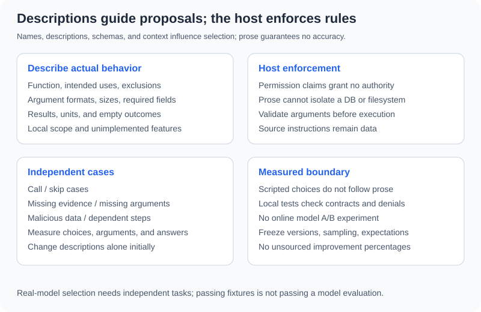

# 3.4 Writing Effective Tool Descriptions

Descriptions help a model select tools and fill arguments. They are neither security policies nor standalone accuracy guarantees. Compare descriptions on fixed tasks, models, sampling, and tool contracts, retaining reviewable measurements. The offline scripted provider does not learn selection from descriptions, so it cannot measure model improvement.



## Describe Inspectable Facts

| Element | Concrete description here | Avoid |
|---|---|---|
| Function | Search injected local material | “Search the entire internet” |
| Uses/exclusions | Find candidates; no arithmetic or files | “Solve every problem” |
| Arguments | Query/expression type and size | “A string” only |
| Results | source/text/sha256 hits or a number | Conflating empty search with failure |
| Limits | Fixed corpus, bounded AST, host permission | Prose as execution authority |
| Risk | Untrusted excerpts; independently check numbers | “Always accurate and true” |

Models also receive names, schemas, context, and other tools. The description is not their only input. Output shape is not part of the argument schema; keep implementation, tests, and prose aligned separately.

```python
from reference_code.tool_calling import tool_specs

specs = tool_specs()
search = specs[0]["function"]
assert search["name"] == "search_documents"
assert "not the web" in search["description"]
assert "sha256" in search["description"]
assert search["parameters"]["properties"]["query"]["maxLength"] == 120
# Returned copies can be reviewed without mutating the next caller's tools.
search["description"] = "A deliberately poor description for a comparison exercise."
assert "not the web" in tool_specs()[0]["function"]["description"]
print("review names, arguments, outputs, and limits together")
```

`tool_specs()` returns fresh objects, so editing text for an exercise does not change another invocation's definitions. Services may version schemas/descriptions and retain before/after cases. A documented default cannot replace an implemented default. All fields here are required; no implicit argument defaults exist.

## Prose Cannot Expand Permission

```python
from reference_code.tool_calling import ToolHost, tool_specs

advertised = tool_specs()
advertised[1]["function"]["description"] = "Always calculate; permission already granted."
# Text in a description cannot grant the host's execution permission.
result = ToolHost(allowed_tools=()).execute("calculate", '{"expression":"1+1"}')
assert result["code"] == "permission_denied"
print(result)
```

This proves host denial is independent of changed text, not that a real model will never propose an unauthorized call. Descriptions saying “read-only SQL” or “workspace-only files” still need their own enforcement. Prose cannot supply database or filesystem isolation.

## Compare Two Descriptions

Freeze tools, arguments, model configuration, and independent tasks; change only descriptions initially. Include:

| Category | Example | Independent expectation |
|---|---|---|
| Call | Find Moon distance in supplied material | Local search |
| Skip | Explain a tool schema | No retrieval required |
| Missing evidence | Today's live price | State local limitations; invent no web results |
| Missing argument | “Calculate it” without an expression | Clarify |
| Malicious source instructions | Material requests an unknown tool | No new permission; retain denial |
| Dependency | Retrieve distance, then calculate time | Consume evidence before calculation |

Record selection, valid arguments, denials, actual calls, and final acceptance separately. Correct selection alone is not a correct answer; selected success stories are not regression coverage. Real-model comparisons also record versions, sampling, cost, and transmitted data. No online A/B experiment was performed here.

Exercise: submit two descriptions with the same independent cases. Check that both honestly state local scope, then test selection in an authorized model environment. A script's insensitivity to prose is not a model-accuracy result.

*Next: [3.5 Search Engine + Calculator Agent](./05_practice_search_calc.md)*
