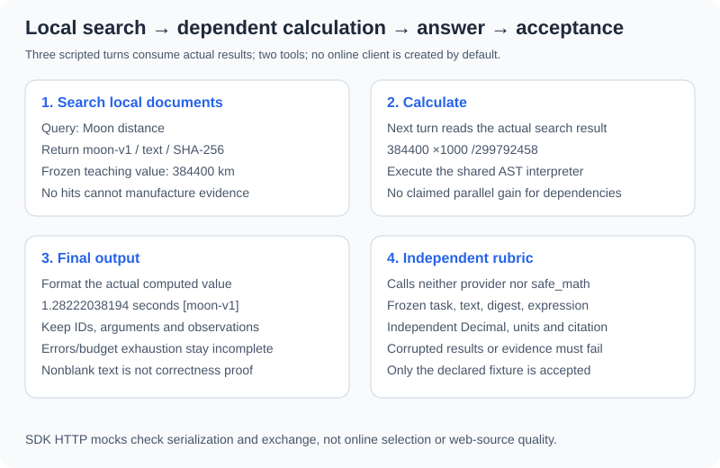

# 3.5 Practice: Search Engine + Calculator Agent

Implement search-then-calculate with **local document search**. Retrieve frozen Moon-distance teaching material, convert kilometers to meters, divide by a fixed speed, and return seconds with a source. The distance is a fixture, not a live astronomical measurement or verified web-search fact.



## Run and Read the Companion

From the repository root with Python 3.11+:

```bash
python -m reference_code.tool_calling
python -m unittest examples.integration_tests.test_tool_calling_chapter -v
```

The core uses the standard library and existing bounded arithmetic/lexical modules. Read `core.py` in this order: `tool_specs/decode_arguments` → `ToolHost.execute` → `FixedProvider.complete` → `run_agent` → `verify_fixture`. The fixed provider scripts this task rather than understanding arbitrary questions. It consumes actual previous tool results instead of reading the document object to bypass execution.

## Normal Path: Results Feed the Next Proposal

```python
import json
from reference_code.tool_calling import run_agent

report = run_agent()
assert report["status"] == "completed" and report["accepted"] is True
assert report["usage"] == {"model_calls": 3, "tool_calls": 2}
assert [row["name"] for row in report["trace"]] == ["search_documents", "calculate"]
assert json.loads(report["trace"][1]["arguments"])["expression"] == "384400 * 1000 / 299792458"
for message in report["messages"]:
    if message["role"] == "tool":
        assert message["tool_call_id"] in {row["id"] for row in report["trace"]}
print(report["answer"], report["verification"])
```

Expected answer: `1.28222038194 seconds [moon-v1]`, with `completed/accepted=True`. Three provider turns propose search, derive arithmetic from returned distance, then format the actual calculated value. The two tools return source/text/digest and an arithmetic result. Inspect correspondence in messages and trace.

| Stage | Input/output | Actual checks |
|---|---|---|
| Search | Query → up to two local hits | Arguments, permission, bounded unique sources, lexical matches |
| Calculate | Expression derived from retrieved data → number | Host argument checks, AST limits, value/arithmetic failures |
| Answer | Actual results → seconds and citation | Nonblank content and independent frozen-task rubric |

Calculation depends on retrieval; these are not independent same-turn operations. `run_agent` processes admitted calls sequentially, without concurrency or query expansion. After a failure, later calls in that batch are skipped with correlated results. Another model answer cannot hide the failure as success.

## Budget and Permission Failures Stay Incomplete

```python
from reference_code.tool_calling import ToolHost, run_agent

for kwargs, reason in [
    ({"max_calls": 1}, "tool_budget_exhausted"),
    ({"max_rounds": 1}, "model_budget_exhausted"),
    ({"max_input_bytes": 10}, "input_budget_exhausted"),
    ({"host": ToolHost(allowed_tools=("search_documents",))}, "tool_failed"),
]:
    report = run_agent(**kwargs)
    assert report["status"] == "incomplete" and report["accepted"] is False
    assert report["reason"] == reason
    print(reason, report["usage"])
```

Also run:

```bash
python -m reference_code.tool_calling --max-calls 1
```

Expected exit code is 1, with `incomplete/accepted=False`. `max_rounds` counts provider calls; `max_calls` counts processed tool proposals, including denials/skips within admitted batches. An unaffordable batch is rejected before execution. Input size counts serialized UTF-8 messages plus tools; provider output is also bounded. The current question is never silently trimmed.

These limits do not measure token bills, time, CPU, or process isolation. This local example has no networking/external writes, hard timeout, or retry controller. Remote tools require total deadlines, cancellation, service timeouts, and side-effect contracts separately.

## Independent Acceptance Ignores the Producer's Success Claim

```python
from copy import deepcopy
from reference_code.tool_calling import QUESTION, run_agent, verify_fixture

report = run_agent()
assert verify_fixture(QUESTION, report["answer"], report["trace"])["status"] == "passed"
assert verify_fixture(QUESTION, "999 seconds [moon-v1]", report["trace"])["status"] == "failed"
corrupted = deepcopy(report["trace"])
corrupted[1]["result"]["value"]["value"] = 999
assert verify_fixture(QUESTION, report["answer"], corrupted)["status"] == "failed"
corrupted = deepcopy(report["trace"])
corrupted[0]["result"]["value"]["hits"][0]["text"] = "Moon distance is 1 km."
assert verify_fixture(QUESTION, report["answer"], corrupted)["status"] == "failed"
print("wrong answer, wrong tool result, and changed evidence rejected")
```

The rubric calls neither the provider nor `safe_math`. It checks the frozen question/text, digest, expression, independent Decimal result, and final value/unit/citation against the trace. An absolute tolerance of 1e-9 seconds is specific to this exercise.

Only the declared task is accepted: arbitrary questions cannot complete through nonblank text. Changed evidence, result, unit, or source cannot inherit success. A content hash checks trace consistency, not real-world authenticity; this is no general natural-language semantic verifier. See the [shared project](../learning_project.md) for separate multi-source/unit/light-travel contracts.

## SDK and Online Extension Boundaries

`OpenAIChatProvider(client, model)` requires an explicitly injected SDK client; defaults never create one. Tests use OpenAI 2.54.0 with an HTTP mock through actual SDK request/response parsing, checking IDs, tools, and subsequent inputs. No online model, model-selection quality, or server-side strict behavior was tested. The test client explicitly uses `max_retries=0`. Real clients additionally need request timeouts and SDK retry policy; `max_rounds` counts provider invocations, not SDK retransmissions.

The older `examples/chapter03/search_calc_agent.py --demo` exercises individual tools, not this protocol/acceptance report. Its web-search entry now checks query and integer result counts before requesting. Successful networking, search quality, and interactive mode are outside this section's acceptance. Readers needing no real search can stop at the verified offline loop.

Exercise: make the scripted provider propose unknown tools, repeated IDs, extra arguments, zero division, and unsupported syntax, then corrupt final seconds. Retain call counts, execution/denial records, ID correspondence, stop reasons, and independent outcomes. Add real models or network adapters only when needed; fixture quality conclusions do not transfer automatically.

*Next: [3.6 Paper Readings](./06_paper_readings.md)*
