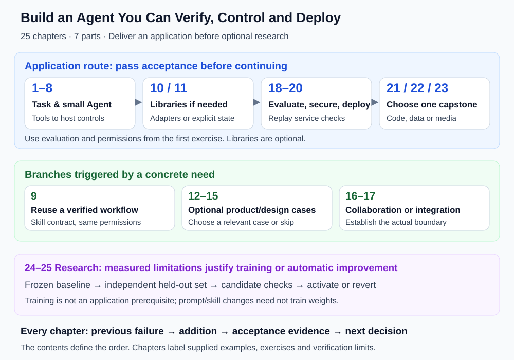

# Preface

> 🤖 *"The future belongs not to those who write code, but to those who can direct AI to write code. And Agent is the bridge connecting human intent with AI capability."*

## Why This Book?

Since 2023, Large Language Models (LLMs) have sparked a technological revolution. But many people have found that simple "conversation" is far from enough — we need AI that can **make autonomous decisions, use tools, and complete complex tasks**. This is the purpose of **Agents (Intelligent Agents)**.

However, learning resources for Agent development are scattered across various papers, blogs, and framework documentation, lacking a **systematic, beginner-friendly, and practice-oriented** learning path. This book is written to fill that gap.

## Who Is This Book For?

- 🐍 **Developers with Python basics** who want to enter the AI Agent field
- 🎓 **Students or researchers interested in LLMs** who want to understand the principles and implementation of Agents
- 💼 **Product managers or tech leads** who want to understand the capability boundaries and application scenarios of Agents
- 🔧 **People already using ChatGPT** and similar tools who want to understand and customize AI capabilities more deeply

## Features of This Book

| Feature | Description |
|---------|-------------|
| 📖 **Progressive Learning** | Starting from "What is an Agent?", gradually deepening into application delivery and deployment, followed by optional training research |
| 🐍 **Python in Practice** | Companion scripts, in-text examples, and excerpts with explicit execution boundaries |
| 🎨 **Rich Visuals** | Extensive architecture diagrams, flowcharts, and sequence diagrams to help understand concepts intuitively |
| 🔨 **Project-Driven** | 3 capstone domains with design and assembly exercises |
| 🌐 **Cutting-Edge** | Covers LangChain, LangGraph, MCP/A2A/ANP protocols, Context Engineering, Agentic-RL, and other latest technologies |
| 📚 **Academic Tracing** | Each chapter includes authoritative paper citations and references, covering the complete academic spectrum from symbolic AI to LLM-driven approaches |
| 📊 **Evaluation System** | In-depth breakdown of mainstream benchmarks including BFCL, GAIA, AgentBench, and SWE-bench |

## How to Use This Book?

**Each chapter starts with a verifiable iteration**:

1. **Failure entry**: take the previous artifact and name an input or scenario it still mishandles.
2. **Capability addition**: explain which data flow, state or execution boundary changes.
3. **Implementation boundary**: distinguish supplied entry points, explanatory snippets and reader exercises.
4. **Acceptance evidence**: preserve expectations, actual results and verdicts for success and failure cases.
5. **Next decision**: add frameworks, collaboration or training only when the problem calls for them; research readings are optional.

## A Throughline for the Book

See [the continuing project and acceptance checks](./learning_project.md) for executable stages.

The goal is to **build an Agent that can be verified, controlled, and deployed**. Independent reference code lives in `reference_code/evidence_assistant/`. Its main experience is a local-document research assistant: answer several questions from fictional project documents and produce a sourced report. Run it first, replace documents and questions, then read the retrieval, planning, context, and report code. This is more substantial than one calculation without requiring a database, framework, or remote service first.

The Moon-distance calculation remains a foundational exercise for units, memory, data flow, and independent acceptance. The calculation and research assistant are separate tasks sharing mechanisms. Later framework, product, and domain chapters are not all wired into this application; port their contracts and verify them explicitly.

At each stage, ask what failed in the previous version, what the new capability changes, and what evidence demonstrates the improvement.

| Stage | Failure to address | Learning artifact |
|---|---|---|
| Chapters 1–3 | Answers cannot reliably obtain facts or execute calculations | A traceable tool call with success and failure cases |
| Chapters 4–7 | Forgotten preferences, missing evidence, drifting plans, excessive context | Fixed questions, sources, task state, and context budgets |
| Chapters 8–9 | Unauthorized actions, unverified completion, duplicated capabilities | Tool permissions, validation gates, and skill interfaces |
| Chapters 10–17 | Difficult state management, integration, or coordination | One suitable implementation compared with the previous baseline |
| Chapters 18–20 | A demo works but quality, risk, and cost remain unmeasured | Regression results, boundary tests, logs, and deployment checks |
| Chapters 21–23 | Working components do not yet deliver a complete task | A domain project with explicit acceptance criteria |

The contents now place application delivery before research, with 25 chapters across seven parts. Chapters 24–25 provide optional training and self-improvement routes. Establish a measurable limitation before deciding to train or optimize automatically.

## Core and Optional Reading

- **First application**: chapters 1–8, the framework material needed from chapters 10–11, chapters 18–19, and one capstone. Read chapter 20 before deployment. Revisit evaluation and safety during the earlier exercises.
- **Engineering extensions**: chapter 9 for skills, chapter 16 for multiple Agents, and chapter 17 for integrations. Choose relevant case studies from chapters 12–15.
- **Research extensions**: chapters 24–25 and paper readings after acquiring tool-use, data, and evaluation foundations. Training is optional for applications using existing models.

Chapter introductions indicate reading levels. The six calculation stages support chapters 3–8; the independent research assistant combines retrieval, planning, context, and reporting. Start with four core modules; persistence, Harness controls, framework migration, and training are optional extensions. Complete success and failure checks before adding features; printed demonstration output is not your own validation evidence.

## How to Use the Code

**Companion scripts** have repository paths and commands. **In-text examples** must be saved and require the listed dependencies. **Excerpts and scaffolds** explain interfaces and control flow; omitted nodes, business backends, and credentials need implementation. A snippet containing `...` is not a complete application.

Start with the independent project in `reference_code/evidence_assistant/`, whose `README.md` and `CONTRACTS.md` describe operation and inputs. `examples/README.md` retains chapter-specific extensions. `reference-agent/` supplies a minimal offline-testable execution, evaluation, and guardrail foundation. Passing fixed offline cases does not establish real-model quality or production safety.

## Technology Stack Overview

This book primarily uses the following technology stack:

- **Programming Language**: Python 3.11+
- **Core Frameworks**: LangChain, LangGraph, OpenAI Agents SDK
- **LLM Services**: OpenAI API (GPT-4o/GPT-5), Anthropic (Claude 4), Open-source models (Llama 4, Qwen 3)
- **Agent Protocols**: MCP (Model Context Protocol), A2A (Agent-to-Agent), ANP (Agent Network Protocol)
- **Vector Databases**: ChromaDB, FAISS
- **Web Framework**: FastAPI
- **Other Tools**: Docker, Pydantic, asyncio, uv

---

*Ready? Let's embark on the Agent development journey together! 🚀*
