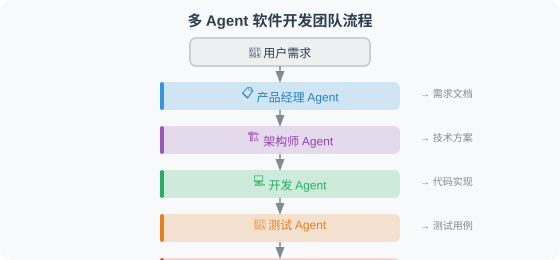

# 16.5 实战：多 Agent 软件开发团队

## 本次迭代与验收

用可运行的开发流程验证角色协作，并把“执行结束”和“验收通过”分开记录。

- **成功标准**：只有真实 `pytest` 返回码为 `0`，且部署配置和说明已落盘，状态才是 `delivered`。比较单 Agent 和团队方案时，应使用相同需求和独立验收集，再记录调用量、耗时和修复次数。
- **失败用例**：覆盖持续断言失败、生成异常、测试收集错误、死循环，以及测试留下后台子进程。预算耗尽或超时都不得进入成功交付节点。
- **执行边界**：默认每次测试最多 30 秒，最多生成 3 版；macOS/Linux 在结束时清理测试进程组。临时目录和进程组都不等于安全沙箱；不可信生成代码还需要外部隔离执行器。

评估方法见[第18章](../chapter_20_evaluation/README.md)，信任与权限设计见[第19章](../chapter_21_security/README.md)。

## 系统设计

本例包含产品经理、架构师、开发工程师、测试工程师、DevOps 工程师和文档工程师六个节点，通过 LangGraph 的共享状态 `DevState` 传递结果。开发节点把代码和测试写到磁盘；测试节点真正运行 `pytest`；只有通过后，运维和文档节点才写出交付产物。

配套实现位于 `examples/dev_team/dev_team.py`，回归用例位于 `examples/dev_team/tests/test_dev_team.py`。书稿只保留关键接口，完整可执行实现以源码为准。

离线 `DeterministicDeveloper` 只生成加法和乘法模块，验证的是编排、文件和失败路径。传入“用户管理系统”不会让它实现注册、登录；真实需求实现需要替换 `Developer`。本例由开发节点同时生成代码和测试，测试节点负责执行，因此通过这套测试仍需要独立验收集补充需求覆盖。



> 图示展示角色关系，实际路由为：产品 → 架构 → 开发 → 测试 → 通过后运维 → 文档；断言失败可回到开发，异常、超时、预算耗尽进入失败结束节点。

## 完成标准与状态契约

`status` 表达整个任务的结果，`test_status` 记录最近一次测试结果。两者不能互相替代：测试通过后还要写完部署和文档产物，才算交付。

| 最终 `status` | 触发条件 | 交付行为 |
|---|---|---|
| `delivered` | 测试通过，运维与文档节点完成 | 写出 `Dockerfile` 和 `README.md` |
| `failed` | 生成或交付产物写入异常，或 pytest 执行、收集、配置错误 | 进入失败节点，保存报告 |
| `timed_out` | 单次测试超过 `test_timeout_seconds` | 清理进程组，立即停止并保存报告 |
| `budget_exhausted` | 断言持续失败，已经生成 `max_iterations` 版 | 保存每一轮失败记录并停止 |

运行期间 `status` 为 `running`。`test_status` 依次使用 `pending`、`passed`、`failed`、`timed_out` 或 `error`；`test_passed` 保留布尔结果。`attempts` 是可追溯的测试记录，每条包含轮次、测试状态、真实返回码、时限、错误说明和输出。超时没有正常退出码，因此该记录中的 `returncode` 为 `None`。

失败节点把结构化结果保存在返回值 `failure_report` 和工作目录的 `failure_report.json` 中。例如：

```json
{
  "reason": "max_iterations",
  "message": "Tests did not pass within the iteration budget",
  "status": "budget_exhausted",
  "delivered": false,
  "iteration": 3,
  "max_iterations": 3,
  "attempts": []
}
```

这里省略了 `attempts` 的具体内容；真实报告保留全部测试记录。生成失败尚未开始测试时，该列表才会为空。失败路径保留实现、测试和诊断信息，跳过 DevOps 和文档节点。`workspace_dir` 必须尚不存在或为空目录；成功目录、失败目录和任何普通非空目录都会在写入前以 `ValueError` 拒绝。程序不删除或覆盖其中的旧产物、失败报告或用户文件。每次重跑应选择新目录，避免混合历史交付物。

## 重试与停止规则

核心路由明确区分通过、可修复失败和必须停止：

```python
def route_after_test(state):
    if state.get("status") in {"failed", "timed_out"}:
        return "fail"
    if state.get("test_passed"):
        return "deliver"
    if state["iteration"] >= state["max_iterations"]:
        return "fail"
    return "fix"
```

`deliver` 指向运维节点，`fix` 回到开发节点，`fail` 指向失败节点再结束。pytest 返回 `1` 时尝试修复；`2`—`5` 等执行错误直接失败。修复时把上一轮真实测试输出追加到技术设计中，交给 `Developer.develop(design, requirement)`，让下一轮获得具体反馈。达到轮次上限只是停止条件，不能把失败变成成功。

`max_iterations` 是生成版本总数，首次生成也占 1 次；它必须是正整数。`test_timeout_seconds` 必须是有限的正数。二者及工作目录条件均在写入文件和启动流程前校验，避免配置错误产生半成品。

## 测试进程生命周期

测试节点用 `Popen(..., start_new_session=True)` 在 macOS/Linux 创建独立会话，并给 `wait()` 设置时限。无论测试通过、失败或超时，都对该进程组发出 `SIGTERM`，随后用 `SIGKILL` 清理仍存活的进程，再用 `wait()` 回收 pytest 主进程。正常退出的 pytest 也可能留下后台子进程，因此成功路径同样执行清理。

输出写入临时文件，待清理后读取。若用继承的标准输出管道，主进程退出后，后台子进程持有管道仍可能导致等待 EOF 的操作无法完成；单给主进程设置超时并不能解决这个问题。

这些措施管理的是普通测试进程的生命周期。主动创建新会话的恶意进程可能逃离原进程组，非 POSIX 平台只提供直接子进程终止；本例也没有限制生成程序的文件、网络、内存或凭据访问。单次测试时限不约束 `Developer.develop` 的耗时，接入模型后仍需为模型调用设置超时和调用预算。

## 如何运行

```bash
cd examples/dev_team
pip install -e .
pytest -v
python dev_team.py --max-iterations 3 --test-timeout-seconds 30
```

离线演示不需要 API Key。程序输出最终状态、测试结果和工作目录；失败时明确显示“未交付”，打印结构化报告并返回退出码 `1`，成功退出码为 `0`。也可直接调用接口：

```python
from dev_team import develop

result = develop(
    "算术模块：加法和乘法",
    max_iterations=3,
    test_timeout_seconds=30,
)
if result["status"] == "delivered":
    print("已交付：", result["workspace_dir"])
else:
    print("未交付：", result["failure_report"])
```

配套测试验证成功落盘、失败后修复、持续失败耗尽预算、生成或交付异常、收集错误、配置校验、非空目录拒绝且原物保持、死循环超时，以及 macOS/Linux 下父进程正常退出和超时两种情况下的子进程清理。子进程用例还模拟忽略 `SIGTERM` 的程序，确保强制终止路径有效。

## 接入真实模型与独立验收

实现 `Developer.develop`，从模型结构化输出中获取源码和测试即可替换离线开发者；`LLMDeveloper` 当前保留为扩展接口，尚未接入模型。真实开发流程还应固定独立验收集，让开发者无法通过重写验收标准来掩盖缺陷。运行生成程序前，应先建立隔离执行环境并限制凭据、网络和文件访问。

只有真正不依赖验收结果的准备工作适合并行。最终部署和交付必须等待验收通过，不能因为并行节点已经产生文件就报告成功。

---

*下一章：[第17章 Agent 通信协议](../chapter_19_protocol/README.md)*
