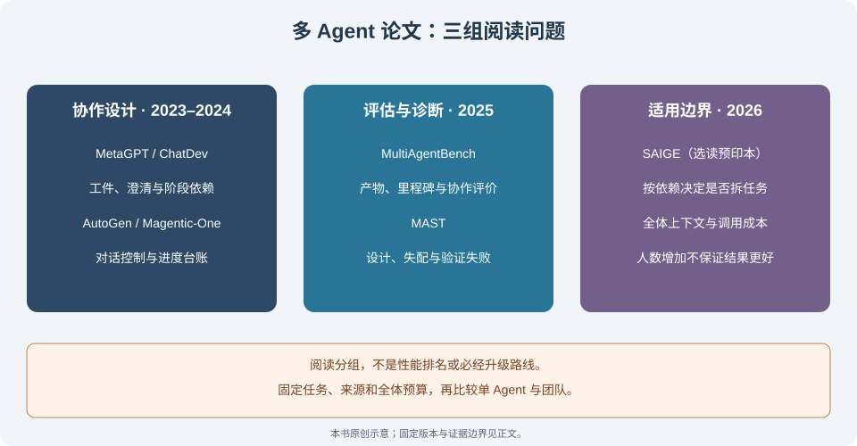
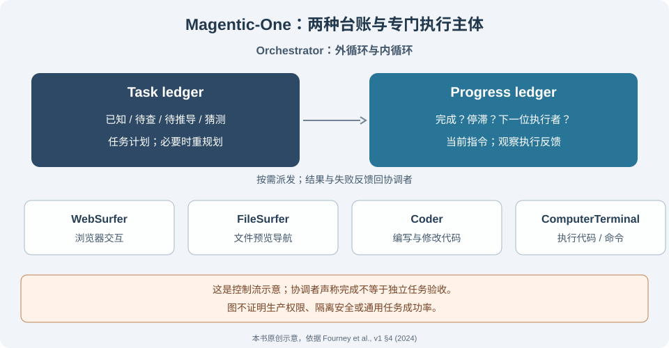

# 16.6 论文解读：多 Agent 系统前沿研究

本节为选读。先完成[16.5的开发团队练习](05_practice_dev_team.md)，再用论文回答一个具体问题：分工是否减少了任务难度，还是只增加交接、上下文和验证成本？单 Agent、固定流水线和多 Agent 团队都应接受同一任务合同的检查。

选文与来源核对截止到2026-10-22。中英文采用相同七篇，链接固定到所列版本。这里核读方法与实验条件，没有复现研究，也不把论文中的框架名称当作当前SDK接口说明。精读一种协作设计和一种评估方法，再完成末尾练习即可。

## 阅读路线：设计与证据分开

| 要回答的问题 | 建议阅读 | 应带回工程的检查 |
|---|---|---|
| 上下游到底传递什么 | MetaGPT、ChatDev | 工件字段、依赖、澄清与独立验收 |
| 谁发言、何时停止、失败交给谁 | AutoGen、Magentic-One | 控制流、进度记录和停止预算 |
| 团队是在合作，还是只交换了很多文字 | MultiAgentBench、MAST | 最终产物、协作过程与失败标签分别报告 |
| 什么时候不该继续拆任务 | SAIGE | 依赖密度、交接损失和全体调用成本 |

图是阅读分组，不表示后一个方案淘汰前一个方案，也没有通用最优 Agent 数量。

## MetaGPT：让工件和依赖成为接口

Sirui Hong等，*MetaGPT: Meta Programming for A Multi-Agent Collaborative Framework*；首次提交于2023年，本节据[v7，2024-11-01，§3–4](https://arxiv.org/html/2308.00352v7)。

论文把软件开发SOP编码进角色与流程：产品、架构、项目管理、工程和QA交换文档、设计与代码，通过共享消息池和订阅选择依赖，并用执行反馈修订代码。结构化产物使接口更容易检查，但格式正确并不保证内容正确，角色名称也不建立权限。

作者在HumanEval、MBPP和SoftwareDev上比较；SoftwareDev包含70个任务，文中比较抽取其中七个，并使用人工可执行性分级等指标。不同任务、指标和模型设置不能压成一个“代码成功率”排名，更不能仅凭对比把收益归因于结构化通信。

**迁移到本书**：给16.5的需求、代码产物和测试报告补上版本及依赖标识。故意提交字段齐全但测试失败的工件，确认它不能进入交付状态；生成者自写测试之外，仍需事先冻结的任务预期。

## ChatDev：把澄清放进阶段对话

Chen Qian等，*ChatDev: Communicative Agents for Software Development*；首次提交于2023年，本节据[v5，2024-06-05，§3–4、§6](https://arxiv.org/html/2307.07924v5)。

该版本用设计、编码、测试三个阶段及更细子任务构成chat chain。每个子任务由指导者与助手对话，阶段结果供后续使用；communicative dehallucination要求助手先追问缺失细节，而不是立即给结论。

作者用SRDD的1200条软件需求研究完整性、可执行性、需求一致性和成对质量评价。能运行、没有占位代码或被评审偏好，都不等于全部业务要求已满足。双人子任务简化局部沟通，也不能自动推出整体通信从平方复杂度降为线性；轮数、边和消息长度仍需计量。

**迁移到本书**：为一条缺单位或缺输入范围的需求增加“等待澄清”结果。不要让两个角色达成一致就补造事实，也不要靠增加对话轮数代替测试。

## AutoGen：对话也需要可编程控制流

Qingyun Wu等，*AutoGen: Enabling Next-Gen LLM Applications via Multi-Agent Conversation*；据[v2，2023-10-03，§2–4及附录D相关设置](https://arxiv.org/html/2308.08155v2)。

论文将可对话主体和conversation programming分开：主体可组合模型、人类输入与工具能力，应用再定义谁接收消息、怎样回复和何时继续。它展示数学、问答、交互环境等六种应用；各应用使用自己的模型、任务与比较设置，并非一项覆盖所有协作方式的受控实验。

**迁移到本书**：把“请求另一角色”视为有输入输出、失败和预算的调用。人类代理不自动等于认证，代码执行能力不自动等于安全隔离。这里阅读的是2023年的论文抽象，不复制旧类名来说明当前安装包。

## Magentic-One：区分任务台账与进度台账

Adam Fourney等，*Magentic-One: A Generalist Multi-Agent System for Solving Complex Tasks*；据[v1，2024-11-07，§4–6](https://arxiv.org/html/2411.04468v1)。

Orchestrator的外循环维护task ledger，区分已知信息、待查事实、待推导内容、猜测和计划；内循环维护progress ledger，判断是否完成、停滞以及下一位执行者。团队包含WebSurfer、FileSurfer、Coder和ComputerTerminal。台账是控制依据，协调者自报完成仍不是独立验收。

作者用AutoGenBench重置容器和记录重复运行，在GAIA、AssistantBench、WebArena上评估，并做消融和错误分析。这支持所测设置下的竞争性结果，不支持“接近人类”、当前排名或“重规划贡献固定比例”的通用结论。容器重置改善实验隔离，也不单独证明生产工具权限安全。

**迁移到本书**：将猜测和已验证结果分栏；连续无进展时保留原因并耗尽预算，不能把重新计划本身计作任务成功。

## MultiAgentBench：协作分数不等于产物完成

Kunlun Zhu等，*MultiAgentBench: Evaluating the Collaboration and Competition of LLM agents*；据[v1，2025-03-03，§3–5](https://arxiv.org/html/2503.01935v1)。

研究在MARBLE环境组织科研、Minecraft、数据库、编程、议价和狼人杀六类场景，比较星形、树、链和网状通信。它同时记录最终任务分数、里程碑贡献及通信/规划评价；部分指标依靠LLM检测或评分，另一些任务使用规则检查。

作者的拓扑和模型结果随场景变化，不能据科研场景的图结构结果推荐所有任务采用图。LLM评审的一致性也不等于客观真值，轮数、角色、工具和评审提示都属于实验条件。

**迁移到本书**：同时报告最终产物通过率、交接错误、总调用量和时间。保留“交流充分但交付失败”的样例，人工抽查评审标签；不要用消息数量代替协作质量。

## MAST：先定位失败，再增加角色

Mert Cemri等，*Why Do Multi-Agent LLM Systems Fail?*；据[v3，2025-10-26，§3–5](https://arxiv.org/html/2503.13657v3)。

论文从轨迹分析建立MAST失败分类，覆盖系统设计、主体间失配和任务验证三类、14种模式。初始人工分析150条轨迹，再构建LLM标注流程；该版本数据集包含来自七种系统的1642条轨迹，涉及编程、数学和一般任务。

这些是采样系统与任务中的失败标签，不是整个生态的发生率，也不是穷尽分类。一个轨迹可能出现多种模式；自动标注需要核对具体证据，不能把“某角色导致失败”直接当作已证明的因果归责。

**迁移到本书**：找一份预算耗尽或测试失败的16.5记录，标出首次违反合同的位置、后续传播和最终验收缺口。先改一处边界再回归，避免每遇到错误就新增一个“监督者”。

## SAIGE：按依赖决定是否分工

Yishuo Yuan等，*Rethinking Multi-Agent Collaboration: When More Is Less*；选读预印本[v2，2026-09-18，§3–5](https://arxiv.org/html/2609.19759v2)。

作者把轨迹视为依赖图，研究哪些边界适合拆成相对独立的子任务。SAIGE按需创建主体，并在需要时检索其他子任务的结果，而非预先固定整个协作拓扑。边界判断错误仍可能造成等待、遗漏和通信开销。

主实验在统一harness和基础模型下比较四类长时程基准，团队最多四个主体、子任务递归深度为一，并另做规模消融。结果随任务依赖结构变化，没有支持“更多Agent总会更好”；这些条件也不能被解释为所有项目的最优人数。

**迁移到本书**：先画依赖，再拆任务。独立读取两份资料可尝试并行；必须连续修改同一工件的步骤，应先考虑单写入者或顺序流水线。比较时统计所有子任务的调用与输入，而不只记协调者。

## 小练习：给同一份交付建立六个对照

使用本书自建小任务：交付须引用本次指定版本的两份资料，明确单位，并正确求出两项同币值之和。基线资料A-v1记录“40 CNY”，B-v1记录“60 CNY”，独立预期为100 CNY。每个对照先冻结自己的输入快照与预期，再手工整理轨迹或实现一个小型处理流程，无需安装上述研究框架。

| 对照输入 | 独立预期 | 应记录的边界 |
|---|---|---|
| 两份正确资料 | 来源、单位与100 CNY均满足 | 基础通过路径 |
| 缺B，角色仍声称已完成 | 不得完成；列出缺失资料 | 未知不能由共识补齐 |
| B改为60 USD | 不可直接相加，要求明确换算依据 | 字段有效但语义合同不满足 |
| 另立A-v1+B-v2快照，B-v2为80 CNY | 调用前另冻预期120 CNY，不沿用旧100报告 | 旧版本和缓存传播 |
| 同一B-v1被转发两次 | 仍只计一次 | 来源身份与重复交接 |
| 子任务失败、超时或总预算用尽 | 保留失败和部分产物，不交付完整结果 | 停止条件与失败传播 |

将最后一行与16.5现有配套的 `delivered/budget_exhausted/timed_out/failed` 区分对照；这些状态针对其代码测试合同，并不自动实现上表的资料任务。在已配置16.5环境中，可运行 `python -m pytest examples/dev_team/tests/test_dev_team.py -q` 查看那一组生命周期反例。

若继续比较单 Agent 与团队，固定同一资料版本、问题集、可用工具和**全体总预算**，记录重复运行与失败，不只挑成功轨迹。交接清单至少标明任务、来源版本、产物、校验状态和剩余预算；下游收到上游的“通过”标签，仍要按自己的消费合同检查。

这些是本书练习，不是七篇论文的复现或基准分数。读完可回到[16.2通信合同](02_communication_patterns.md)或[16.5](05_practice_dev_team.md)修一处已观察到的失败，再到[第18章评估](../chapter_20_evaluation/README.md)设计比较。没有测出分工收益时，保留简单方案。
